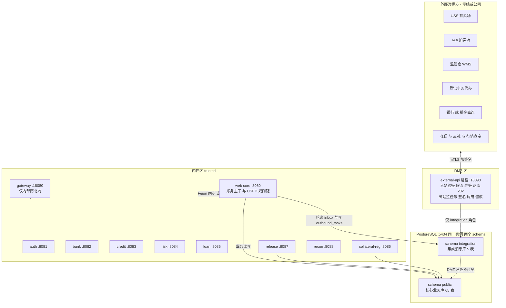
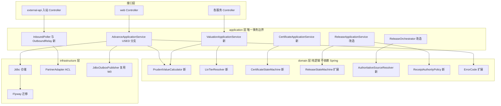
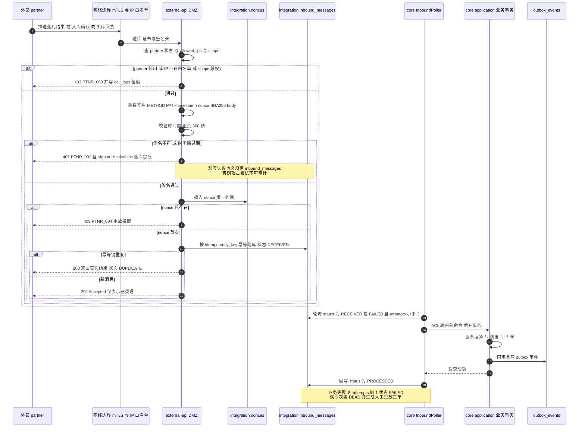
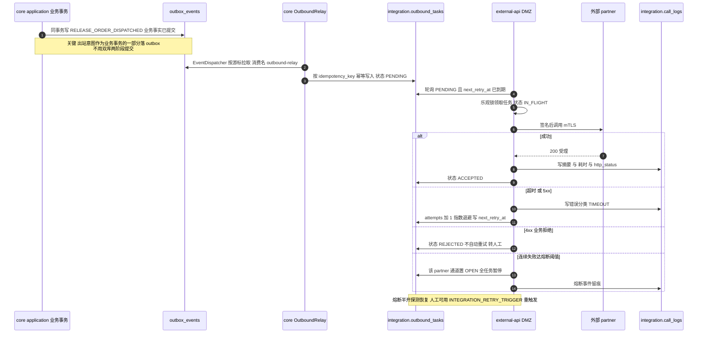
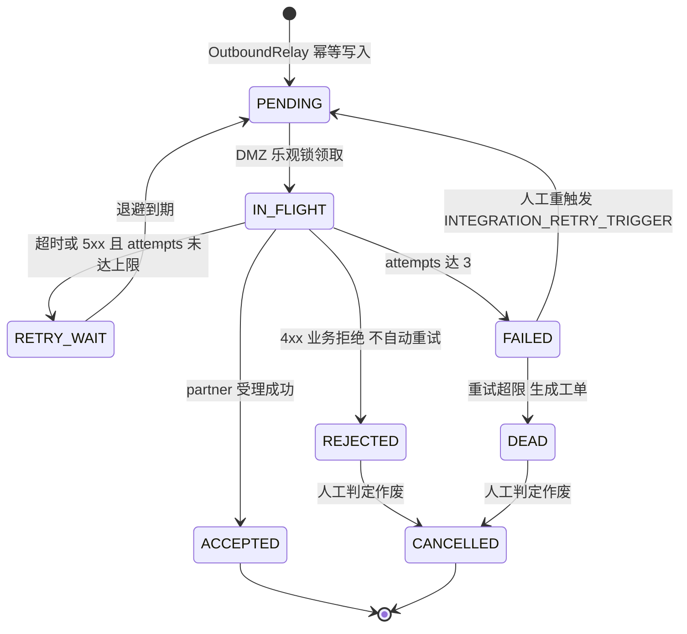
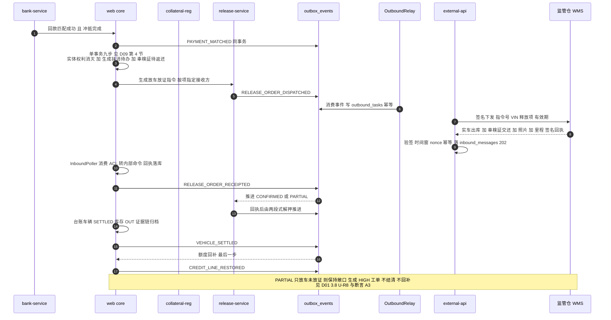
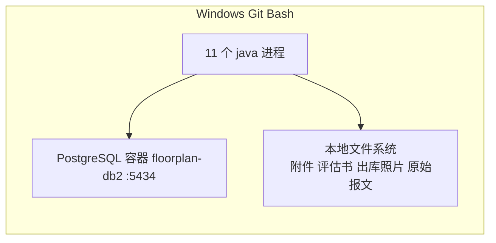
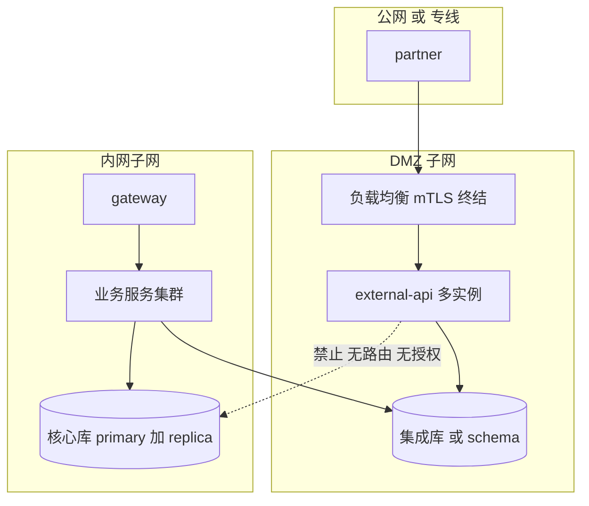

# 二手车库存垫资改造 · D02 总体架构设计

> 上游：需求书 REQ-USED-FLOORPLAN-001、D00 命名锚点、D01 定源 ADR 草案。
> 性质：**设计提案**，开发暂缓。本文一切「组件」均为目标态，代码里目前**不存在**。

---

## 0. 文档控制

| 项 | 内容 |
|---|---|
| 编号 | DESIGN-USED-FLOORPLAN-D02 |
| 版本 | v0.1（草案，待评审） |
| 日期 | 2026-11-22 |
| 基线 | `master` @ `8ea23ab`（10 服务 / DDD 四层 / Flyway V1–V26 / W0 outbox 已落地） |
| 适用域 | `vehicle_type='USED'` |
| 读者 | 架构、运维、后端全员 |
| 未签字项 | `[待定源 D-01 ~ D-09]` `[待定源 U-01 ~ U-08]`，见 D01 §5 |

---

## 1. 架构总览

### 1.1 三区拓扑



> 最后一条虚线是**架构级不变式**（U-R11）：`floorplan_dmz` 角色对 `public` schema 无任何权限，
> 且该不变式**必须可证伪**（验证方法见 §5.6）。

### 1.2 一句话架构

> **账务主干不拆（P-8），外部世界全隔离（ADR009），跨机构动作全异步且幂等（W0 outbox），
> 结清证据只认 partner 签名回执（P-6）。**

### 1.3 与现状的差量

| 维度 | 现状 `8ea23ab` | USED 域目标态 | 差量性质 |
|---|---|---|---|
| 进程数 | 10 | **11**（仅新增 `external-api`） | +1 |
| DB schema | 1（`public`） | 2（+ `integration`） | +1 |
| 表 | 65 | +19 新增 +10 扩展 | 只增不改 |
| 外部对手方 | 0 个真实接口（`external-api` 全库 0 处 Java） | 4 类（拍卖场 / WMS / 代办 / 银行） | 🆕 从 0 到 1 |
| 事件机制 | W0 已落地 outbox + dispatcher + 幂等 + 死信 | 直接复用，加 10 个事件类型 | ✅ 复用 |
| 放车通道 | 唯一实现 `ManualReleaseChannel`，`dispatch()` 只打日志 | 通道真正参与路由，API 为 P0 | ⚠️ 改造 |
| 回执权威 | `INTERNAL_WITNESS` 我方代录，自由字符串可伪造 | `PARTNER_RECEIPT` 验签 + 强枚举 | ⚠️ 反转（D01 反转 #4） |
| 金额基准 | `invoice_amount × 0.90` | `prudent_value × 分档 LTV` | ⚠️ 反转（D01 反转 #6） |
| 监管 | 实地盘点，`custodians` 表零查询 | WMS 实控，逐台账实对账 | ⚠️ 反转（D01 反转 #1） |

---

## 2. 设计目标与约束

### 2.1 目标（按优先级）

| # | 目标 | 可验证判据 |
|---|---|---|
| G1 | **资金安全**：四条不可绕过红线（D01 §4.3）在架构层不可退化 | 断言 A1–A9 全部通过 |
| G2 | **跨机构可靠性**：指令与回执允许延迟、乱序、重复、失败，但**不丢、不重复生效** | 至少一次投递 + 两层幂等；断言 A4 |
| G3 | **边界可证伪**：DMZ 与核心的隔离不是文档承诺，是数据库权限 | 断言 A5 + §5.6 验证法 |
| G4 | **可回退**：`floorplan.used.enabled=false` 时，LEGACY 域行为逐位不变 | LEGACY 回归冒烟全绿（D11 §6） |
| G5 | **可运营**：四类缺口（指令超期 / 台账未更新 / 回补缺失 / 账实差异）有自动巡检与工单 | §9 巡检作业清单 |
| G6 | **不引入新基础设施**：不装 Kafka/RabbitMQ/S3/MinIO/Seata/Quartz | 依赖清单审查（§11.3） |

### 2.2 约束

| 约束 | 来源 | 架构应对 |
|---|---|---|
| 金额一律 `BIGINT` 整数日元，比率 `BigDecimal`，时区 `Asia/Tokyo` | AGENTS.md §6.3 / 需求书 §9 | 估值链路全部整数 + 显式量化；比率不入 `double` |
| `@Transactional` 只在 `application` 层 | AGENTS.md §3.1 / §10 | 见 §7 事务边界表 |
| `domain` 层不依赖 Spring、可纯单测 | AGENTS.md §10 | 估值、LTV 分档、权威源优先级、状态机全部为纯策略类 |
| 禁止新代码直读别的服务的表 | AGENTS.md §3.1 | 集成 schema 是**消息存储**而非别服务的业务表，边界见 §5.7 例外声明 |
| 只有 `web` 跑 Flyway | AGENTS.md 坑 #3 | `external-api` 的 `flyway.enabled=false`，`integration` 建表仍走 `db/migration/`（V70–V74） |
| 不引入对象存储 | 用户既定约束 / 需求书 §9 | 评估书、車検証扫描件、出库照片一律本地文件系统，DB 只存路径与哈希 |
| 事件机制复用 W0，不另造 | D00 §10 | §6 |
| V1–V26 字节不变 | AGENTS.md §6.1 | V40+ 号段（D00 §6） |

---

## 3. 进程与服务职责

### 3.1 职责表

| 进程 | 端口 | 分区 | USED 域新增职责 | 明确**不做**的事 | 依据 |
|---|---|---|---|---|---|
| `web`（core） | 8080 | 内网 | ① USED 估值与审慎值计算 ② 落札对象与采购映射 ③ 垫款金额基准（唯一入口）④ 车辆主数据与 WMS 在库台账 ⑤ `InboundPoller` 消费入站消息 → ACL → 内部命令 ⑥ `OutboundRelay` 生成出站任务 ⑦ 巡检作业宿主 | 不直连任何 partner；不持 partner 密钥；不在事务内做远程调用 | D00 §3.1、ADR-U-03/06/07 |
| `collateral-reg-service` | 8086 | 内网 | ① `inspection_certificates` 质押对象与状态机 ② `certificate_custody_events` 换证/再発行留痕 ③ `registration_applications` 抵当権设定·抹消/移転登録委托与回执 ④ V10 权威源类型多源化 ⑤ 门禁判定查询提供方 | **仍是只读投影角色不越权改账**（ADR-Q27）；不发起放款 | D01 反转 #5、ADR-U-04 |
| `release-service` | 8087 | 内网 | ① 放车放证指令十态状态机 ② 按项指定接收方 ③ `ApiReleaseChannel` 等真实通道路由 ④ 回执落库与权威校验 ⑤ 指令撤销 /cancel | 不计算金额；不直接改 `vehicle_units`/`credit_lines`（走 outbox） | D01 反转 #3/#4 |
| `bank-service` | 8082 | 内网 | ① 回款来源扩展（零售/批发/拍卖受托直划）② 五信号匹配补全 ③ `ReleaseOrchestrator` 九步单事务编排 | 不在编排事务内调远程服务 | 需求书 R8、D01 3.9 |
| `credit-service` | 8083 | 内网 | ① `dealer_licenses` / `dealer_auction_memberships` / `dealer_compliance_checks` 资质档案与准入闸门 ② 双维评级 ③ 额度回补的真实实现（`CREDIT_LINE_RESTORED`） | 不做车辆估值 | 需求书 R1、D01 3.1/3.2 |
| `risk-service` | 8084 | 内网 | ① `LTV_BREACH` / `WMS_STOCK_MISSING` / `SHAKEN_EXPIRED` 等新告警真实化 ② `work_orders` 工单真实落地（缺口 #4）③ 处置接管状态 ④ `disposal_auctions` + `liquidation_statements` | 不改担保权属 | 需求书 R9/R10 |
| `loan-service` | 8085 | 内网 | 复用，不改。本金来源随 core 审定垫款变化而自然变化 | 不感知车辆类型 | 需求书 §3.3 |
| `recon-service` | 8088 | 内网 | ① 与拍卖场落札/结算对账 ② 与 WMS 逐台在库/出库对账 ③ 对拍规则按 `vehicle_type` 过滤 ④ 三类差异闭环（缺口 D3） | 不写业务表 | 需求书 R14.3 |
| `auth-service` | 8081 | 内网 | 权限点扩展（D00 §11）；**不新增认证机制** | 不管 partner 认证（partner 走签名，见 §5.5） | D00 §11 |
| `gateway` | 18080 | 内网 | **不改**。USED 域内部新端点沿用既有路由前缀 | 不加外部路由；不改 yml（共享禁区） | AGENTS.md §7.1 |
| **`external-api-service`** 🆕 | **18090** | **DMZ** | ① 入站：mTLS 终结、验签、时间窗、nonce、限流、幂等、落 `inbound_messages`、返 202 ② 出站：拉 `outbound_tasks`、按 partner 签名、超时/退避/熔断、写 `call_logs` ③ 密钥解密与版本管理 ④ 回执类入站的**唯一**入口 | **不连 `public` schema**、**不跑任何业务规则**、**不接收内网主动推送**、不直接改任何业务状态 | ADR009、U-R11、ADR-U-05/06/07 |

### 3.2 为什么不拆更多服务（原则 P-8 的正面回答）

见 D00 §4.3 的四个备选否决表。补充一条判据：

> **拆服务的唯一正当理由是「伸缩特征或故障隔离需求不同」，不是「领域概念不同」。**
> 估值与垫款共享同一次同步门禁与同一个本地事务；落札与采购是同一聚合的两端；
> 車検証与担保权属是同一权威源的不同证据类型——三者拆开都会把本地事务劈成分布式事务。
> `external-api` 拆得出去，是因为它的**伸缩特征（外部突发流量）与信任级别（低信任）**与核心完全不同。

### 3.3 新增服务的成套性检查（AGENTS.md §12 反模式的反制）

`external-api` 必须同时满足五件才算落地，缺一即判「未完成」：

| # | 件 | 具体交付 | 验收 |
|---|---|---|---|
| 1 | 拆能力 | 入站验签 / 出站签名 / nonce / 限流 / 密钥轮换 | 断言 A5 |
| 2 | 迁数据 | `integration` schema 五表 + 角色授权（V70–V74） | Flyway 落库 + `\dp` 权限实证 |
| 3 | 通链路 | 至少一条真实往返：WMS 入库确认入站 → core 消费 → 车辆 `IN_STOCK` | 端到端断言（D11 §4.3） |
| 4 | 有端点 | `/external/**` 全清单（D07 §3）+ 启动类与装配 | 网关外直连 18090 可达 |
| 5 | 有断言 | `scripts/smoke_used_integration.py` 覆盖正/反/重放/超频四路 | 冒烟全绿 |

---

## 4. 分层与依赖方向



**四条分层铁律**：

1. `domain` 不注入 `JdbcTemplate`、不读配置、不 `new` 外部客户端。估值/LTV/权威源优先级/状态机
   全部做成纯函数策略类（正面样例：`RoleSeparationPolicy`、`DpdCalculator`、`ReleaseStateMachine`）。
   **这是估值公式可单测、可被风控逐条验证的前提**（D08 §9 的用例表全部是 domain 级单测）。
2. `@Transactional` 只出现在 `application` 层，一个用例一个边界。
3. `external-api` 不依赖 `domain`（它没有业务规则），只依赖 `common` 的契约与序列化。
   **这条能防止有人在 DMZ 里"顺手"调用领域服务**——用 ArchUnit 或编译期依赖检查固化。
4. 跨进程只走两条路：**同步 Feign（门禁类，fail-closed）** 或 **outbox（状态同步类，最终一致）**。
   禁止跨 schema 直读业务表（例外声明 §5.7）。

---

## 5. 外部集成架构（本文重点）

### 5.1 设计原则（沿用 ADR009 五层纵深，USED 域首次落地）

| 层 | 手段 | 现状 | USED 域 |
|---|---|---|---|
| L1 网络 | 专线 / VPN / IP 白名单 / mTLS | 无 | 必须；`partners.allowed_ips` |
| L2 进程 | `external-api` 独立入口，与核心进程隔离 | **全库 0 处 Java** | 新建 :18090 |
| L3 网关 | 独立限流、路径白名单、超时 | CORS 全通配 | 收紧；按 partner 限流 |
| L4 身份 | 签名鉴权（per-partner 密钥 + nonce + 时间窗） | 所有渠道共用一个全局密钥、无 nonce | 全新（§5.4） |
| L5 审计 | 三路审计（业务 / 集成 / 访问） | `integration_calls` 表未建 | `integration.call_logs`（只存摘要） |

### 5.2 集成域五张表的职责

| 表 | 写方 | 读方 | 关键字段 | 生命周期 |
|---|---|---|---|---|
| `integration.partners` | core 管理台（`PARTNER_CONFIG_MANAGE`） | DMZ、core | `partner_code`、`partner_type`(§D00 8.4)、状态、`secret_ref`+`key_version`+轮换宽限、`allowed_ips`、`allowed_scopes`、`rate_limit`、通道能力、回执 SLA | 长期，配置类 |
| `integration.inbound_messages` | DMZ | core `InboundPoller`、recon | `idempotency_key`(§13.2)、`partner_code`、`endpoint`、`direction`、`signature_ok`、`payload_digest`、`payload_ref`、`status`、`attempts`、`last_error`、`trace_id`、`received_at`/`processed_at` | 处理成功后按保留期归档（原始报文本体落文件系统） |
| `integration.outbound_tasks` | core `OutboundRelay` | DMZ 出站调度器 | `task_type`、`idempotency_key`、`partner_code`、`endpoint`、`payload_ref`、`status`、`attempts`、`next_retry_at`、`expires_at`、`trace_id` | 同上 |
| `integration.nonces` | DMZ | DMZ | `partner_code`+`nonce` 唯一、`expires_at` | TTL 86400s 后清理 |
| `integration.call_logs` | DMZ | recon、运营 | 方向、`partner_code`、`endpoint`、**请求/响应摘要与哈希（不存全文）**、`http_status`、耗时、`signature_ok`、错误分类 | append-only，长期 |

**共同约束**：① 五表**不含任何业务判定字段**（DMZ 无法表达业务语义）；② 载荷只存
`payload_ref`（本地文件系统路径）+ `payload_digest`（SHA-256），不入库大报文；
③ 状态机与 `event_consumptions.status` 语义对齐（`PENDING/PROCESSED/FAILED/DEAD`），减少认知负担。

### 5.3 入站链路（partner → 我方）



**六个设计要点**：

| # | 要点 | 理由 |
|---|---|---|
| 1 | **202 不等于业务成功**，只等于"已受理且验签通过" | 否则 partner 会以为放车已生效；回执 SLA 与业务结果必须解耦（D07 §2.4 明确响应语义） |
| 2 | **验签失败也要落库** | 需求书 R11.3 明确要求 `signature_ok=false` 留痕；攻击尝试是审计对象 |
| 3 | **幂等键冲突返回首次结果，不返回错误** | partner 侧必须重试（R11.5）；返回错误会让对方误判为失败而反复重投 |
| 4 | **DMZ 不做任何业务判定** | 业务判定失败（如車検証号与 VIN 不符）发生在 core 消费阶段，消息状态置 `FAILED` 而非丢弃——保留可观测性与人工介入 |
| 5 | **core 主动拉取，DMZ 不推** | ADR-U-07：DMZ 无内网写权限，信任面最小 |
| 6 | **ACL 强制外部 DTO → 内部命令** | 外部字段增删不得穿透到内部模型（ADR009 逐笔对账是兜底而非补充） |

### 5.4 签名规范

```
signature = HMAC-SHA256(
    method + "\n" + path + "\n" + timestamp + "\n" + nonce + "\n" + SHA256(body)
)
```

请求头（双向同构）：

| 头 | 必填 | 说明 |
|---|---|---|
| `X-Partner-Code` | 是 | 标识对方；入站即审计主体（R12.2） |
| `X-Timestamp` | 是 | epoch 秒；超出 `±300s` 拒绝 |
| `X-Nonce` | 是 | 一次性随机串；`integration.nonces` 去重，TTL 86400s |
| `X-Key-Version` | 是 | 支持轮换宽限期内新旧版本并存 |
| `X-Signature` | 是 | 上述 HMAC 的 base64 |
| `X-Idempotency-Key` | 是（写操作） | 取值见 D00 §13.2 组合规则 |
| `X-Trace-Id` | 是 | 贯穿到 `outbox_events.payload.traceId`（`JsonPayloadReader.requireVinAndTraceId` 硬要求） |

**四条实现约束**：① 摘要用 `SHA256(body)` 而非签名整个 body（性能与长度可控）；
② 比较用**常数时间**比较，避免时序侧信道；③ `method`/`path` 取**收到时的原值**，
不做规范化后再签（否则代理重写路径会验签失败）；④ 出站同规则，用我方对 partner 申请的密钥签名，
`call_logs` 只记摘要与哈希。

### 5.5 出站链路（我方 → partner）



**为什么出站要绕 outbox（而不是直接写 `outbound_tasks`）**：

若在业务事务里直接写 `integration.outbound_tasks`，就变成"一个事务写两个 schema 的两张表"——
虽然同实例同库能原子提交，但一旦按 D01 §6 生产物理分库（U-03 的加固形态），
立刻退化成双库两阶段提交。用 outbox：业务事实与"要发消息"这一意图在**同一本地事务**（`outbox_events`），
relay 把它搬运到 `outbound_tasks` 时靠幂等键保证至少一次 + 不重复生效。这样同库与分库两种部署
**代码路径完全一致**，只是延迟多一跳。

**出站任务状态机**：



**与业务态的关系**：出站任务成功（`ACCEPTED`）只表示"partner 受理了"，**不表示车放了**。
业务态推进只由入站回执驱动（§5.3）。这是防止"我以为发了指令就当对方做了"的关键区分。

### 5.6 密钥与信任边界（三条不变式 + 证伪方法）

| 不变式 | 实现手段 | **如何验证（D11 引用）** |
|---|---|---|
| **INV-1** DMZ 不持核心库连接 | `external-api` 的 datasource 配置 `currentSchema=integration` + 角色 `floorplan_dmz`；该角色对 `public` **不授予任何权限** | ① 以 `floorplan_dmz` 执行 `SELECT count(*) FROM public.vehicle_units` 必须 `permission denied` ② `psql \dp public.*` 显示无授权 ③ 冒烟断言 A5b：DMZ 进程启动时探测核心表可达性，可达即**测试失败** |
| **INV-2** DMZ 不跑业务逻辑 | 编译期依赖：`external-api` 的 pom **不依赖 `domain`/`application`**，只依赖 `common` | 依赖树检查 `mvn dependency:tree`；DMZ 代码里出现 `*ApplicationService` 引用即 CI 失败 |
| **INV-3** 内网不接收 DMZ 主动推送 | DMZ 无内网 client；所有内网→DMZ 与 DMZ→integration schema 的流向单向 | 网络策略 + 冒烟断言：DMZ 进程无 `gateway:18080` 或 `core:8080` 的出站连接（`netstat` 采样） |
| **INV-4** partner 密钥不回显明文 | `partners` 接口只返回 `secret_ref` 与指纹前 8 位；密文由 DMZ 侧解密（本地 keystore） | 管理台响应体断言不含密钥字段；审计 `PARTNER_SECRET_ROTATED` |
| **INV-5** 内部用户不能伪造 partner 回执 | `/external/**` 只存在于 DMZ，内网网关**不加**该路由；`confirmation_authority=PARTNER_RECEIPT` 的记录只能由 DMZ 消息路径产生 | 断言 A5：内部令牌调用回执端点必须 404/403；断言 A2b：人工路径写入 `INTERNAL_WITNESS` 且**无法**推进 `SETTLED` |

**密钥轮换**：`key_version` 递增，宽限期（建议 7 天）内新旧版本并存可验；
DMZ 按请求头 `X-Key-Version` 选版本；宽限期结束旧版本置 `RETIRED`，此后带旧版本的请求
按 `PTNR_002` 拒绝并留痕。轮换动作记 `PARTNER_SECRET_ROTATED` 审计。

### 5.7 跨 schema 读写的例外声明（对抗 AGENTS.md §3.1）

AGENTS.md §3.1 禁止"新代码直接读别的服务的表"。本设计里 `core` 读写 `integration.*`
**不构成违反**，理由：

1. `integration.*` 是**消息存储**，不是别的服务的业务表；它的业务语义由 core 解释，DMZ 只搬运。
2. 该 schema 的**唯一权威使用方是 core**（DMZ 只是投递/领取通道），不存在"两个服务共用一份业务真相"。
3. 写方向单向清晰：core 写 `outbound_tasks`、DMZ 更新其执行态；DMZ 写 `inbound_messages`、core 更新其处理态。
4. 物理分库后这条边界自动变成"两个数据库"，代码路径不变（§5.5 已论证）。

**但这确实是一个需要显式登记的例外**，故写入 D01 §4.4 授权项，由架构与收口方签字确认 `[待定源 U-03]`。

---

## 6. 事件驱动架构（复用 W0，不另造）

### 6.1 复用清单

W0 已在 `8ea23ab` 落地，USED 域**照用**：

| 组件 | 出处 |  USED 域用法 |
|---|---|---|
| `outbox_events` | `V21__outbox_events.sql` | 新增 10 个事件类型（D00 §10.2） |
| `event_consumptions` / `consumer_offsets` | `V26__event_consumption.sql` | 框架层幂等 + 游标；重试 3 次后 `DEAD` 放行 |
| `OutboxPublisher` / `JdbcOutboxPublisher` | `common/contract`、`infrastructure/outbox` | 跟随调用方事务，**不加** `@Transactional`；`NOT EXISTS` 去重 |
| `DomainEvent` / `EventConsumer` / `EventDispatcher` | `common/event`、`infrastructure/outbox` | 各服务实现消费者；`name()` 用**实例唯一**的服务名 |
| `@EnableScheduling` + `@Import` 两 bean | 9 个启动类（W0-6） | `external-api` 启动类同样装配 |

### 6.2 USED 域事件生产/消费矩阵

| 事件 | 生产方 | 消费方（consumer 名） | 消费动作 | 幂等锚点 | 失败后果 |
|---|---|---|---|---|---|
| `LOAN_CREATED`（现有） | core | loan-service | 建借据 | `vin` + 借据唯一键 | 无借据 → DPD 不算 |
| `PAYMENT_MATCHED`（现有） | bank | core、release | 冲抵、生成解押 | `vin` + 匹配 ID | 未解押 → 车不放 |
| `COLLATERAL_CHANGED`（现有） | collateral-reg | core | 车辆担保态同步 | `vin` | 门禁态过期 |
| `CERTIFICATE_PLEDGED` 🆕 | collateral-reg | core、risk | 車検証设质完成推进车辆态 | `vin` + 证书号 | 无法放款（红线 3） |
| `VALUATION_REFRESHED` 🆕 | core(valuation) | core(aging)、risk | 重估生效、递减双因子 | `vin` + 估值 ID | 残值过期 |
| `LTV_BREACH_DETECTED` 🆕 | core(valuation) | risk、credit | 告警 + 追加还款工单 + 冻结新放款 | `vin` + 估值 ID | 敞口不受控 |
| `WMS_INBOUND_CONFIRMED` 🆕 | core(inbox 处理) | core | 车辆 `IN_STOCK` 起息 | `vin` + `inbound_no` | 不起息、不可押 |
| `RELEASE_ORDER_DISPATCHED` 🆕 | release | integration relay | 生成出站任务 | `order_no` | 指令不下发 |
| `RELEASE_ORDER_RECEIPTED` 🆕 | integration(core 消费 DMZ 消息后) | release、core | 推进 `CONFIRMED`/`PARTIAL` → 台账 | `order_no` + `item_type` | 不结清（红线 2） |
| `VEHICLE_SETTLED` 🆕 | core | credit、loan、recon | 结清 + 触发额度回补 | `vin` + 债权 ID | 额度不回补 |
| `CREDIT_LINE_RESTORED` 🆕 | credit | recon、loan | 回补完成留痕 | `credit_line_id` + 增量 | 回补不可观测 |
| `REGISTRATION_DISCHARGED` 🆕 | collateral-reg | release | 推进 `LIEN_DISCHARGED` | `vin` + 申请号 | 登记抹消未闭环 |
| `DISPOSAL_AUCTION_RESULT` 🆕 | integration | risk | 清算计算书 | `disposal_case_no` | 损失不可算 |

### 6.3 三条纪律（W0 契约的硬约束，USED 域必须遵守）

| 纪律 | 出处 | USED 域落地写法 |
|---|---|---|
| **事件传事实，不传控制流** | D00 §10.2 规定 2 | `RELEASE_ORDER_RECEIPTED → VEHICLE_SETTLED → CREDIT_LINE_RESTORED` 三跳各自**依据本服务表内业务态判断**，不假设上游已到。每跳独立幂等 |
| **两层幂等** | `JdbcOutboxPublisher` 类注释已论证 `NOT EXISTS` 有并发窗口 | 框架层 `(event_id, consumer)` + 业务层唯一键（如 `interest_ledger(vin,biz_date)`、`redemption` 部分唯一索引） |
| **消费者内禁止服务间调用** | `EventConsumer` 契约第 3 条：调度线程无 JWT 上下文 | 需要跨服务取数 → **在本服务表里落一份投影**，或把该动作放到 HTTP 请求线程内做。USED 域各消费者必须遵守，禁止"顺手加个 Feign 调用" |

### 6.4 端到端事件链（放车闭环，核心链路）



---

## 7. 一致性与事务边界

### 7.1 动作 → 手段 → 失败后果 → 补偿

| 动作 | 一致性手段 | 延迟 | 失败后果 | 补偿 |
|---|---|---|---|---|
| 准入闸门（资质 / 许可 / 反社） | **同步 Feign**，fail-closed | 0 | 拒付 | 催补工单，补齐后重新申请 |
| 担保门禁（权威源核查） | **同步 Feign**，fail-closed | 0 | 拒付 | `CERT_PENDING` / `QUAL_PENDING` 工单（Q21 精神） |
| 估值有效性（必须有 `ACTIVE` 估值） | 同步查本地表 | 0 | `VALU_001` 拒付 | 触发重估 |
| 额度占用 + 垫款登记 + 付款指令 + **outbox 事件** | **core 单事务** | 0 | 整体回滚，不占额度 | 人工重发申请 |
| 实车入库确认 | 入站 inbox + core 消费（幂等） | 秒—分 | 车辆未 `IN_STOCK`，不起息 | `attempts<3` 自动重试，超限人工 |
| 車検証设质 → 车辆担保态 | outbox `CERTIFICATE_PLEDGED` | 秒 | 态不同步 → 门禁过期 | 巡检 `LEDGER_GAP` |
| 重估 → 递减 → LTV 告警 | outbox `VALUATION_REFRESHED` / `LTV_BREACH_DETECTED` | 秒—分 | 敞口不受控 | `RISK_SCAN` 作业兜底（D00 R9.5） |
| 回款匹配 → 冲抵 → 解押 → 生成指令 | **core/bank 单事务**（九步，D09 §4） | 0 | 整体回滚，**不放额度、不下发指令**（断言 A9） | 人工重放匹配 |
| 指令下发 | outbox + `outbound_tasks` | 秒—分 | 未下发，状态留 `PENDING_RELEASE` | `EXPIRED` 巡检 + 人工重触发 |
| 回执 → 结清 → 额度回补 | 入站 inbox + outbox 链，**每跳独立幂等** | 秒—分 | 台账缺口 | `LEDGER_GAP` 巡检 + 重放（断言 A4 防重复回补） |
| 登记抹消完成 | 入站 + outbox `REGISTRATION_DISCHARGED` | 日级 | `LIEN_DISCHARGED` 不推进 | 登记待办工单 |

### 7.2 事务边界的三条禁令

1. **事务内不做远程调用**（含 Feign、HTTP、文件 IO 到远端）。门禁类调用必须在开事务**之前**完成。
2. **不在 `@Transactional` 方法内 catch 后返回 200**（AGENTS.md §10：Controller 不要 try-catch 成 200）。
3. **`OutboxPublisher.publish()` 不得自带事务**——W0 已如此实现，USED 域新增调用点必须保持。

### 7.3 「禁止出现的状态组合」（架构级不变式，必须可测）

| 非法组合 | 为什么非法 | 断言 |
|---|---|---|
| 已收足额回款 + 未解押 + 已回补额度 | 钱收了、额度放了、车还押着 | A9 |
| 已放车 + 未放证 + 车辆 `SETTLED` | 车交付但物权凭证未转移 | A3 |
| `RELEASED` + 车辆未 `SETTLED`（超过 SLA） | 台账未联动 | `LEDGER_GAP` |
| `SETTLED` + 额度未回补（超过 SLA） | 回补缺口 | `LEDGER_GAP` |
| `confirmation_authority=PARTNER_RECEIPT` + 无对应 `inbound_messages` 记录 | **伪造的外部回执** | A5 |
| 车辆 `IN_STOCK` + 无 WMS 入库确认 | 实物不在控 | A8 前置 |
| 放款成功 + `prudent_value` 无效或过期 | 无金额基准 | A6 |
| 放款成功 + 無車検証设质 | 无物权凭证 | A7 |

---

## 8. 部署视图

### 8.1 本地开发（现状形态，不新增基础设施）



| 事实 | 值 | 注意 |
|---|---|---|
| 数据库 | `jdbc:postgresql://localhost:5434/floorplan`（**5434**） | 5432 被占用；库/用户/密码均 `floorplan` |
| schema | `public` + `integration` 同库 | U-03 采纳值 |
| Flyway | 只有 `web` 执行；`external-api` `flyway.enabled=false` | 启动顺序：`web` 先于 `external-api` |
| Nacos | 不启，`fail-fast=false` | 注册失败只告警 |
| 端口 | 8080–8088 / 18080 / **18090** | USED 域只新增 18090 |
| 启动坑 | `env -u SERVER__PORT java -jar ...` | `run-microservices.sh` 已处理，该文件属共享禁区（收口方改） |
| 进程坑 | 后台 JVM 随 shell 回收 | **启动 + 测试 + 清理必须在同一条命令内** |
| 构建坑 | `mvn clean` 可能被 IDE 语言服务器锁住 `target` | 改用 `mvn -B package` |

### 8.2 生产形态（加固，不改代码）



**加固项清单**（与一期设计的差异只有部署参数，**无代码变更**）：

| # | 加固 | 一期 | 生产 |
|---|---|---|---|
| 1 | 集成库 | 同实例分 schema + 角色隔离 | **物理分库/独立实例**，schema 名与 SQL 不变 |
| 2 | DMZ 网络 | 本机端口 | 独立子网，`public` 不可路由，安全组双向限制 |
| 3 | 密钥 | 本地 keystore | KMS/HSM；`secret_ref` 只存引用 |
| 4 | 文件 | 本地文件系统 | 仍**本地/NAS**（用户约束 U-R12，不引入对象存储） |
| 5 | 多实例 | 单实例 | ⚠️ **消费游标是服务级唯一**（`consumer_offsets.consumer`），多实例会互抢游标 → 见 §12 R-2 |
| 6 | 时钟 | 系统时钟 | NTP 强制，否则 ±300s 时间窗会误拒（`timestamp` 校验依赖时钟一致性） |

---

## 9. 可观测性与巡检

### 9.1 traceId 贯穿

`X-Trace-Id` → `outbox_events.payload.traceId`（W0 `JsonPayloadReader.requireVinAndTraceId` 硬校验）
→ `integration.inbound_messages.trace_id` / `outbound_tasks.trace_id` / `call_logs` → `audit_events`。
业务主键（VIN / `order_no` / `bid_no`）与 traceId **同时**打结构化日志（AGENTS.md §10）。

### 9.2 四类缺口巡检作业（G5 的落地，`POST /api/jobs/*` 手动触发起步，D8 未接调度器）

| 作业 | 检测什么 | 判据 | 产出 |
|---|---|---|---|
| `RELEASE_RECEIPT_CHECK` | 指令超期无回执 | `status IN (SENT, ACKNOWLEDGED)` 且 `valid_until < now()` | `RELEASE_RECEIPT_OVERDUE` 告警 + `RECEIPT_MISSING` 工单，指令置 `EXPIRED` |
| `LEDGER_GAP_CHECK` | `RELEASED` 未 `SETTLED`；`SETTLED` 未回补；`PENDING_RELEASE` 超时 | 超过 SLA（建议 `SENT→回执` 24h、`RELEASED→SETTLED` 1h） | `LEDGER_GAP` HIGH 工单 + 可重放事件 |
| `WMS_RECONCILE_CHECK` | 账有实无 / 账无实有 / 車検証不符 / 库位不符 / 里程异常 | 我方在库清单 ↔ WMS 快照逐台比对 | `wms_reconcile_diffs` + 分级工单（账有实无 = HIGH） |
| `CONSUMPTION_DEAD_CHECK` | `event_consumptions.status='DEAD'`；`integration.*.status='DEAD'` | 重试超限 | 死信清单 + 人工重放工单（W3 重放功能落地前的唯一入口） |

### 9.3 指标（不引入 actuator 之外的组件，D12 生产化波次负责）

`outbox 积压深度` / `消费者 lag` / `DEAD 计数` / `出站任务成功率` / `P99 出站耗时` /
`partner 熔断状态` / `验签失败计数`（**安全指标，必须告警**）/ `nonce 重放计数` /
`回执缺失计数` / `账实差异计数` / `估值过期台数` / `LTV 突破敞口合计`。

---

## 10. 架构决策记录（ADR-U-01 ~ U-10 详文）

> 每条格式：背景 → 决策 → 理由 → 备选与否决 → 影响 → 关联待定源。结论索引见 D00 §17。

### ADR-U-01 · 双域同库共存，按 `vehicle_type` 显式分叉

**背景**：需求书 §4.4 给了三方案（A 封存只读 / B 双模长期并存 / C 一次性迁移）。
**决策**：A。USED 域新开走新规则链，LEGACY 存量只读封存、不新开、不迁移；`V1`–`V26` 字节不变。
**理由**：C 需要反推「发票→评估价」「让渡担保→車検証」等**不可反推字段**，风险极高（需求书已判定）；
B 让规则分叉与测试矩阵翻倍，与"不碰新车"前提矛盾。
**备选否决**：物理拆库归档 LEGACY 数据 → 一期不做，列为 §11.2 退场路线。
**影响**：所有规则链必须显式判定 `vehicle_type`（D00 P-2）；报表与对拍需按类型过滤（D01 D-01）。
**关联**：D-01。

### ADR-U-02 · 只新增一个部署单元

**背景**：USED 域引入 4 个新逻辑上下文 + 1 个新信任区。AGENTS.md §12 明确禁止"建目录就算拆服务"。
**决策**：新增 `external-api`(18090)；其余上下文并入现有 9 服务。
**理由**：拆分的唯一正当理由是伸缩特征或故障隔离不同；`external-api` 恰好两条都满足（外部突发流量 + 低信任）。
**影响**：§3.1 职责表；`web`(core) 承载估值与落札，模块体积增大 → 用包边界与 ArchUnit 约束，不用进程边界。
**关联**：无。

### ADR-U-03 · 估值与落札留在 core

**决策**：`valuation` / `auction` 上下文进 `web`(core)。
**理由**：估值参与放款**同步**门禁，必须与垫款、额度占用在同一本地事务域；跨进程会把金额基准
变成最终一致——那意味着"闸门依据一个可能过期的数字放行"，违反 P-7。
**备选否决**：`valuation-service` → 需要引入分布式事务或 Saga 补偿，成本远超收益。
**影响**：core 新增包 `application.valuation`、`domain.valuation`；D08 的公式类全部是可纯单测的 domain 对象。

### ADR-U-04 · 車検証质押落 collateral-reg，V10 架构沿用、只加权威源类型

**决策**：`inspection_certificates` 等三表由 `collateral-reg-service` 维护；V10 逐台批次架构**不动**，
新增 `AuthoritativeSourceType` 支持多源。
**理由**：ADR-Q27 裁决的核心是"逐台权属只有一个权威源表"，这个**架构性质与担保类型无关**；
USED 域换的是"证据类型"（从法务省让渡登记编号 → 車検証/登録/抵当権），不是"权威源结构"。
最小改动 = 不推翻既有裁决。
**影响**：collateral-reg 从"只读投影"升级为"車検証质押的写入方"——**这是 ADR-Q27 适用域需要加限定语的原因**
（D01 §6）；`collateral-reg-service` 仍不改 `credit_lines`。
**关联**：D-03、反转 #5。

### ADR-U-05 · 集成域用独立 schema + 专属 DB 角色

**决策**：一期同实例分 schema（`integration`），角色 `floorplan_dmz` 对 `public` 零授权；生产按 §8.2 物理分库。
**理由**：需求是"边界可证伪"而不是"必须物理隔离"；schema + 角色已经能写出**可自动化验证**的断言
（INV-1），且不动现有单实例运维形态、不新增基础设施（G6）。
**备选否决**：独立实例（一期成本高，且与"文件仍用本地"的部署成熟度不匹配）；同 schema（边界无法用权限证明）。
**影响**：V70–V74 建 schema/表/角色/授权；`external-api` 的 datasource URL 带 `currentSchema=integration`。
**关联**：U-03（待签字）。

### ADR-U-06 · 出站走任务队列 + DMZ 拉取

**决策**：core 经 outbox → `integration.outbound_tasks`；DMZ 领取、签名、调用、留痕。
**理由**：见 §5.5 —— 避免双库两阶段提交；同库/分库两种部署代码路径一致；DMZ 不持核心库连接仍成立。
**影响**：多一跳延迟（可接受，需求书 §9 允许秒级）；`OutboundRelay` 是 `EventConsumer` 的一个实现，复用 W0 幂等。
**关联**：U-04（事件常量扩展归收口方）。

### ADR-U-07 · 入站 core 主动拉取，DMZ 不推内网

**理由**：DMZ 若可推内网，则信任面从"一条白名单端点"扩大到"DMZ→任意内部地址"。
拉取模式还天然提供背压：核心不可用时消息堆积在 `inbound_messages`，不丢。
**代价**：回执落地延迟 = 轮询周期（建议 5–15s）。**明确记录该代价**，不做"实时推送"的口头承诺。

### ADR-U-08 · 结清只认 `PARTNER_RECEIPT`

**决策**：`PARTNER_RECEIPT`（验签绑定）是唯一可推进 `SETTLED`/回补/标记放证的权威；
`INTERNAL_WITNESS` 仅作降级事实记录，**不可**推进结清。
**理由**：D01 反转 #4。原始设计要求（`放车放证设计.md:707,726`）本就是"回执应由接收方确认"，
V24 的折中建立在"日本无第三方监管"这一已被 USED 域否定的前提上。
**影响**：`confirmation_authority` 强枚举 + DB CHECK + 与 `inbound_messages` 外键式关联（INV-5）；
`normalizeAuthority()` 的"任意字符串都能落库"行为必须消除；存量回填策略 U-05。
**关联**：D-04（无真实 partner 时如何验收 → 挡板 partner，见 D11 §5）。

### ADR-U-09 · 两段式解押

**决策**：「担保实体权利消灭 + 生成登记抹消待办」**先于**指令下发；「登记簿抹消完成」`LIEN_DISCHARGED`
**后于**回执。`LIEN_DISCHARGED` 在 USED 域专指**登记抹消完成**。
**理由**：调和现状 `ReleaseStatus`（`RELEASED → LIEN_DISCHARGED`）与 `ADR:196` Q11「先解押→发指令」的冲突
（需求书 §4.2 L4 明确点名该不一致）。法律上实体权利消灭与登记簿变动本就是两件事
（沿用现有正确认知：登记簿变动需权利人与登记义务人共同申请）。
**影响**：D09 §4 状态机；D11 断言 A3/A9；R5.6。
**关联**：**D-07（本条必须业务与架构共同签字，否则 D09 状态机无法定稿）**。

### ADR-U-10 · USED 域号段 V40+

**背景**：需求书写「V26+」，但 V26 已被 W0 占用、V27–V31 已预留、在途波次可能继续吃 V32–V39。
**决策**：USED 域整体置于 V40–V79，V32–V39 留给在途波次；撞号则整体后移一个号段。
**理由**：Flyway 撞号 = 拒绝启动 = 冒烟全断（本仓已发生两次的真实教训）。
**关联**：U-01（收口方确认在途占用）。

---

## 11. 演进路径与代价

### 11.1 落地顺序（与 D01/D12 一致）

| 阶段 | 架构交付 | 门禁 |
|---|---|---|
| S1 | V40–V59：字典、资质、车辆主数据、車検証、估值表 | 迁移落库 + LEGACY 回归全绿 |
| S2 | 金额基准切换 + 门禁按新权威源重写 + 递减双因子 | 断言 A6/A7 通过 |
| S3 | `external-api` + `integration` 五表 + 签名/nonce/限流 + `call_logs` | INV-1~INV-5 全部可证伪 |
| S4 | 放车放证闭环 + 回款编排 + outbox 事件链 + 巡检 | 断言 A1–A4/A8/A9；§7.3 非法组合零命中 |
| S5 | 贷后巡检 + 再拍卖变现 + 三类对账 | 断言 A10 |

**硬依赖**：S3 是 S4 的前置（没有权威回执通道就没有结清证据）；S2 是 S1 表结构的取数消费者。

### 11.2 LEGACY 退场路线（远期，本期不做）

```
一期  同库双域共存，vehicle_type 分叉
  ↓   （条件：USED 稳定运行 + LEGACY 存量全部自然结清）
二期  LEGACY 端点加 410 Gone 只读窗口，报表按类型分列
  ↓   （条件：业务确认历史数据归档策略 D-01）
三期  LEGACY 表转归档 schema，物理拆库
      （此时 ADR005 的共库例外全部消除，AGENTS.md §3.1 规则完整生效）
```

### 11.3 明确不引入的组件

| 不引入 | 原因 |
|---|---|
| Kafka / RabbitMQ | outbox + 游标轮询已满足"允许秒级延迟、不丢"，且不新增基础设施（G6） |
| Seata / 分布式事务 | `OutboxPublisher` 类注释已判定"AT 模式的全局锁+回滚在金融账务上成本和风险都太高" |
| S3 / MinIO / 对象存储 | 用户既定约束 U-R12 |
| Quartz / XXL-JOB | 沿用 `@Scheduled`（W0-6 已装配）+ `POST /api/jobs/*` 手动触发；调度中心属 D12 生产化波次 |
| API 网关产品（Kong/APISIX） | DMZ 只做验签/限流/转换，不引入新网关形态 |

---

## 12. 架构层遗留风险

| # | 风险 | 影响 | 应对 |
|---|---|---|---|
| R-1 | partner 无真实 API（D-04 调研可能返回"只有门户/纸质"） | 反转 #3 无法验收，红线 2 无法用 `PARTNER_RECEIPT` 满足 | 三层设计（API/文件/人工）；S0 先调研再定 S3/S4 范围；人工路径**明确不推进结清**，只记录事实 |
| R-2 | 消费游标是**服务级唯一**（`consumer_offsets.consumer`），多实例部署互抢 | 事件漏消费或重复 | 一期单实例（W0 已验证边界）；多实例前必须改为按分区或抢占锁 → 列为生产化前置任务 |
| R-3 | `OutboxPublisher` 的 `NOT EXISTS` 去重对"同合同类事件已 SENT"会**跳过新事件** | 第二次重估的 `VALUATION_REFRESHED` 可能因 `(event_type, aggregate_key)` 已 SENT 而插不进去 | ⚠️ 真实设计风险。应对：USED 域的重复型事件必须把 `aggregate_key` 细化为 `vin + 业务周期`（如 `VIN-2026W48`），或走独立事件名。**须与 W0 收口方确认** → 已登记为 D00 **U-03**（与 W0 地基的依赖），签字位见 D01 §5 U-03 |
| R-4 | 消费者无 JWT 上下文（W0 契约第 3 条） | 消费方不能跨服务取数，某些联动需要本地投影 | 投影表设计进 D06；禁止在消费者里加 Feign |
| R-5 | 重试 3 次即 `DEAD` 且**推进游标** | 外部长时间不可用（如 WMS 宕机一天）会造成大量死信 | `DEAD` 重放入口必须 S3 就落地（不能等 W3），否则运维不可用 |
| R-6 | 金额基准切换与 LEGACY 共用 `advance_amount` 列 | 迁移期"新口径金额 + 旧取数 SQL"混用 | 对拍规则与报表按 `vehicle_type` 过滤（S2 门禁）；新增 `valuation_id` 外键留痕取数来源 |
| R-7 | 同库分 schema 的隔离强度弱于物理分库 | 若角色授权脚本出错，INV-1 静默失效 | 冒烟 A5b **主动探测**（可达即失败），不依赖"应该没权限"的假设 |

---

## 13. 自检与引用

- 表名 / 枚举 / 错误码 / 事件名 / 权限点 / 配置键 / 端口 / 号段全部取自或已回补至 **D00**；
  本文未新造任何命名。
- 本文未修改任何代码、迁移、共享禁区文件；`run-microservices.sh`（启动 `external-api`）与
  `gateway/application.yml`（**不需要**改，外部走 18090）由收口方在 S3 处理。
- 未签字口径已标注：D-01 ~ D-09、U-01 ~ U-08，汇总见 D01 §5。
- 下一步：D03 领域模型、D04 数据库设计（把 §5.2 五表与 §7.3 不变式落成约束）、
  D09 放车放证闭环（把 §6.4 链路展开成状态机）、D11 把 §5.6 与 §7.3 全部变成断言。
