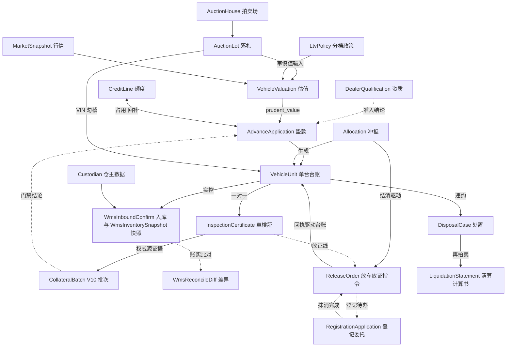
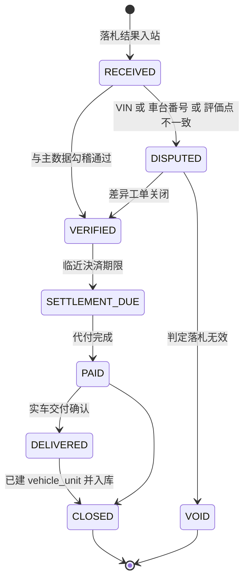
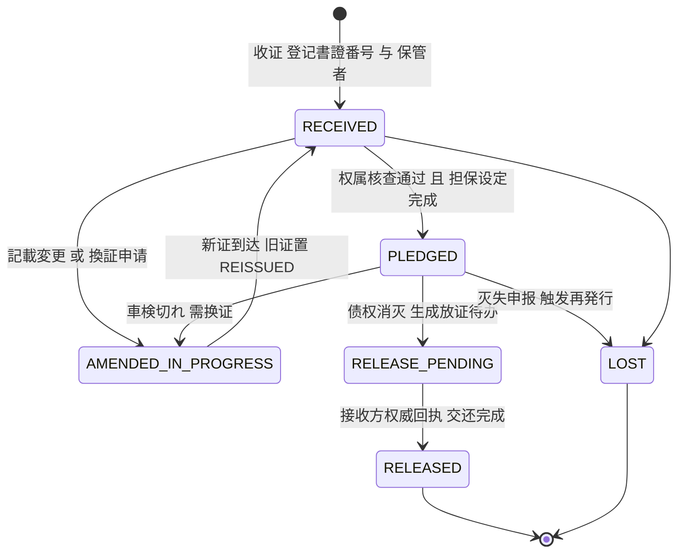
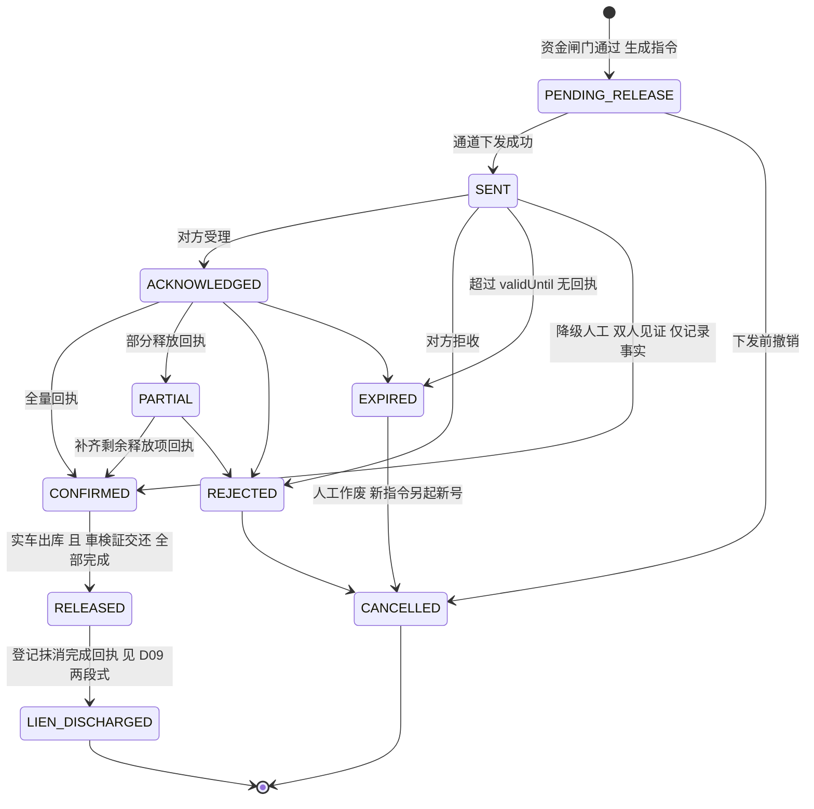

# 二手车库存垫资改造 · D03 领域模型与状态机设计

> 上游：需求书 R1–R14、D00 命名锚点（枚举取值以 D00 §8 为准，本文不重定义只展开）、D02 分层约束。
> 性质：**设计提案**，开发暂缓。文中所有类名为目标态，当前代码库中**不存在**。
> 铁律：本文所有 `domain` 对象**不得依赖 Spring、不得注入 `JdbcTemplate`、不得读配置、不得 `new` 外部客户端**
> （AGENTS.md §10，正面样例 `RoleSeparationPolicy` / `DpdCalculator`）。

---

## 0. 文档控制

| 项 | 内容 |
|---|---|
| 编号 | DESIGN-USED-FLOORPLAN-D03 |
| 版本 | v0.1（草案） |
| 日期 | 2026-11-22 |
| 覆盖 | 8 个上下文的聚合、实体、值对象、领域策略、**9 台状态机**、不变式、包结构、单测清单 |
| 不覆盖 | DDL 列规格（D04）、用例与事务（D06）、接口报文（D07）、公式细节（D08）、闭环顺序（D09） |

---

## 1. 模型总览

### 1.1 聚合清单（22 个聚合根）

| # | 上下文 | 聚合根 | 一致性边界（一个事务内改的东西） | 与现状关系 |
|---|---|---|---|---|
| 1 | dealer | `DealerProfile` | 车商摘要 + 双维评级 + 保证金 | ⚠️ 扩展现有 `Dealer` |
| 2 | dealer | `DealerQualification` | 许可 + 会员 + 合规核查（**独立聚合**：年审节奏与车商主档不同） | 🆕 |
| 3 | auction | `AuctionHouse` | 拍卖场主数据 + 准入 + 结算节奏 | 🆕 |
| 4 | auction | `AuctionLot` | 落札 + 费用明细 + 状态 | 🆕 |
| 5 | auction | `AuctionSettlement` | 结算单 + 逐台分摊 | 🆕 |
| 6 | vehicle | `VehicleUnit` | 单台台账 + 状态机 + 质押/库存引用 | ⚠️ 扩展（现有聚合，USED 分支） |
| 7 | vehicle | `VehicleConditionReport` | 車況票 + 評価点 + 修復歴 | 🆕 |
| 8 | valuation | `VehicleValuation` | 输入源 + 审慎值 + 状态 + 有效期 | 🆕 |
| 9 | valuation | `LtvPolicy` | 分档政策 + 档位 + 启停 | 🆕 |
| 10 | valuation | `MarketSnapshot` | 行情快照（不可变） | 🆕 |
| 11 | certificate | `InspectionCertificate` | 車検証 + 状态机 + 保管者 | 🆕 |
| 12 | certificate | `RegistrationApplication` | 登记委托 + 回执 | 🆕 |
| 13 | collateral | `CollateralBatch` | V10 批次 + 逐台 items + 权威源类型 | ⚠️ 扩展（ADR-Q27） |
| 14 | custody | `Custodian` | 仓 / 通道能力 / 服务时段 / 对账周期 | ⚠️ 扩展现有表（首次被真实使用） |
| 15 | custody | `WmsInventorySnapshot` | 某仓某日在库全集（不可变） | 🆕 |
| 16 | custody | `WmsInboundConfirm` | 入库确认 | 🆕 |
| 17 | credit | `CreditLine` | 额度 + 占用/冻结/回补 | ✅ 复用（改本金来源，不改结构） |
| 18 | advance | `AdvanceApplication` | 垫款申请 + 审定金额 + 闸门结果 | ⚠️ 扩展 |
| 19 | release | `ReleaseOrder` | 指令 + 释放项 + 回执 + 状态机 | ⚠️ 重点改造 |
| 20 | repayment | `Repayment` + `Allocation` | 回款 + 冲抵 | ✅ 复用 |
| 21 | disposal | `DisposalCase` | 处置 + 接管态 | ⚠️ 扩展 |
| 22 | disposal | `LiquidationStatement` | 清算计算书（**一案一书，出具后不可改**） | 🆕 |

> 集成域（`Partner` / `InboundMessage` / `OutboundTask`）**不是领域聚合**，是基础设施模型，
> 不放进 `domain` 层（放 `infrastructure.integration`）。理由：它们没有业务不变式，
> 业务不变式全在 core 消费之后的聚合里。这条划分能防止 DMZ 侧"顺手"写业务规则（D02 INV-2）。

### 1.2 聚合关系



**关键读法**：`VehicleUnit` 是**唯一汇聚点**——上游（资质、估值、落札、额度）决定它能不能被创建，
下游（质押、实控、指令、登记、处置）都挂在它身上。需求书 §2.2「三流逐台可勾稽」
在模型上就表现为「所有下游对象都必须能由 `vin` 反查」。

---

## 2. 上下文逐一建模

### 2.1 dealer — 车商资质（R1）

#### `DealerProfile`（扩展现有 `Dealer`）

| 成员 | 类型 | 说明 |
|---|---|---|
| `riskGrade` | `RiskGrade`（现有 A–D） | **授信**用；决定额度与基础利率 |
| `operatingScore` | `OperatingScore` 🆕 VO | 经营资质分（0–100），由许可 + 会员 + 資本 + 年限 + 既往违约加权 |
| `stockQualityScore` | `StockQualityScore` 🆕 VO | 在库车辆质量分（0–100），由在库车龄带/評価点/修復歴占比/估值衰减率聚合 |
| `riskTier` | 现有（贷后画像用） | **不改语义**，避免与上两者打架（D01 3.2 U-R2） |
| `marginDeposit` | `long` | 保证金（整数日元）；影响 LTV 上浮档位 |

**三评分关系（必须写进注释，D01 U-R2 的落点）**：

| 评分 | 输入 | 影响 | 不影响 |
|---|---|---|---|
| `riskGrade` 授信分 | 人工打标（现有 `V3__rating_config.sql`）＋`operatingScore` 建议 | 额度、基础利率 | **不影响**单台 LTV |
| `stockQualityScore` 车辆质量分 | 在库车辆实际属性聚合 | 单台 LTV 档、监管强度（D-09） | **不影响**额度 |
| `riskTier` 贷后画像分 | DPD、逾期、递减执行 | 巡检频率、预警分级 | **不影响**放款 |

> **禁止互相派生**。现状 `ADR` 把评级与画像混用是 USED 域要消除的口径打架（R1.3）。

#### `DealerQualification`（🆕 独立聚合）

```
DealerQualification
├─ license: DealerLicense                实体（1..n 历史，有效唯一）
│   ├─ licenseNo / competentAuthority（管辖公安委员会）/ issuedOn / expiresOn / status
│   └─ 不变式：同一 dealerId 同时最多一条 ACTIVE 且未过期
├─ memberships: List<AuctionMembership>  实体（按拍卖场分别）
│   ├─ auctionHouseCode / memberNo / status / expiresOn
│   └─ 允许同一车商在 USS 与 TAA 各有会员号（R1.1 验收）
├─ complianceChecks: List<ComplianceCheck>  实体（反社 / AML / 本人确认）
│   ├─ checkType / checkedOn / validUntil / result / evidencePath
│   └─ 结论 UNKNOWN 视为不通过（P-7）
└─ admissionState: AdmissionsState  VO（派生，不落库或只落快照）
    ├─ ADMITTED / BLOCKED_LICENSE / BLOCKED_COMPLIANCE / BLOCKED_MEMBERSHIP / EXPIRING
    └─ 由 license + compliance + membership 三方有效性和推导
```

**领域策略 `DealerAdmissionPolicy`（纯函数）**：

```
evaluate(dealer, license, memberships, checks, bizDate) -> AdmissionDecision
  规则顺序（任一命中即拒，无绕过开关）：
   1 license 缺失 或 已过期           -> BLOCKED_LICENSE   QUAL_001/002
   2 compliance 无有效通过记录        -> BLOCKED_COMPLIANCE QUAL_003
   3 申请指向的拍卖场无有效会员        -> BLOCKED_MEMBERSHIP QUAL_004
   4 admissionState = EXPIRING(<=30d) -> 允许但产出资质到期预警工单
   5 其余                             -> ADMITTED
  注意：不存在 relaxedDealers 之类的白名单入参（Q21 教训，AGENTS.md §8）
```

### 2.2 auction — 落札与采购（R4）

#### `AuctionLot`

```
AuctionLot（聚合根，业务键 AUC:{auction_code}-{yyyymmdd}-{lot_no}）
├─ auctionHouseCode / sessionDate / sessionNo / lotNo / bidNo        bidNo != lotNo（D00 §2）
├─ vin / registrationPlate / firstRegisteredOn / mileage(带 source)
├─ wonPrice (BIGINT 落札価) / evaluationGrade / interiorGrade / exteriorGrade
├─ repairHistory: RepairHistoryFlag
├─ costs: List<AuctionLotCost>   諸費用（落札料 / 成約料 / 消費税 / 陸送費 / 手数料）
│   └─ costType / amount / taxable  含税口径显式（R4.5，D-06 税务待确认）
├─ settlementDueDate              決済期限
├─ sellerMemberNo / buyerMemberNo 出品店 / 落札店
├─ status: AuctionLotStatus       （§3.1）
└─ 不变式：同一 (auctionHouseCode, lotNo, sessionDate) 唯一落札；bidNo 全局唯一
```

**值对象 `Money`**：`{ amount: long(整数日元), taxTreatment: TAXABLE | NON_TAXABLE | MARGIN_TAX }`
— 用于 R4.5「垫款基准是否含税」待定口径。**`MARGIN_TAX`（中古车 margin 课税）是否适用属 D-02 法务输入。**

#### `AuctionSettlement`

一场结算含多台车（R4.4 拆分要求）：`settlementNo` + 明细行 `List<{lotId, allocAmount}>`，
不变式：**明细分摊合计 = 结算总额**（否则 `AUC_003`）。分摊后驱动 `PaymentInstruction` 逐台。

**`AuctionLot` 与 `purchase_orders` 的映射**：`purchase_orders.order_no` 在 USED 域语义改为
「落札票 / 出品票」号（R2.4），并加 `auction_lot_id` 外键；**LEGACY 域该列语义不变**（厂家発注書）。
这是一处「同列不同语义」的高危设计，必须在 D04 加 `vehicle_type` 条件约束 + D07 在接口层分叉说明。

### 2.3 vehicle — 车辆主数据（R2）

#### `VehicleUnit`（扩展现有聚合，USED 分支）

新增成员（列规格见 D04）：

```
+ registrationPlate            登録番号（车牌）
+ firstRegisteredOn            初度登録年月 → 车龄
+ inspectionExpiryDate         車検満了日
+ inspectionRemainingMonths    派生 + 快照
+ mileage / mileageUnit / mileageSource / mileageCapturedOn   里程可追溯（R2.3）
+ repairHistory / accidentHistory
+ auctionLotId  ── 来源勾稽
+ valuationId   ── 放款基准来源（禁止再用 invoiceAmount 推导）
+ inspectionCertificateId ── 一车一证
+ warehouseCode / binLocation ── 实控位置
+ saleChannel: SaleChannel     售出类型（RETAIL / WHOLESALE_RESELL / AUCTION_RELIST）
+ authoritativeSourceType      见 §2.5
```

**必须消除的隐式默认**（D00 P-2）：
删除 `PurchaseOrderApplicationService:194,305` 的 `setVehicleType("NEW_STOCK")` 与
`VehicleController:92` 的 `purchaseChannel` 默认 `"OEM"`，改为**必填 + 导入层强枚举校验**，
非法值 `VALID_001` 拒绝（R2.1 验收）。

**USED 域 `VehicleStatus` 迁移表（在现有六态基础上插入两个新前置）**：

| 迁移 | 触发 | USED 域新增前置 |
|---|---|---|
| `DRAFT → PENDING_AUDIT` | 建账 | 落札数据与主数据一致性核查（R2.3 不一致建差异工单，不静默覆盖） |
| `PENDING_AUDIT → CREATED` | 准入通过 | `DealerAdmissionPolicy=ADMITTED` + 车况票齐备 |
| `CREATED → PENDING_ADVANCE` | 申请垫款 | **必须有 `ACTIVE` 估值**（`VALU_001`） |
| `PENDING_ADVANCE → ADVANCED` | 放款 | 四闸门：估值 / 资质 / 権属（`EncumbranceType=NONE`）/ 車検証已收证 |
| `ADVANCED → IN_STOCK` | 入库 | **必须有 WMS 入库确认**（`WMS_001`，R6 验收） |
| `IN_STOCK → SOLD` | 售出登记 | 售出类型决定结算窗口（R9.2） |
| `SOLD → PENDING_RELEASE` | 回款匹配 + 冲抵完成 | 资金闸门（红线 1） |
| `PENDING_RELEASE → RELEASED` | 回执全量 + 两段式解押 | 权威回执（红线 2） |
| `RELEASED → SETTLED` | 台账联动（outbox） | 额度回补紧随其后 |

> **不新增车辆状态值**，只加前置——这样 LEGACY 域的 `VehicleUnit` 状态机单测不需要改期望表。
> 前置校验由 `domain` 策略返回结论、由 `application` 拒绝迁移（分层要求）。

### 2.4 valuation — 估值与 LTV（R3，公式细节在 D08）

```
VehicleValuation（聚合根，VAL-{vin}-{yyyymmdd}-{seq}）
├─ inputs: List<ValuationInput>     值对象集合，每个 {source, value, ref, provider, asOf, digest}
│     source ∈ ValuationSource（D00 §8.5）
│     ⚠ 全部输入都留，不只留结果 —— 审计要能回答「当时看到的价是哪些」
├─ auctionWonPrice / appraisedValue / marketPrice     三个语义字段（可空，取决于来源）
├─ prudentValue: long              审慎值 = PrudentValueCalculator(inputs, rule)
├─ prudentRule: PrudentValueRule   快照到记录（政策后续变更不影响历史）
├─ valuationDate / validUntil / status(ValuationStatus)
├─ purpose: ValuationPurpose       ADVANCE_BASE / PERIODIC_RECHECK / EVENT_RECHECK / DISPOSAL_PRICING
├─ reportPath（本地文件，U-R12）+ reportDigest
├─ overriddenBy / coSignedBy       MANUAL_OVERRIDE 时必填二人（U-07）
└─ 不变式：
    I1 同一 VIN 同时最多一条 status=ACTIVE（部分唯一索引，D00 §13.1）
    I2 prudentValue > 0，否则不得置 ACTIVE（VALU_003）
    I3 purpose=ADVANCE_BASE 的估值必须有外部来源或人工评估报告，INTERNAL_DEGRADED 只能 PERIODIC_RECHECK/EVENT_RECHECK（U-08）
    I4 估值一旦被放款引用（advances.valuation_id 指向）则不可改写，只能 SUPERSEDED 新记录
```

```
LtvPolicy（聚合根）
├─ policyCode / version / effectiveFrom / effectiveTo / status
├─ bands: List<LtvBand>   每带 {优先级, 匹配条件(车龄带/里程带/修復歴/評価点带/車検残存/车型热度/车商分档), maxRatio(BigDecimal), 利率加点}
└─ 不变式：任一输入组合必须命中且仅命中一个带（否则 LTV_002）；ratio ∈ (0, 1]
```

**领域策略（全部纯函数，D08 给用例表）**：
`PrudentValueCalculator`、`LtvTierResolver`、`ResidualRatioCalculator`、`ValuationExpiryPolicy`、
`DepreciationEngine`（估值衰减 + 天数双因子）。

### 2.5 certificate — 車検証质押（R5）

```
InspectionCertificate（聚合根，CERT-{certificate_no}）
├─ certificateNo 証書番号 / registrationPlate 登録番号 / vin 車台番号
├─ ownerName 所有者 / userName 使用者            （两者可不同，抵押权常见结构）
├─ issueDate / inspectionExpiryDate
├─ securityType: SecurityType（USED 域取值见 D00 §8.2）
├─ encumbrance: List<EncumbranceFinding>  {type: EncumbranceType, foundOn, source: RegistryCheckSource, evidencePath, conclusion}
├─ custody: {holder: CustodianRef, holderType: CustodianType, warehouseCode, binLocation?, receivedOn}
├─ status: CertificateStatus  （§3.2 六态）
├─ predecessor: certificateId?  换证链条（R2.5）
└─ 不变式：
    I1 与 VIN 一对一（部分唯一索引 WHERE status NOT IN ('REISSUED','LOST')）
    I2 状态迁移必须由状态机方法完成，禁止直接 UPDATE status（AGENTS.md §6.3）
    I3 encumbrance 含除 NONE 外任一项 → 不得进入 PLEDGED（CERT_005，红线 3）
    I4 有效（HELD 之后）证书必须有 holder，否则不能用于担保
```

`CertificateCustodyEvent`（实体，挂在证书上，R2.5 历史留痕）：
`{eventType: RECEIVED|PLEDGED|TRANSFERRED|RELEASED|REISSUED|LOST|AMENDED, from, to, operator|partnerCode, at, evidencePath, reason}`。

**`RegistrationApplication`（登记委托聚合）**：
`{applyNo, type: TRANSFER|MORTGAGE_SETUP|MORTGAGE_DISCHARGE, vin, certificateNo, agent(partner), appliedOn, expectedBy, status, receiptPath, registryResult, completedOn}`
— 需求书 R5.6 的正确认知必须保留：**登记簿变动需权利人与登记义务人共同申请**，
所以系统内"解押完成"分两个事实（实体权利消灭 vs 登记抹消完成），见 D09 §4。

**`AuthoritativeSourceResolver`（纯函数，D01 3.5 U-R5 落点）**：

```
resolve(vin, sources: List<SourceFinding>) -> CollateralConclusion
  输入源优先级：INSPECTION_CERT > VEHICLE_REGISTRY > MORTGAGE_REGISTRATION > MOVABLE_REGISTRATION
  规则：
   1 任一源报出 EncumbranceType != NONE -> ENCLOSED（最审慎，视为有瑕疵）+ 工单，不自动放行
   2 最高优先级可用源给出清晰权属且已设质 -> REGISTERED
   3 无任何可用源 -> NONE -> 门禁拒付（CERT_001 / GUARANTEE_001）
   4 源之间结论冲突 -> CONFLICTED -> 拒付 + HIGH 工单（不取乐观解释）
  与 ADR-Q27 的关系：V10 仍是唯一逐台权威源表；本 resolver 只决定「批次记录里采信哪种证据类型」，
  不引入第二张权威源表。
```

### 2.6 custody — 监管仓（R6）

```
Custodian（扩展现有表，首次真实使用）
├─ custodianCode / custodianType(D00 §8.3) / name / contact
├─ apiEndpoint / apiSecretRef（V19 已预留两列，USED 域终于有读写方）
├─ channelCapability: Set<ReleaseChannelType>  API / PORTAL / MQ / MANUAL
├─ serviceWindow（服务时段，放车指令只能在该时段下发）
├─ reconcileCycle（DAILY / PER_SNAPSHOT）
└─ status

WmsInboundConfirm  { vin, warehouseCode, binLocation, conditionSnapshot, odometerKm, photos[], inboundNo, confirmedAt, partnerCode }
  不变式：(warehouseCode, vin, inboundNo) 唯一；VIN 不一致 → 差异工单不静默覆盖

WmsInventorySnapshot  { snapshotDate, warehouseCode, items[ {vin, binLocation, odometerKm, condition, certNo?} ], receivedAt, partnerCode }
  不可变；同日重推 → 新记录 + 旧记录 SUPERSEDED，不覆盖

WmsReconcileDiff  { bizDate, warehouseCode, vin, diffType, severity, status, resolutionNote, actor }
  diffType ∈ {MISSING_IN_WMS(账有实无) / EXTRA_IN_WMS(账无实有) / CERT_MISMATCH / BIN_MISMATCH / ODOMETER_DIFF / CONDITION_DIFF}
  severity：MISSING_IN_WMS 恒为 HIGH（R6.3 验收）；其余可配置分档
```

### 2.7 release — 放车放证（R7，状态机见 §3.3，闭环见 D09）

```
ReleaseOrder（聚合根，order_no 法律凭证不可复用）
├─ 身份：orderNo / vin / dealerId / redemptionId / inspectionCertificateNo（新增，不复用旧 certificate_no）
├─ 指令要素：items: List<ReleaseItem>、validUntil、traceId
├─ ReleaseItem { itemType: ReleaseItemType, receiverParty: {type: CustodianType, custodianCode, partnerCode}, status: ItemStatus, releasedAt, receiptId }
│     ★ 按项指定接收方（R7.2）：VEHICLE→WMS/AUCTION_VAULT，INSPECTION_CERT→CERT_DEPOSITORY
│     ★ ItemStatus ∈ {PENDING, INSTRUCTED, RELEASED, NOT_RELEASED, REFUSED}
├─ 状态：status: ReleaseStatus（十态）+ stateHistory（现有 release_state_history）
├─ 通道：deliveryChannel ∈ {API, PORTAL, MQ, MANUAL} —— 必须真正参与路由（R7.3）
├─ 权威：confirmationAuthority: ConfirmationAuthority（强枚举）
├─ Receipt（实体）{ source, partnerCode, authority, receivedAt, 实际释放项, receiverName, photos, odometerKm, exceptionType, exceptionReason, signatureOk }
│     ★ 现状 saveReceipt 只写 7 列、exception_type 从不写入 —— USED 域 exceptionType 必填（无异常填 NONE）
└─ 不变式：
    I1 资金闸门：无已匹配且冲抵完成的回款 → 不得创建指令（RELS_001，红线 1）
    I2 权威闸门：authority != PARTNER_RECEIPT → 不得推进 SETTLED（RELS_002，红线 2）
    I3 部分释放：items 未全 RELEASED → 状态只能是 PARTIAL，不得 RELEASED（红线 / A3）
    I4 撤销：仅 PENDING_RELEASE / SENT 可 CANCELLED；已 RELEASED 不可撤（走登记更正流程）
    I5 有效期：now > validUntil 且未收到回执 → EXPIRED，且必须重新生成新指令号（不复用）
    I6 并发：状态迁移必须 CAS（WHERE id AND status=expectedFrom），沿用 6dfc4cc 修复后的写法
```

**`ReleaseChannel` 接缝（现状已有接口 + 唯一 Manual 实现）**：

| 实现 | 状态 | `dispatch()` 行为 | `confirm()` 来源 |
|---|---|---|---|
| `ManualReleaseChannel` | 现有 | 只打 2 条 log | 内部代录 `INTERNAL_WITNESS` |
| `ApiReleaseChannel` 🆕 P0 | 待建 | 写 `integration.outbound_tasks` | partner 验签回执 |
| `PortalReleaseChannel` 🆕 P1 | 待建 | 生成门户待办 + 文件导出 | partner 回执 / 人工核对 |
| `MqReleaseChannel` 🆕 P1 | 待建 | 出站队列 | 回执消息 |

路由：`ReleaseChannelRouter.route(deliveryChannel, custodian.channelCapability)`，
**通道不支持则拒**（不静默降级成 Manual；降级必须由 `manual-fallback.enabled` 显式授权并打 `MANUAL_FALLBACK_USED` 审计）。

### 2.8 disposal — 违约与再拍卖（R10）

```
DisposalCase（扩展）
├─ + takeoverState: {NOT_TAKEN, WMS_TAKEOVER, SEALED, DISPOSE_AUTHORIZED}   ★ 车本就在仓，接管而非拖车（R10.1）
├─ + outboundBlocked: boolean  接管后普通出库一律禁止（WMS_003 阻断放车指令）
└─ 状态机沿用现有（含 NOTIFIED / LEGAL_ACTION / CANCELLED，缺端点属 D7）

DisposalAuction（🆕 实体集，一案多轮出场）
├─ disposalCaseNo / auctionHouseCode / lotNo / consignDate / auctionDate
├─ hammerPrice（落札价）/ commission（佣金）/ buyerType / valuationAmount / valuationRef / disposalCost
└─ 不变式：净变现所得 = hammerPrice − commission − disposalCost（整数运算，不允许负成本溢出）

LiquidationStatement（🆕 聚合根，LQD-{disposalCaseNo}）
├─ receivablePrincipal / accruedInterest / penalty / fees / netProceeds
├─ lossAmount = 应收合计 − 净变现所得
└─ 不变式：出具后不可修改（append-only）；不平则 DSPO_002；一案一书唯一
```

### 2.9 integration — 外部协同（基础设施模型，非领域聚合）

```
Partner        { partnerCode, partnerType, status, keyVersion, secretRef, allowedIps, allowedScopes, rateLimit, receiptSlaHours }
InboundMessage { idempotencyKey UNIQUE, partnerCode, endpoint, signatureOk, payloadRef, payloadDigest, status, attempts, lastError, traceId, receivedAt, processedAt }
OutboundTask   { idempotencyKey UNIQUE, taskType, partnerCode, endpoint, payloadRef, status, attempts, nextRetryAt, expiresAt, traceId }
Nonce          { partnerCode, nonce UNIQUE, expiresAt }
CallLog        { direction, partnerCode, endpoint, requestDigest, responseDigest, httpStatus, elapsedMs, signatureOk, errorClass, traceId }
```

状态机见 §3.5 / §3.6。**注意：`signatureOk=false` 也必须落 `InboundMessage`**（D02 §5.3 要点 2）。

---

## 3. 状态机全集

> 每台状态机都必须：① 用**方法**迁移而非 `UPDATE ... SET status`；② 迁移带 CAS；
> ③ 有**硬编码白名单**单测（参照 `ReleaseStateMachineTest` 修复后的正面样例，
> 禁止用 `canTransit` 自身生成用例再断言 `canTransit` —— 那是本仓真实踩过的循环论证）。

### 3.1 `AuctionLotStatus` 🆕


非法迁移：`RECEIVED → PAID`（跳过核查）、`PAID → VERIFIED`（回退）、`CLOSED → *`。

### 3.2 `CertificateStatus` 🆕（六态，`[待定源 U-02]` 由需求书 4 态细化）



| 迁移 | 前置（domain 结论 + application 拒绝） | 错误码 |
|---|---|---|
| `RECEIVED → PLEDGED` | `EncumbranceType=NONE` 全部通过；`AuthoritativeSourceResolver ∈ {REGISTERED}` | `CERT_005` / `CERT_003` |
| `PLEDGED → RELEASE_PENDING` | 该 VIN 债权已消灭（冲抵完成） | `RELS_001` |
| `RELEASE_PENDING → RELEASED` | `PARTNER_RECEIPT` 且 `itemType=INSPECTION_CERT` 的释放项已回执 | `RELS_002` |
| `* → LOST` | 二人审批 + 再发行计划 | `CERT_004` |

**禁止**：`RECEIVED → RELEASED`（未设质即交还）、`RELEASED → *`（终态）。

### 3.3 `ReleaseStatus` ⚠️ 扩展（十态，USED 域）



**与现状的差量**：新增 `ACKNOWLEDGED` / `REJECTED` / `EXPIRED` / `PARTIAL` 四态；
`LIEN_DISCHARGED` **语义收窄为"登记抹消完成"**（D01 3.7 U-R7，`[待定源 D-07]`）。

**LEGACY 兼容**：现有 `ReleaseStateMachineTest` 的 6×6=36 组合期望表**不得改动**。
USED 域新增独立测试类 `ReleaseStateMachineUsedTest`，硬编码 10×10 白名单，
并断言「旧六态之间的合法迁移集在 USED 枚举下保持完全一致」（防反转泄漏到 LEGACY）。

**两条红线在状态机上的表达**：

| 红线 | 状态机保证 |
|---|---|
| 无权威回执不得 `RELEASED`/`SETTLED` | `PARTIAL` 与 `ACKNOWLEDGED` **不能**直接到 `LIEN_DISCHARGED`；`RELEASED` 只有一条入边且要求全部 items `RELEASED` |
| 未到账不得下发 | `PENDING_RELEASE` 之前没有状态；创建聚合时资金闸门是构造前置，不是状态 |

### 3.4 `VehicleStatus` — 沿用现有六/七态，仅加前置（§2.3）

### 3.5 `MessageStatus`（入站）🆕

```
RECEIVED → ACCEPTED(幂等判定为新) → PROCESSED
RECEIVED → DUPLICATE（返回首次结果，非错误）
RECEIVED → REJECTED_BAD_SIGNATURE（终态，但已留痕，产生安全告警）
ACCEPTED → FAILED(attempts<3) → ACCEPTED（重试）
FAILED(attempts=3) → DEAD（终态 + 人工重放工单）
```

### 3.6 `OutboundTaskStatus`（出站）

见 D02 §5.5 状态图（`PENDING / IN_FLIGHT / ACCEPTED / RETRY_WAIT / FAILED / DEAD / REJECTED / CANCELLED`）。
**与业务态解耦**：`ACCEPTED` 只表示对方受理，不推进 `ReleaseStatus`。

### 3.7 `ValuationStatus` 🆕

`DRAFT → ACTIVE → {EXPIRED | SUPERSEDED}`；`ACTIVE` 唯一（同 VIN）；被放款引用后不可回退（I4）。

### 3.8 `RegistrationApplicationStatus` 🆕

```
DRAFT → SUBMITTED（委托代办）→ ACCEPTED_BY_AGENT → COMPLETED（收到登记回执）
SUBMITTED → REJECTED（文书不符）→ DRAFT
COMPLETED → 驱动 ReleaseStatus.LIEN_DISCHARGED 或 CertificateStatus 相关迁移
```

### 3.9 `DisposalCase` 扩展态

沿用现有 `DisposalStatus`（含 `NOTIFIED`/`LEGAL_ACTION`/`CANCELLED`，D7 只缺端点），
新增**并列**的 `takeoverState` 维度（§2.8），不改动原状态机——
避免与 LEGACY 域共用状态时产生语义漂移。

---

## 4. 领域策略类清单（全部可纯单测）

| 类 | 职责 | 输入 → 输出 | 关联 |
|---|---|---|---|
| `DealerAdmissionPolicy` 🆕 | 资质准入判定 | 许可+会员+合规 → `AdmissionDecision` | R1.2 |
| `PrudentValueCalculator` 🆕 | 审慎值 | 输入源集合+规则 → `long` | R3.1 D08 |
| `LtvTierResolver` 🆕 | 分档命中 | 车辆属性+车商分+政策 → `(band, maxRatio, rateAddOn)` | R3.2 D08 |
| `AdvanceBaseResolver` 🆕 | 垫款基准 | 审慎值 × ratio → 审定垫款（整数量化 `DOWN`） | R3.1 |
| `ResidualRatioCalculator` 🆕 | 残值率 | 当前估值 / 未偿本金 → `BigDecimal` | R3.3 |
| `LtvBreachPolicy` 🆕 | 突破分档 | 残值率+阈值 → `LtvBreachSeverity` + 动作 | R3.3 |
| `DepreciationEngine` 🆕 | 双因子递减 | 估值衰减 + 天数 → 递减额 | R9.3 |
| `SettlementWindowResolver` 🆕 | 结算窗口 | `SaleChannel` → 到期日 | R9.2 |
| `EncumbrancePolicy` 🆕 | 权利瑕疵 | findings → 可押/拒付 | R5.3 |
| `AuthoritativeSourceResolver` 🆕 | 权威源优先级 | 多源 findings → 结论 | R5.4 U-R5 |
| `CertificateStateMachine` 🆕 | 六态迁移 | from+event → to 或拒绝 | R5.1 |
| `ReleaseStateMachine` ⚠️ | 十态迁移 | 同上 | R7.5 |
| `ReleaseChannelRouter` 🆕 | 通道路由 | channel+capability → channel 或拒 | R7.3 |
| `ReceiptAuthorityPolicy` 🆕 | 回执权威判定 | authority+signatureOk+inboundRef → 是否可推进结清 | R7.4 P-6 |
| `PartialReleasePolicy` 🆕 | 部分释放 | items → `PARTIAL`/`RELEASED` + 敞口 | R7.2 U-R8 |
| `FundGatePolicy` 🆕 | 资金闸门 | 匹配+冲抵 → 是否可生成指令 | R7.1 红线 1 |
| `StockReconcilePolicy` 🆕 | 账实差异分级 | 我方清单+WMS 快照 → diffs | R6.3 |
| `LiquidationCalculator` 🆕 | 清算 | 应收+净变现 → 损失 | R10.3 |
| `AuctionSettlementAllocator` 🆕 | 结算分摊 | 结算单+多台 → 逐台金额（合计守恒） | R4.4 |

**共同要求**：① 无副作用、无 IO；② 入参是值对象/原始类型，不传实体；
③ 返回结论对象（含 `allowed`、`errorCode`、`reason`、`traceableEvidence`），**不抛裸异常**；
④ 所有阈值/比率由 `application` 层从配置或规则表读入后传入，domain 不读配置。

---

## 5. 领域事件（聚合内）与集成事件（outbox）的区别

| | 领域事件 | 集成事件（outbox） |
|---|---|---|
| 范围 | 同进程同事务，可内存派发 | 跨服务 / 跨进程，落 `outbox_events` |
| 载体 | Spring `ApplicationEventPublisher` 或直接在应用服务内顺序调用 | `OutboxPublisher.publish(...)` |
| 幂等 | 不需要（同事务） | 两层（框架 + 业务唯一键） |
| USED 域用量 | 少（用于同聚合的派生，如估值生效 → 重算递减计划） | 多（D02 §6.2 矩阵 13 项） |

> 本仓现状无「领域事件总线」，也不打算引入。**默认做法是在 `application` 层显式顺序调用**，
> 可读性优于隐藏派发。只有需要跨进程才升级为 outbox 事件。

---

## 6. 包结构（目标态）

```
domain/  com.company.floorplan.domain
├─ dealer/        DealerProfile, DealerQualification, DealerLicense, AuctionMembership,
│                 ComplianceCheck, AdmissionDecision, DealerAdmissionPolicy
├─ auction/       AuctionHouse, AuctionLot, AuctionLotCost, AuctionSettlement,
│                 AuctionLotStatus, AuctionSettlementAllocator
├─ vehicle/       VehicleUnit(扩展), VehicleConditionReport, Mileage, RepairHistoryFlag,
│                 PurchaseChannel, SaleChannel
├─ valuation/     VehicleValuation, ValuationInput, LtvPolicy, LtvBand, MarketSnapshot,
│                 PrudentValueCalculator, LtvTierResolver, ResidualRatioCalculator,
│                 LtvBreachPolicy, DepreciationEngine, ValuationSource, ValuationPurpose,
│                 ValuationStatus, PrudentValueRule
├─ certificate/   InspectionCertificate, CertificateCustodyEvent, RegistrationApplication,
│                 EncumbranceFinding, CertificateStateMachine, CertificateStatus,
│                 EncumbrancePolicy, AuthoritativeSourceResolver, AuthoritativeSourceType
├─ collateral/    CollateralBatch(扩展)
├─ custody/       Custodian, WmsInboundConfirm, WmsInventorySnapshot, WmsReconcileDiff,
│                 StockReconcilePolicy, SupervisionType
├─ release/       ReleaseOrder, ReleaseItem, Receipt, ReleaseStatus, ReleaseItemType,
│                 ReleaseStateMachine, ReleaseChannelRouter, ReceiptAuthorityPolicy,
│                 PartialReleasePolicy, FundGatePolicy, ConfirmationAuthority
├─ disposal/      DisposalCase(扩展), DisposalAuction, LiquidationStatement, LiquidationCalculator
└─ exception/     ErrorCode（扩展 D00 §9 段位）

application/ com.company.floorplan.application
├─ valuation/     ValuationApplicationService, MarketSnapshotApplicationService
├─ auction/       AuctionLotApplicationService, AuctionSettlementApplicationService
├─ certificate/   CertificateApplicationService, RegistrationApplicationService
├─ custody/       CustodyApplicationService, StockReconcileApplicationService
├─ release/       ReleaseApplicationService(改造), ReleaseLedgerConsumer
└─ integration/   InboundApplicationService(ACL 后编排), OutboundRelayService

infrastructure/ com.company.floorplan.infrastructure
├─ jdbc/          各仓储 Jdbc 实现
├─ integration/   Partner, InboundMessage, OutboundTask, Nonce, CallLog（★ 非领域模型）
├─ integration/acl/  UssLotDto→CreateAuctionLotCommand 等外部→内部转换
└─ outbox/        JdbcOutboxPublisher, EventDispatcher（复用 W0）

external-api/  com.company.floorplan.external
├─ web/          入站 Controller, 出站 Scheduler
├─ security/     SignatureVerifier, NonceGuard, RateLimiter, KeyStore
└─ acl/          协议转换（★ pom 不依赖 domain / application）
```

**ArchUnit 约束（CI 可执行）**：
① `domain..` 不得依赖 `org.springframework..`；
② `..external-api..` 不得依赖 `..domain..` 与 `..application..`；
③ `@Transactional` 只出现在 `..application..`；
④ `domain` 不得依赖 `infrastructure`。

---

## 7. 单测清单（`domain` 层，无 Spring 上下文）

| 测试类 | 必测点 | 项数建议 |
|---|---|---|
| `DealerAdmissionPolicyTest` | 无许可 / 许可过期 / 反社未过 / 目标拍卖场无会员 / 即将到期允许 / **无白名单入参（反射断签名）** | 8 |
| `PrudentValueCalculatorTest` | min 规则 / 加权规则 / 单源 / 全空拒 / 含税口径 / 零值 / 负值 | 10 |
| `LtvTierResolverTest` | 命中唯一带 / 多带冲突 / 无带命中 / 修復歴 MAJOR 降档 / UNKNOWN 按 MAJOR / 边界值 | 12 |
| `ResidualRatioCalculatorTest` | 正常 / 本金为 0（不得除零）/ 估值过期 / 阈值分档 | 6 |
| `DepreciationEngineTest` | 仅天数 / 仅估值衰减 / 双因子叠加 / 上限封顶 / 豁免规则表命中 | 8 |
| `EncumbrancePolicyTest` | NONE 通过 / 每种瑕疵各一例 / UNKNOWN 拒 / 多瑕疵取最审慎 | 8 |
| `AuthoritativeSourceResolverTest` | 单源 / 优先级 / 冲突取审慎 / 无源 NONE | 7 |
| `CertificateStateMachineTest` | 硬编码 6×6=36 全组合白名单 + `implementationMatchesHardcodedWhitelist()` | 2 |
| `ReleaseStateMachineUsedTest` | 硬编码 10×10=100 白名单；**旧 6 态子表与现状逐格一致** | 3 |
| `ReceiptAuthorityPolicyTest` | PARTNER_RECEIPT+验签通过可推进；INTERNAL_WITNESS **不可**；无 inboundRef 不可；伪造不可 | 6 |
| `PartialReleasePolicyTest` | 只放车 / 只放证 / 全放 / 拒收一项 → 状态与敞口 | 6 |
| `FundGatePolicyTest` | 未匹配 / 部分到账 / 已足额 / 重复匹配 / 冲抵未完成 → 是否可生成指令 | 7 |
| `StockReconcilePolicyTest` | 六种 diffType 各一 + 账有实无恒 HIGH | 8 |
| `LiquidationCalculatorTest` | 正常 / 变现为 0 / 成本超所得 / 整数守恒 | 5 |
| `AuctionSettlementAllocatorTest` | 分摊合计守恒 / 余数处理 / 单车多费用项 | 5 |

> **反循环论证硬要求**：状态机测试的期望迁移表必须**手写字面量**，
> 不得由 `canTransit()` 生成（本仓真实踩过并已由 `6dfc4cc` 修掉，见 PROGRESS §7）。

---

## 8. 自检

- 枚举取值全部引用 D00 §8，未自造；`ReleaseItemType` 明确区分 `CERTIFICATE`（LEGACY 合格证）与 `INSPECTION_CERT`（USED 車検証）。
- 未提议修改任何现有状态机的 LEGACY 行为；所有改造以「新增前置 / 新增并列维度 / 新增状态但旧子表不变」实现。
- 四条红线在模型层的落点均已指明（§3.3 表、§2.5 I3、§2.7 I1/I2、§2.6 `MISSING_IN_WMS`）。
- 未签字项：`U-02`（证书 6 态）、`D-07`（`LIEN_DISCHARGED` 语义）、`D-03`（担保类型集）、`D-09`（监督类型启用）、`D-06`（阈值/分档）。
- 列规格 → D04；顺序与补偿 → D09；用例断言 → D11。
