# 二手车库存垫资改造 · D05 业务流程图

> 上游：需求书 §6.1 主流程 12 步、§6.2 状态机、§6.3 两条红线；D02（拓扑与集成机制）、D03（聚合与状态机）、D04（表与列）。
> 本文只画**目标态**流程。现状（人工搬数据、`ManualReleaseChannel` 只记日志）在 §1.3 用一张「断点图」定位，
> 便于评审对照「哪一段是新建、哪一段是打通」。
> 所有图使用 Mermaid；节点上的 `[闸门]` 标记对应 D06 的门禁判定方法，`[事件]` 标记对应 D02 §7 事件矩阵，
> `[表]` 标记对应 D04 的落库对象。

---

## 0. 文档控制

| 项 | 内容 |
|---|---|
| 编号 | DESIGN-USED-FLOORPLAN-D05 |
| 版本 | v0.1（草案） |
| 图清单 | 泳道全景 1 + 阶段时序 12 + 活动图 5 + 状态图 1 + 甘特 1 + 非法路径对照 2 |
| 参与者命名 | 与 D00 §2 术语表一致；外部系统一律用 `partner_type` 而非具体公司名 |
| 未签字影响 | `D-04`（拍卖场接口形态）影响 §3.2/§3.3 的「谁推谁拉」；`D-07`（两段式解押）影响 §5；`D-08`（结算窗口）影响 §8 时点 |

---

## 1. 参与者与泳道

### 1.1 泳道定义

| 泳道 | 角色 / 系统 | 在本流程中负责 | 触达方式 |
|---|---|---|---|
| `DEALER` | 中古车销售业者（车商） | 落札、提交垫款申请、卖车、还款 | 门户 / API |
| `AUCTION` | 拍卖场（USS / TAA / …） | 落札结果、结算单、再拍卖受托与场内引取 | `partner_type=AUCTION` |
| `WMS` | 第三方监管仓 | 入库确认、库存快照、放车回执 | `partner_type=WMS` |
| `CUSTODY` | 凭证保管方 / 登记代办 | 車検証保管、抹消登记、登记识别信息 | `CERT_DEPOSITORY` / `LEGAL_AGENT` |
| `BANK` | 银行 / 支付通道 | 流水、代付结果 | `BANK` |
| `EXT` | `external-api`（DMZ，18090） | 验签、幂等、入站/出站任务、调用留痕 | D02 §5 |
| `CORE` | 核心业务服务（8080–8088） | 状态机、门禁、账务、额度、审计 | — |
| `OPS` | 内勤 / 风控 / 财务 / 法务 | 复核、豁免、工单处置、计算书签认 | 权限点（D10） |
| `JOB` | 定时作业 | 轮询消费、重估、对账、到期预警、中继 | `@Scheduled`（W0 已开） |

### 1.2 关键约定（所有图共用）

1. **实线 = 同步调用**；**虚线 = 异步（outbox / 任务表 / 回执）**。时序图中 `->>` 为同步，`-->>` 为异步或响应。
2. **`EXT` 永不调用 `CORE`**：入站一律 `CORE/JOB` 拉取（D02 §5.3 INV-1）。
3. **`CORE` 永不直连外部**：出站一律写 `integration.outbound_tasks` 由 `EXT` 领取（INV-2）。
4. 任何「人工」节点都必须显式画出**操作人 + 权限点 + 审计事件**，否则视为漏建模。
5. `[闸门]` 未通过时的**唯一出口是拒绝 + 留痕**，不得出现「绕过继续」的边（P-7 / 红线）。

### 1.3 现状断点定位（评审对照用）

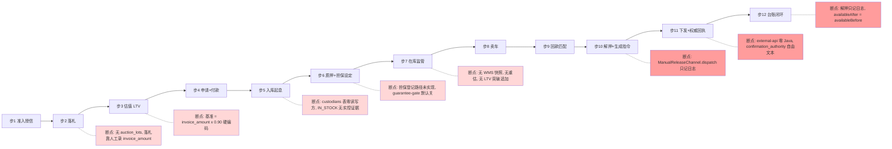

> 深红三处（步 10 / 11 / 12）即需求书 §6.3 两条红线所在，也是**改造的最小必要闭环**：
> 若只做前九步而不打通后三步，系统会得到「放款更准、但钱收不回、车放得走」的最坏组合。
> 排期上 W-U4（放车放证）与 W-U3（集成）必须**同波交付**，见 D12。

---

## 2. 主流程 12 步全景泳道

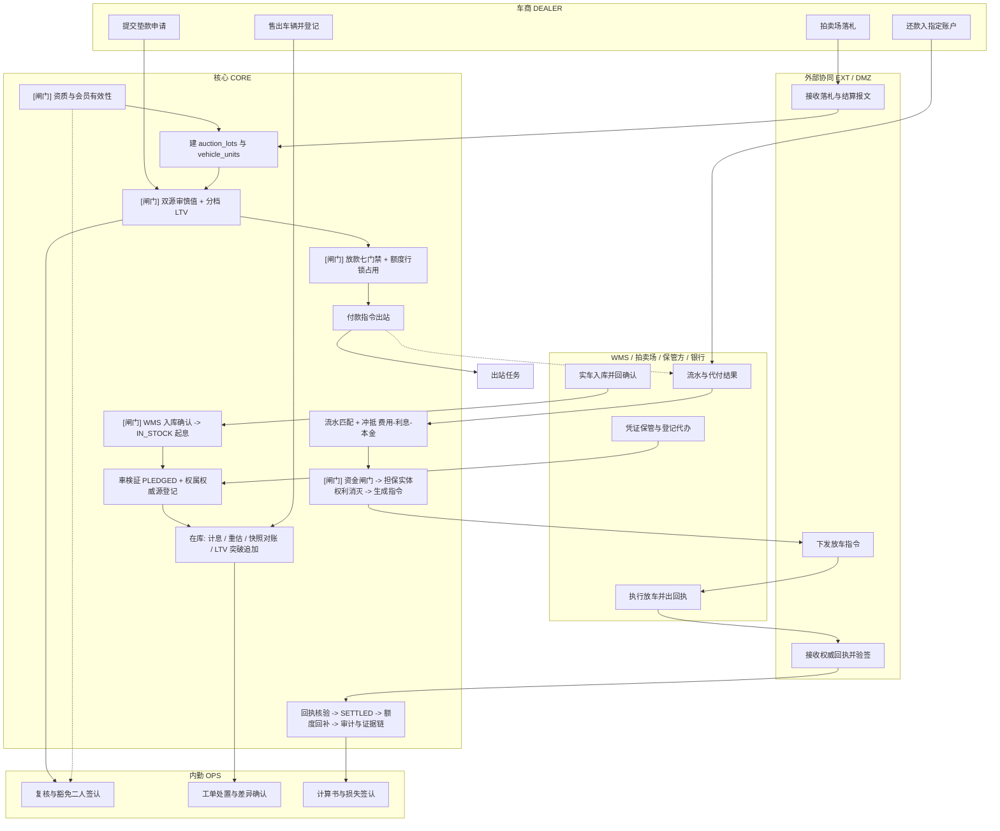

> 图上**唯一一条从 `c10` 之外进入 `e2`（下发）的路径不存在**——这是红线 1 的结构表达：
> 生成与下发有效指令的前置只有「资金闸门通过」。人工重触发、代录、超时自动推进全部走 `c10` 同一入口，
> 因此在 D06 中它们必须是同一个服务方法，而不是各自的旁路方法。

---

## 3. 分阶段时序

### 3.1 步 1：车商准入与授信（R1）

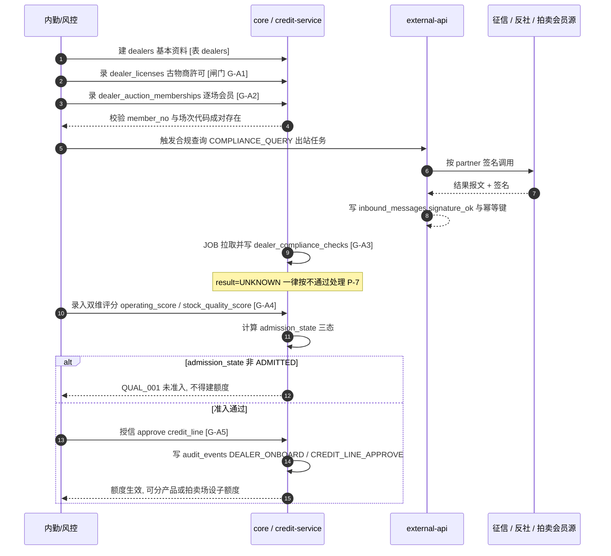

**建模要点**
- 四道闸门 **A1 許可 / A2 逐场会员 / A3 合规 / A4 双维评级** 全部 fail-closed，任一 `UNKNOWN` 即拒。
- 双维评分**不可互相推导**（D03 §3.1）：图上没有从 `operating_score` 指向 `stock_quality_score` 的边，评审可用此图反查实现是否偷偷推导。
- 子额度（R1.3）：`credit_lines` 现状只有 `dealer_id` 一级；若采用「分产品/分拍卖场子额度」，
  则 §3.4 的额度占用需改为**先占子额度、不足再回落到母额度**，本图未展开（`[待定源 U-02]`，需求书 R1.3 未给算法）。

### 3.2 步 2：拍卖场落札与结算（R4）

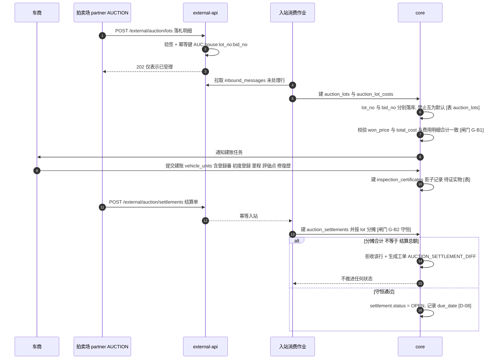

**建模要点**
- 拍卖场既可能推 API，也可能只给门户/文件（`[待定源 D-04]`）。两种形态在图上**共用同一个 `inbound_messages` 入口**，
  差别只在 `partners.protocol`；因此核心侧代码路径唯一——这是把「接口形态未定」和「业务逻辑未定」解耦的关键设计。
- **G-B2 分摊守恒**是硬校验：不守恒宁可拒收，不许「先入账后调整」（避免制造需要人工兜底的脏数据）。

### 3.3 步 3：估值与单台准入（R3）

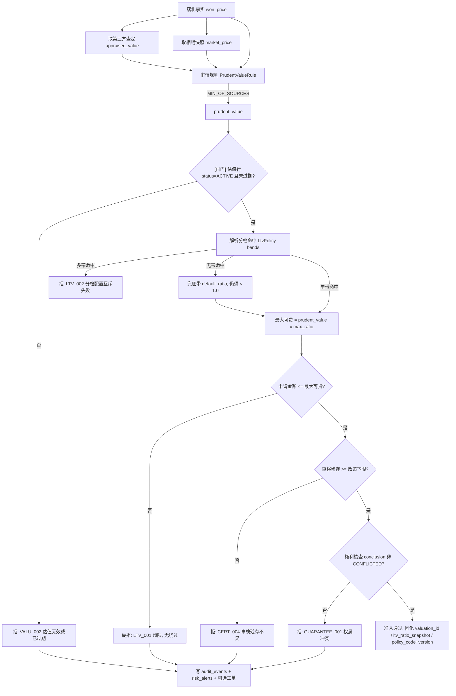

**建模要点**
- 审慎值只允许**在已登记的源之间取小**；`INTERNAL_DEGRADED` 不得作为 `ADVANCE_BASE`（D03 §2.4 I3）——
  图上体现为：降级分支不进入 `PV` 的可用路径。
- 命中结果必须**固化快照**（`ltv_policy_code` + `version` + `ratio_snapshot`），
  否则政策改版后历史放款无法复现「当时为什么放这个数」。
- 本图是 D08 的入口视图；分档区间与阈值的具体语义见 D08 §4。

### 3.4 步 4：垫款申请、额度占用与付款（R5 前半）

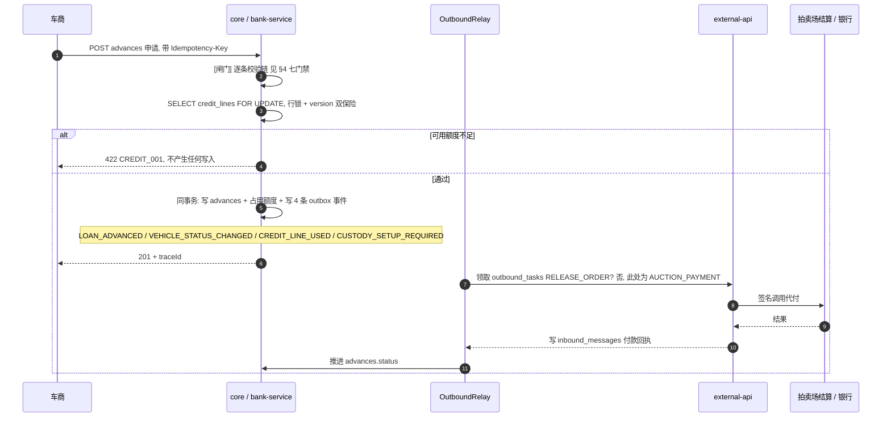

**建模要点**
- **额度占用与事件写入必须在同一事务**（D02 §9 禁止事项 1）；图上是一个 `CORE->>CORE` 自环，落代码时是一个 `@Transactional` 方法。
- 代付对象是**拍卖场结算账户**而非车商（ADR-007 上游直付口径的 USED 延伸，`[待定源 D-01]`）；
  若 D-01 裁决为「付车商」，则本图最后四条边改向 `BANK` 的车商账户，业务状态机不变。

### 3.5 步 5：实车入监管仓与起息（R6）

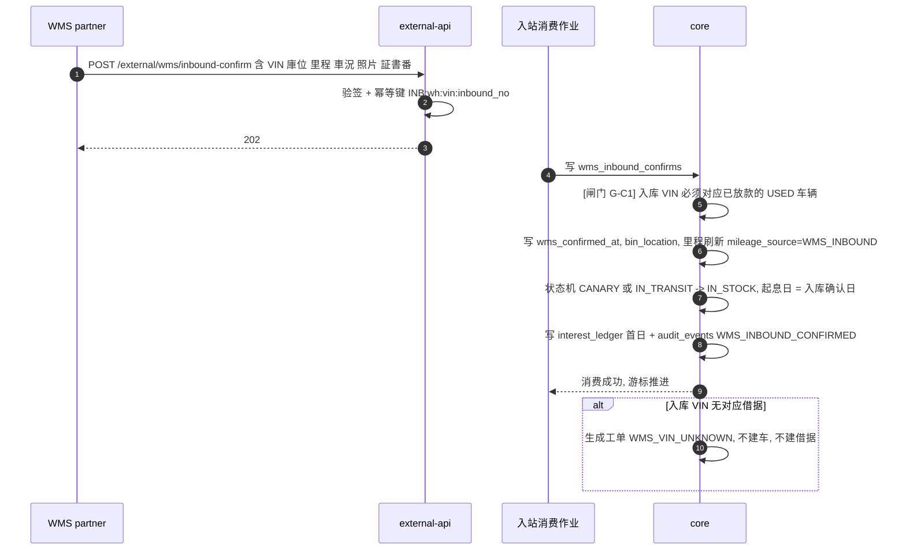

> **起息日为什么绑入库确认而不是放款日**：R6.2 的验收点是「入库确认成为 `IN_STOCK` 前置」。
> 若 D-03/D-09 裁决允许先放款后入库的宽限窗口，则图上 `G-C1` 需加一个带时限的 `TRANSIT` 中间态（D03 §3.3 已预留）。

### 3.6 步 6：車検証质押与担保设定（R5 / R7 前半，两段式解押的第一段的镜像）

```mermaid
sequenceDiagram
    autonumber
    participant OP as 内勤
    participant CD as 凭证保管方 / 登记代办
    participant EXT as external-api
    participant JOB as 作业
    participant CORE as core
    OP->>CORE: 登记 inspection_certificates 证实物收到 status=RECEIVED [闸门 G-D1 証書番与VIN一致]
    CORE->>CORE: 一车一证部分唯一索引兜底, 违反则 CERT_002
    OP->>CORE: 指定 holder_custodian_code + holder_type
    CORE->>CORE: 实体交付 -> PLEDGED + certificate_custody_events [事件 CERTIFICATE_PLEDGED]
    OP->>CORE: 提交登记识别信息核查 REGISTRY_AGENT 渠道 [G-D2]
    CORE->>CORE: financing_lien_checks 写结论, conclusion=CONFLICTED 直接阻断
    OP->>CORE: 委托抵当権设定 / 所有权移転登録 registration_applications
    CORE->>EXT: 出站 COMPLIANCE/REGISTRY 查询
    CD-->>EXT: 登记完成回执
    EXT-->>JOB: 入站
    JOB->>CORE: registration_applications.status=COMPLETED
    CORE->>CORE: collateral_registration_batches 记权属权威源 + 顺位
    CORE->>CORE: vehicle_units.security_status=REGISTERED（仅状态；权威源列已于 D04 §5.1 撤销，见 D13 G13）
    Note over CORE: 至此 §4 门禁 5 才可能通过; guarantee-gate 开关状态见 D02 §10 R-4
```

**建模要点**
- 质押的**生效点是实体交付（PLEDGED）**，登记完成只影响 `security_status`；两者在图上分属两条边，
  避免「登记没完成就当质押不成立」或「登记完成就当凭证已到手」两种反向误判。
- 核查渠道不含厂商门户（D00 §8.2，`OEM_PORTAL` 仅 LEGACY）。

### 3.7 步 7：在库监管（R3.4 / R6.3 / R9）

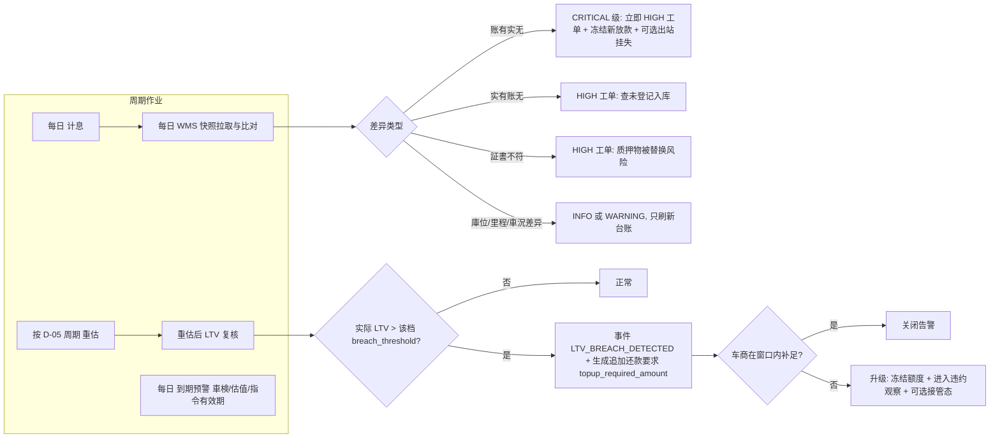

> 四类差异的严重级与处置动作在 D03 §6.5、D09 §7 定义；本图只画因果，不画实现。
> 「冻结新放款」与「冻结额度」是两个不同动作（前者只挡新增，后者影响存量回补顺序），实现时不可混用同一列。

### 3.8 步 8–9：售出与回款匹配（R9）

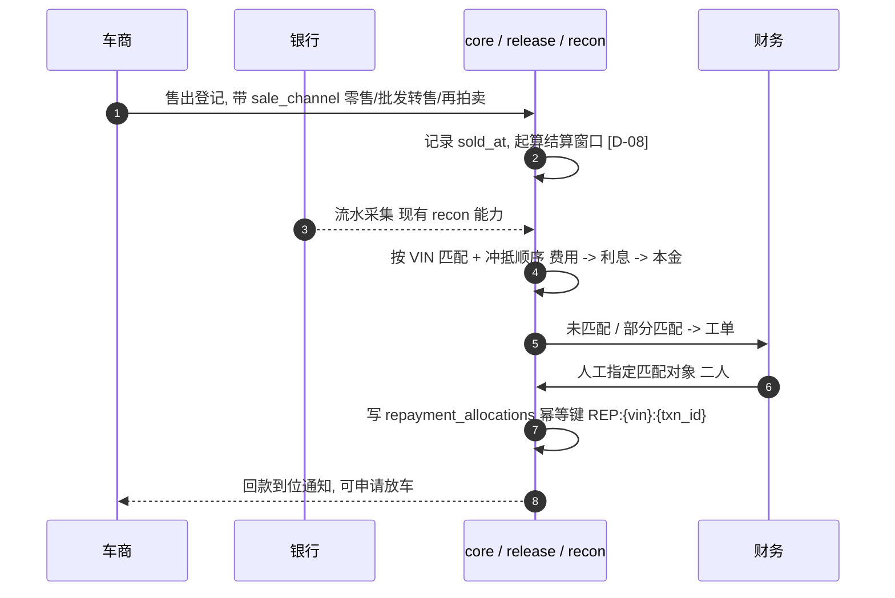

**建模要点**
- 回款**必须入指定账户**（需求书步 9 前置 R9.1）；图上没有「现金直抵」边。
- 冲抵顺序固定为 **费用 → 利息 → 本金**；若 D-01 或财务口径要求「利息优先」，须书面裁决后改 `settle()` 内部顺序，不改本图拓扑。

### 3.9 步 10–11：放车闭环（R7，红线区）

见 §5 专章。

### 3.10 步 10–12：放证与登记抹消（平行线）

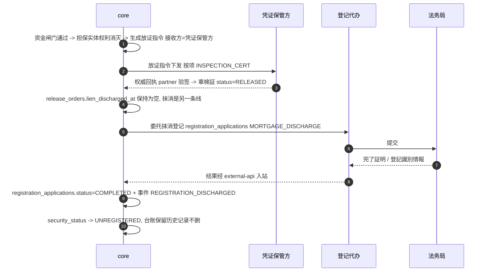

> **两条线不可合并**：放车/放证是「占有与交还」，抹消登记是「公示对抗要件的消除」。
> 图上 `lien_discharged_at` 在回执后即留空，登记完成后另记 `registration_applications.completed_on`。
> 混淆这两点正是现状 Q11 与代码 `RELEASED -> LIEN_DISCHARGED` 语义打架的根源（需求书 §6.2 注、D-07）。

### 3.11 步 7 兜底：账实对账全链

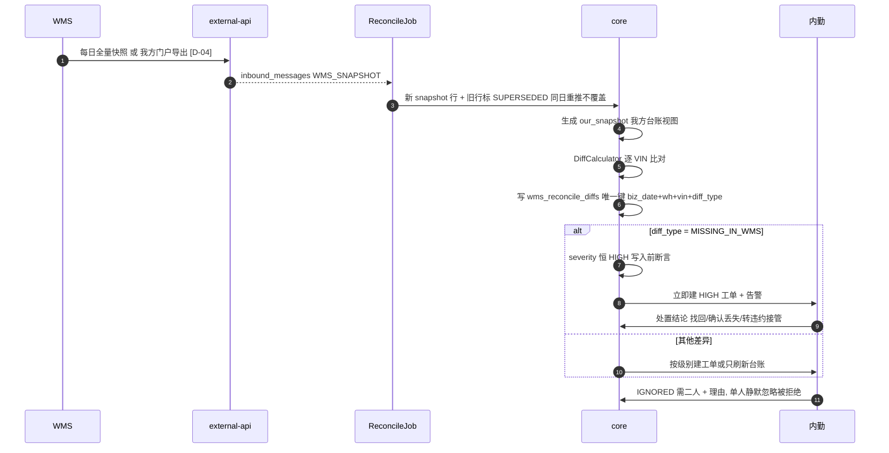

### 3.12 步 12 之外：违约处置与变现（R10）

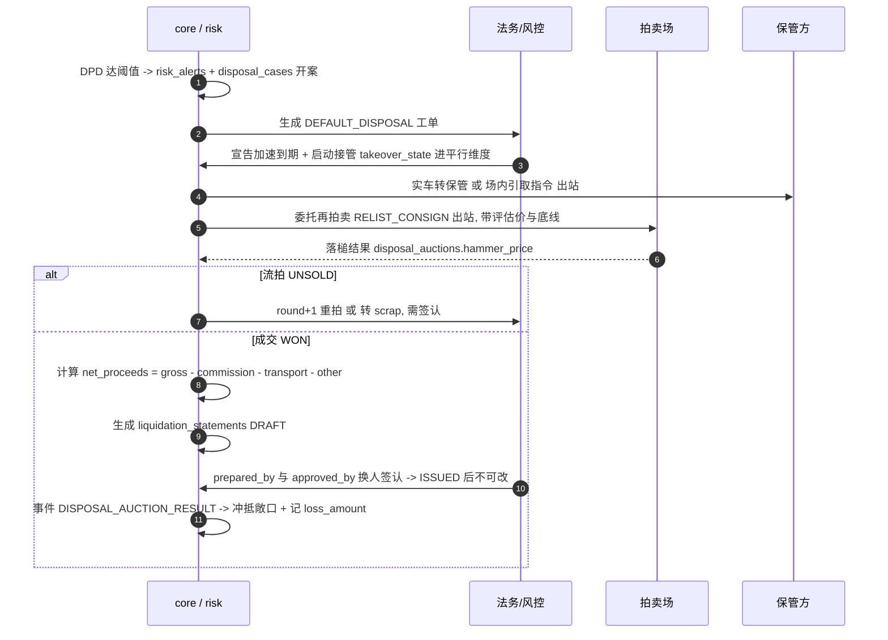

> `takeover_state` 是**并行维度**而非改写 `VehicleStatus`（D03 §6.6）：图上处置期间车辆状态仍可能停在 `IN_STOCK`/`OVERDUE`，
> 但放车/放证指令的下发被 `outbound_blocked` 挡住。这样做的代价是查询要带两个条件，收益是 LEGACY 状态机测试零改动。

---

## 4. 放款门禁判定活动图（七闸门，fail-closed）

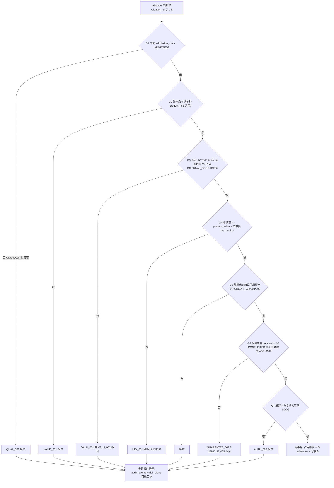

> 顺序刻意把**便宜且无副作用**的检查放前面（G1/G2），把**需要行锁**的额度检查（G5）放后面，
> 减少锁持有时间；但 G5 之后的任何失败都必须整事务回滚，不允许「先占额再判 G6」。
> 七闸门与 `RoleSeparationPolicy` / `GuaranteeGatePolicy` 现有实现的对应关系在 D06 §4，
> 其中 G6 在 `floorplan.core.guarantee-gate.enabled=false` 时**只告警不阻断**（D02 §10 R-4，不许擅自打开）。

---

## 5. 放车放证闭环（两段式解押）

### 5.1 九步全景

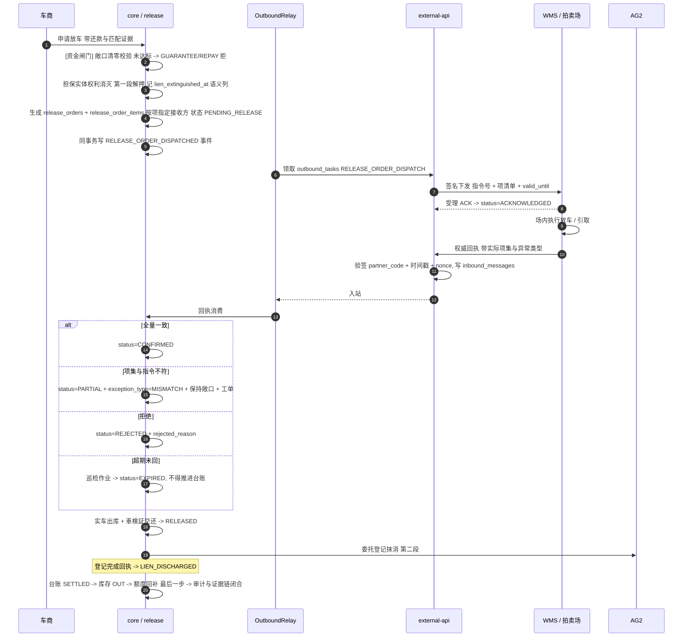

### 5.2 红线 1：禁止路径对照

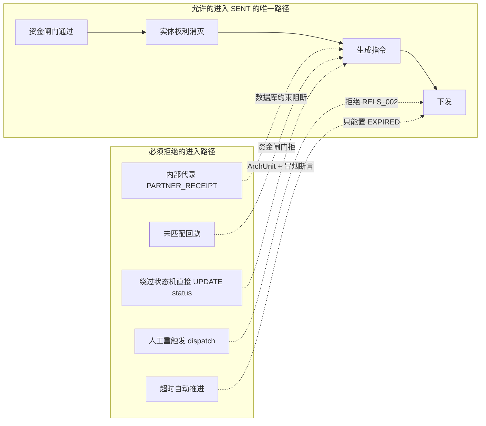

### 5.3 红线 2：台账推进的前置

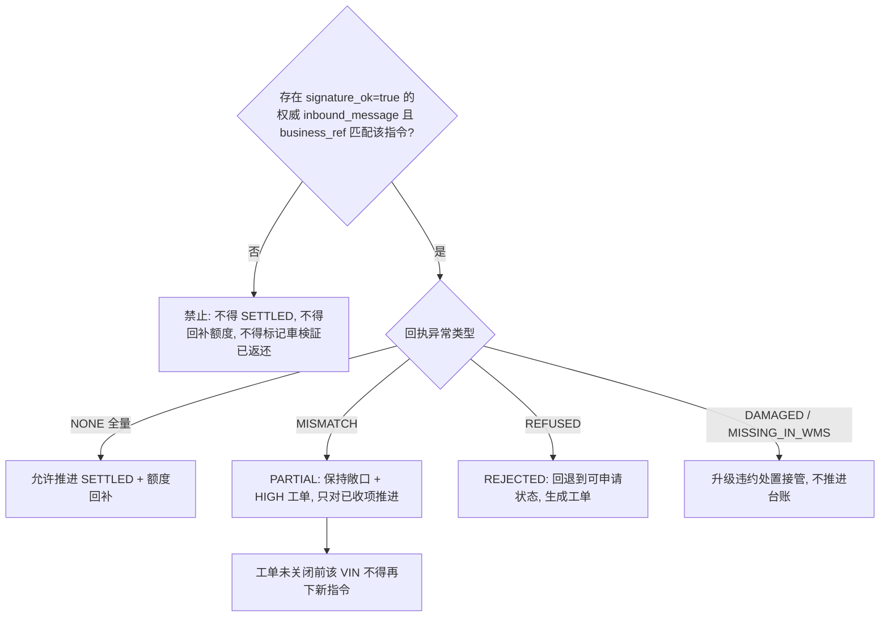

> `RELEASED` 之后、`LIEN_DISCHARGED` 之前，**登记簿上仍有我方权利**。
> 这期间若发生第三方主张（旧担保权人、竞卖、差押），处置依据是登记簿而非系统内 `lien_discharged` 标记——
> 所以 §5.1 最后一段的「额度回补」必须是整链的**最后一个动作**，不能提前（步 12 括注「额度回补（最后）」）。

### 5.4 指令状态机（十态，与 D03 §6.3 同图）

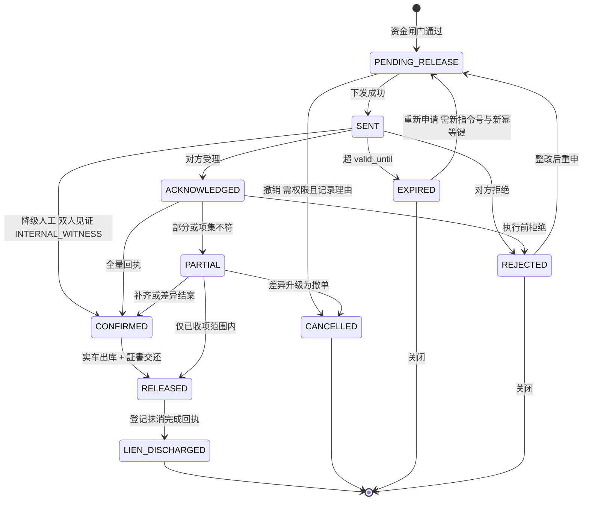

---

## 6. 集成链路活动图（INV-1 / INV-3 的可视化）

### 6.1 入站三分支

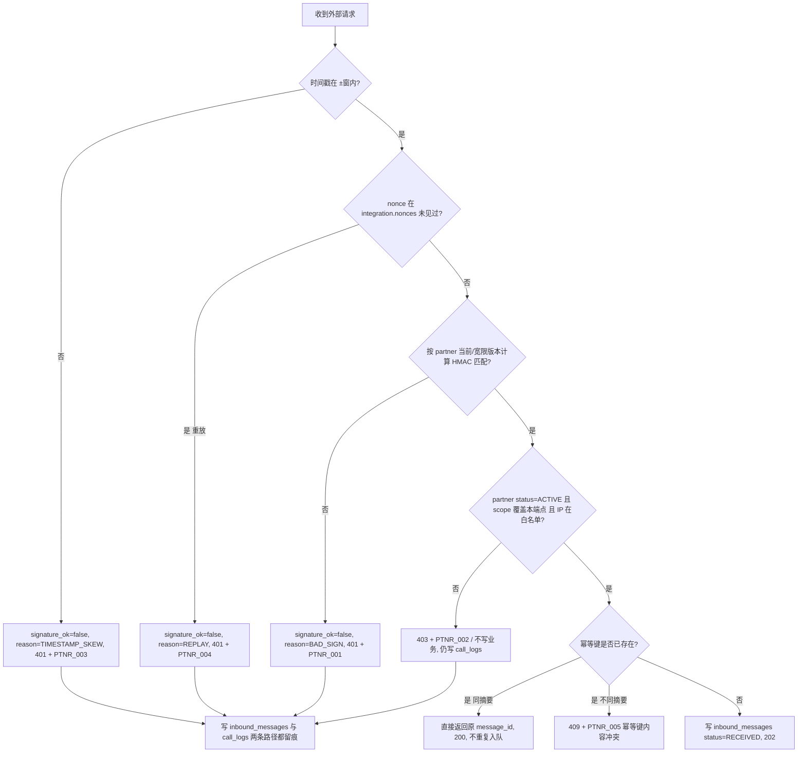

> 三类失败（`TIMESTAMP_SKEW` / `REPLAY` / `BAD_SIGN`）**都必须落库**，否则无法做重放攻击的取证分析。
> 这是 R11.3「全量留痕」的具体形态。

### 6.2 出站任务状态机（D02 §5.4 的流程视图）

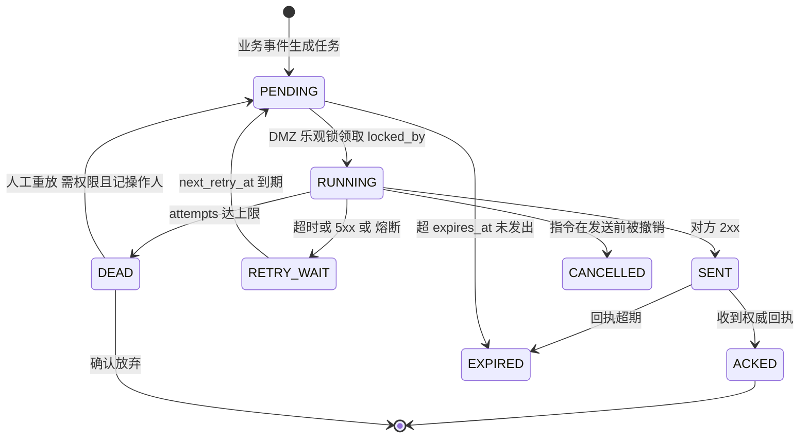

> `RETRY_WAIT` 与 `PENDING` 分列的意义：**可重放**（任务从未发出，重试无害）与
> **可能已发出**（需先查对方状态再决定重试）在业务上完全不同。`SENT` 态不自动重投，只等回执或超时。

---

## 7. 异常与补偿矩阵

| # | 异常 | 检测点 | 系统动作 | 补偿 / 恢复 | 状态是否回退 |
|---|---|---|---|---|---|
| X-1 | 落札行费用合计 ≠ total_cost | G-B1 | 拒收 + `AUC_002` + 工单 | 请对方重推（新 nonce/新幂等键行） | 是，不建 lot |
| X-2 | 结算分摊不守恒 | G-B2 | 拒收 + `AUC_005` + 工单 | 重新导入结算单 | 是 |
| X-3 | 放款事务回滚 | — | outbox 同生共死，无事件残留 | 无需补偿 | — |
| X-4 | 消费端 3 次失败 | `EventDispatcher` | 事件置 `DEAD`，**游标仍推进** | 人工重放事件 + 幂等键保证重复消费无效 | 否 |
| X-5 | 指令下发后 DMZ 宕机 | `outbound_tasks` 卡 `RUNNING` | 巡检发现超 `locked_at` 时限未更新 → 回 `RETRY_WAIT` | 领取超时重投（幂等键 `RLO:{order_no}` 保证对方侧不重复执行） | 否 |
| X-6 | 回执超期 | 巡检 + `valid_until` | `EXPIRED` + 工单 `RELEASE_RECEIPT_OVERDUE` | 联系对方补推；**不得**代录 | 否（禁止自动推进） |
| X-7 | 回执项集不符 | 消费时比对指令项 | `PARTIAL` + `MISMATCH` + 敞口保持 | 差异结案或二次指令 | 部分推进 |
| X-8 | 账有实无（车丢了） | 对账 diff | 恒 HIGH + 冻结新放款 + 可选出站挂失 | 转处置接管 R10 | 台账不变（先取证） |
| X-9 | 估值过期 / 被新行取代 | 巡检 + `uk_val_active` | 估值 `EXPIRED`，申请时 `VALU_002` 拒 | 重估生成新行 | 是（阻断新申请，不动存量放款） |
| X-10 | 权属核查结论 `CONFLICTED` | G-D2 / G6 | `GUARANTEE_001` 拒付 | 法务清权后重核 | 是 |
| X-11 | 重复融资嫌疑（同 VIN 多敞口） | ADR-010 防线 | `VEHICLE_005` 拒付 + 告警 | 人工判定 | 是 |
| X-12 | 伪造外部回执尝试 | §6.1 验签 + §5.3 CHECK 约束 | 数据库层不可能；API 层 401 | 安全审计 + partner 熔断 | — |
| X-13 | 幂等键同键不同摘要 | §6.1 S5 | 409 `CONFLICT_001` | 对方换新键 | — |
| X-14 | `call_logs` 暴涨 | 容量巡检 | 归档到本地冷存 | 分区/滚动 | — |
| X-15 | 再拍卖流拍 | `disposal_auctions.status=UNSOLD` | 告警 + 工单 | round+1 或转 scrap，需签认 | 敞口不消 |

---

## 8. 典型周期时间轴（示意，数值随 `[待定源 D-08]` 调整）

```mermaid
gantt
    title 单车全周期典型时点（示例轴，非承诺值）
    dateFormat YYYY-MM-DD
    axisFormat %m-%d
    section 采购与放款
    落札与明细入站           :a1, 2026-01-05, 1d
    结算单与分摊守恒         :a2, after a1, 3d
    估值与分档 LTV 判定      :a3, after a2, 1d
    垫款申请与代付拍卖场      :crit, a4, after a3, 2d
    section 实控建立
    实车入监管仓与入库确认    :b1, after a4, 2d
    車検証收取与质押         :b2, after b1, 1d
    担保设定与登记完成       :b3, after b2, 7d
    section 在库
    计息与每日快照对账        :c1, after b3, 40d
    定期重估与 LTV 复核      :c2, after b3, 40d
    section 退出
    售出与回款入指定账户      :d1, after c1, 5d
    资金闸门与实体权利消灭     :d2, after d1, 1d
    指令下发到权威回执       :crit, d3, after d2, 3d
    登记抹消完成             :d4, after d3, 10d
```

**时限类参数一览**（评审时逐项确认业务事实）

| 时限 | 驱动对象 | 默认值来源 | 到期动作 |
|---|---|---|---|
| 拍卖场结算窗口 | `auction_settlements.due_date` | `[D-08]` | 逾期预警 + 敞口挂账 |
| 估值有效期 | `vehicle_valuations.valid_until` | `[D-05]` | 置 `EXPIRED`，新申请拒 |
| 指令有效期 | `release_orders.valid_until` | 现状列，沿用 | 置 `EXPIRED` + 工单 |
| 回执 SLA | `partners.receipt_sla_hours` | `[待定源 U-09]` | 超时告警，不自动推进 |
| 車検残存下限 | `ltv_policy_bands.inspection_remaining_min` | `[D-06]` | 拒付 |
| 合规检查有效期 | `dealer_compliance_checks.valid_until` | `[D-02]` | 年审提醒 + 准入降级 |
| 出库宽限期 | `vehicle_units.status` 前置 | 需求书 R6 | 超期强制对账 |
| 豁免窗口 | `aging_plans.rule_code` 豁免 | `[D-05]` | 二人签认 + 审计 |

---

## 9. 与既有口径的衔接点（避免画两张皮）

| 衔接 | 现状 | 本流程的处置 |
|---|---|---|
| Q11「先解押后发指令」 | 代码 `RELEASED -> LIEN_DISCHARGED` | 采用**两段式**：实体权利消灭（步 10，指令前）+ 登记抹消完成（`LIEN_DISCHARGED`，回执后）。图 §5.1 步骤 3 与倒数第 2 步分别对应 |
| Q21 无登记不放款 | `guarantee-gate` 默认关 | G6/G7 保持阻断语义；开关状态按 D02 R-4 不动，图上明确标注「只告警」的边界 |
| Q27 权属唯一权威源 | V10 批次表 | 图上所有权属结论只从 `collateral_registration_batches` 出，不从 `vehicle_units.security_status` 反推 |
| ADR-010 同 VIN 多敞口 | 已有防线 | X-11 直接复用，不另建 |
| Q14 DPD 自然日 | `DpdCalculator` | 处置触发按自然日，图上不重复定义 |
| 外部五层防线 | ADR009 Proposed | §6.1/§6.2 是第 4、5 层的具体时序，第 1–3 层（网络/入口/网关）属部署视图，见 D02 §8 |

---

## 10. 自检

- 12 步主流程逐步映射到 §2 全景 + §3 分阶段，无步骤只在文字里出现而不在图上出现。
- 两条红线各自有**结构表达**（§2 无旁路边、§5.2/§5.3 禁止路径图），不是口号。
- 所有「人工」节点均带操作人与审计要求；所有闸门标 `[G-x]` 可回查 D06。
- 时序图中的每一次外部触达都经过 `external-api`，无 `CORE` 直连外部、无外部直推 `CORE`（INV-1/INV-2）。
- 与 LEGACY 的差异只出现在**新增泳道与新增闸门**上，未改写现有状态机语义（§3.12 用并行维度、§5.4 十态为追加超集）。
- 未签字项已在 §0 列表标注影响面：`D-01`（付款对象）/`D-04`（报文形态）/`D-05`（重估周期）/`D-06`（分档参数）/`D-07`（两段式）/`D-08`（结算窗口）/`D-09`（钥匙与封签）/`U-02`（证书 6 态）/`U-09`（回执 SLA 与效力分级）。
