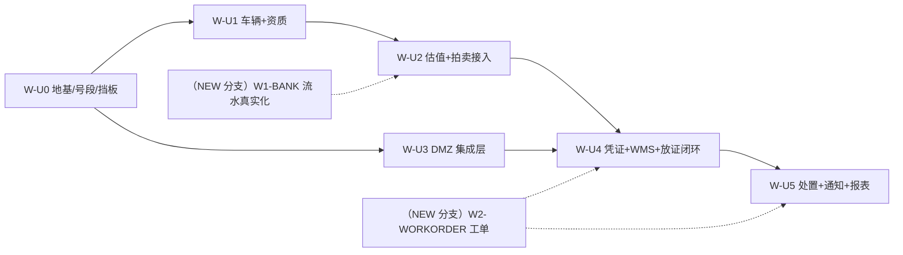
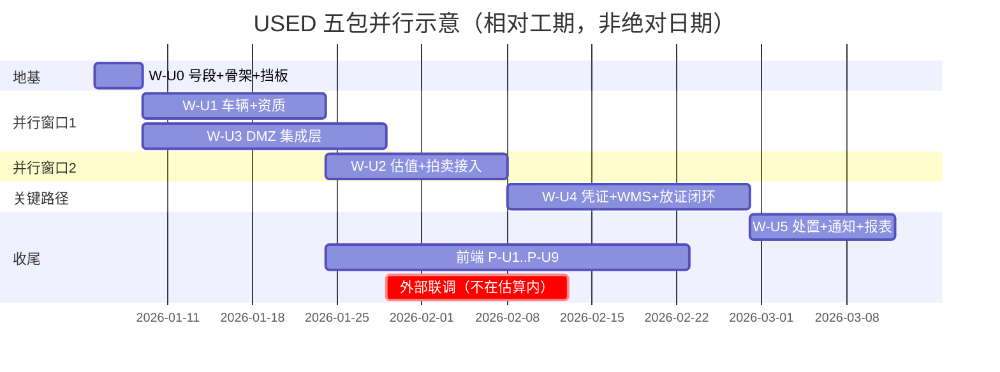

# 二手车库存垫资改造 · D12 任务拆分与并行开发方案

> 上游：需求书 §12（五波次 S1–S5）与 §13（并行开发注意）、D02 §6.1（服务归属与写入集边界）、
> D04 §2（号段 V40–V79）、D06（用例清单）、D07 §5/§7（契约与端点清单）、D09/D10/D11。
> **本文是执行计划，不是设计**；口径以 D01–D11 为准，本文只负责拆包、排依赖、定写入集与门禁。
> 开发暂缓阶段：本文先定形态，等签字后按包启动。

---

## 0. 文档控制

| 项 | 内容 |
|---|---|
| 编号 | DESIGN-USED-FLOORPLAN-D12 |
| 版本 | v0.1（草案） |
| 包数 | **6 个**（W-U0 收口 + W-U1…W-U5 五个开发包） |
| 建议并行度 | **最多 3 个 agent 同时在写**（W-U1/W-U2/W-U3 可并行；W-U4 需等 W-U2+W-U3；W-U5 最后） |
| 号段 | `V40`–`V79`（跳 `V32`–`V39` 留缓冲，见 §5） |
| 分支 | 每包一支 `docs/used-floorplan` 之后的 `feat/used-<pkg>`，由收口方合回 |
| 前提 | 需求书 §5 的 R1–R14 与 §11 的 A1–A10 **不可拆分交付**（需求书 §12 明言） |

---

## 1. 包定义总览

| 包 | 名称 | 覆盖需求 | 对应波次 | 依赖 | 里程碑 |
|---|---|---|---|---|---|
| **W-U0** | 收口与地基对齐 | 号段登记、脚手架、挡板、CI | S1 前 | 无 | M-U0 |
| **W-U1** | 二手车车辆与车商资质 | R1、R2、R3.1（字段与建账部分） | S1 | W-U0 | M-U1 |
| **W-U2** | 多源审慎估值与拍卖接入 | R3、R4（I-01/I-02 消费侧） | S2 | W-U1；`external-api` 骨架 | M-U2 |
| **W-U3** | 外部接口 DMZ 隔离层 | R11（I-01…I-12 传输侧） | S2 与 S4 之间**必须前置** | W-U0 | M-U3 |
| **W-U4** | 凭证质押、WMS 与放车放证闭环 | R5、R6、R7、R8 | S3 + S4 | W-U2、W-U3 | M-U4 |
| **W-U5** | 逾期处置、通知与报表 | R9、R10、R12、R13、R14 | S5 | W-U4 | M-U5 |

**为什么 W-U3 要提前**：需求书 §12 把它放在 S2/S4 之间是有原因的 ——
I-07 回执是放车闭环的**唯一合法证据来源**。若 DMZ 层晚于 W-U4，放车就只能再次退化成人工代录，
闭环会第二次烂尾（D00 §7.3 的判断，也是需求书 §13.4 的原话「不要依赖外部接口就绪才做内部状态机」的对偶）。
**结论：状态机与业务逻辑可以先写（用测试 partner），但结清语义必须等 W-U3 落地才算完成。**

---

## 2. 依赖图与并行窗口



**并行窗口**

| 窗口 | 可同时进行的包 | 备注 |
|---|---|---|
| 窗口 1 | W-U1、W-U3（+ NEW 分支 W0/W1） | 两者写入集几乎不相交（W-U3 只碰 `integration` 与新服务） |
| 窗口 2 | W-U2、W-U3 收尾 | W-U2 依赖 W-U1 的 `vehicle_type='USED'` 建账 |
| 窗口 3 | W-U4（1–2 人）+ NEW 分支 W2 前端 | W-U4 是收口关键路径 |
| 窗口 4 | W-U5 | 需要 W-U4 已全绿，不与别人并跑冒烟 |

**与 NEW 分支（在途 W0–W3）的摩擦点与顺序要求**

| # | 摩擦点 | 冲突类型 | 处理 |
|---|---|---|---|
| F1 | `V26` 已被 W0-4 占用 | 号段 | USED 直接用 V40+，**不动 V27–V31**；合并前双方都核对 `PROGRESS.md` 登记表 |
| F2 | `EventDispatcher` / `JdbcOutboxPublisher` 行为 | 框架 | USED **只注册 handler，不改框架**；改动须经 W0 窗口批准 |
| F3 | outbox 去重键（NEW D4 要改 `aggregate_key` 语义） | 语义 | 在 NEW 落地前，USED 用 `vin + 业务周期` 前缀规避（D02 §9.1） |
| F4 | `run-microservices.sh` 新增 `external-api` | 共享禁区 | 由**收口方**改；USED 分支只提交需求说明（AGENTS.md §7.1） |
| F5 | 网关新增 `certificate-reg-service` 路由 | 共享禁区 | 同上，路由文件只有 W3 能改 |
| F6 | `smoke-test.py` 合并 | 共享禁区 | 各包只写 `scripts/smoke_used_*.py`，收口方合并 |
| F7 | `SqlStructureSelfCheck.java:43-52` 白名单 | 同类可并存 | W-U1 提交**追加 diff**（D04 §9.2 给了格式），两边都是追加不冲突 |
| F8 | 前端 `app.js` 导航 | 共享禁区 | USED 前端页面走 NEW 分支 W2 的波次，或本方案单列 §6.3 |
| F9 | `web/` 目录膨胀 | 组织 | W-U1 起就禁止再往 `web/` 塞 USED Controller（D02 §10 第 1 条） |

---

## 3. 包详表

### W-U0 收口与地基对齐（0.5 周，1 人）

| 项 | 内容 |
|---|---|
| 交付 | ① `PROGRESS.md` 登记 V40–V79 号段；② `external-api`、`certificate-reg-service` 两个**可启动的空服务**（yml + 启动类 + pom）；③ 挡板 `FakePartnerServer` + 6 个测试 partner 种子数据（脚本，不进生产配置）；④ `scripts/smoke_used_*` 命名约定与合并流程；⑤ `floorplan_dmz` 角色在本地 PG 建好（**不等 V70**，先手工建，V70 里用 `DO $$` 幂等兜底） |
| 写入集 | 新目录 `external-api/`、`certificate-reg-service/`（仅骨架）、`scripts/`、收口方自己的 `PROGRESS.md`/`run-microservices.sh`/`gateway` 路由 |
| 门禁 | `mvn -B package` 全绿 + `run-microservices.sh start/stop` 正常（此时 **15→17 个构建单元**，AGENTS.md §5 的「15 个」需由收口方更新为实际数） |
| 风险 | 两个空服务会被误认为「已拆分」（AGENTS.md §12 反模式第 1 条）→ 在 D02 §12 的 M-U0 里明确写「骨架 ≠ 能力」 |

### W-U1 二手车车辆与车商资质（2–3 周，1–2 人）

| 项 | 内容 |
|---|---|
| 覆盖 | R1.1–R1.5、R2.1–R2.4、R3.1（字段定义与建账） |
| 用例 | `UC-R1-1`…`UC-R1-7`、`UC-R2-1`…`UC-R2-5` |
| 迁移 | V40–V47、V50–V54、V57–V58、V67、V75、V77、V78 |
| 新表 | `dealer_licenses`、`dealer_auction_memberships`、`dealer_compliance_checks`、`vehicle_condition_reports`、`inspection_certificates`、`certificate_custody_events`、`registration_applications` |
| 服务 | `web`(core) 资质端点 + `used-vehicle-service` 建账扩展 |
| 端点 | I-10 的内部端点子集（`/api/dealers/{id}/license*`、`/compliance*`、`/admission-state`）+ `POST /api/vehicles/used` + `GET /api/vehicles/{vin}/evidence-chain` |
| 事件 | 仅发布 `DEALER_ADMISSION_STATE_CHANGED`；**不消费**外部报文 |
| 冒烟 | `smoke_used_dealer.py`(12) + `smoke_used_vehicle.py`(16) |
| 门禁 | A7.3/A7.4 的资质部分；一车一证 `uk_cert_active_vin` 生效；`mileage UNKNOWN` 可表达；**L4 LEGACY 建账回归不破** |
| 不做 | 不做质押生效语义（W-U4）、不做抵押登记（W-U4）、不做额度 |

### W-U2 多源审慎估值与拍卖接入（2–3 周，1–2 人）

| 项 | 内容 |
|---|---|
| 覆盖 | R3.2–R3.8、R4.1–R4.6、**R3.5/R3.6 的放款基准切换** |
| 用例 | `UC-R3-1`…`UC-R3-9`、`UC-R4-1`…`UC-R4-7` |
| 迁移 | V48、V55–V56、V59、V60–V64 |
| 新表 | `vehicle_valuations`、`valuation_inputs`、`valuation_market_snapshots`、`ltv_policies`、`ltv_policy_bands`、`auction_houses`、`auction_lots`、`auction_lot_costs`、`auction_settlements`(+items) |
| 服务 | `used-vehicle-service` + `credit-service` + `bank-service`（拍卖支付消费 `BANK_TX_MATCHED`） |
| 端点 | `POST /api/valuations`、`POST /api/valuations/{vin}/override`、`GET /api/valuations/{vin}`、`POST /api/ltv-policies`、`POST /api/ltv-policies/{code}/activate`、`GET /api/auction-lots*`、`POST /api/auction-settlements/{id}/confirm` |
| 事件 | 发布 `VEHICLE_APPRAISED`、`LOT_WON`、`AUCTION_PAY_REQUESTED`、`AUCTION_OVERDUE`；消费 `BANK_TX_MATCHED`（**幂等键 `AEF:*`**） |
| 冒烟 | `smoke_used_valuation.py`(24) + `smoke_used_auction.py`(18) |
| 门禁 | **A6 全组**（112 而非 180）；估值覆盖二人；分档唯一命中无兜底；`SELF_PAY` 走真实资金不再恒 `SUCCEEDED`；结算守恒 `AUC_005`；**P20 重估不回溯** |
| 关键顺序 | 放款基准切换（D08 §5.1 四步）**必须在本包一次做完**，不留「新公式实现了但没人调」的窗口 |
| 依赖缺口 | 自动评估询价若需外部调用，走 W-U3 的 I-06；W-U3 未就绪时只实现「人工录入 + 内部降级源标记」，并断言降级源不可作基准（A6.5） |

### W-U3 外部接口 DMZ 隔离层（3–4 周，1 人 + DBA 半天）

| 项 | 内容 |
|---|---|
| 覆盖 | R11.1–R11.6 |
| 用例 | `UC-R11-1`…`UC-R11-7` |
| 迁移 | V70–V74 |
| 新表 | `integration.schema` 五表 + 角色授权 |
| 服务 | **`external-api`（新部署单元）** + core 侧两个轮询作业 + `common/contract` 六个新契约 |
| 端点 | 对外 12 个 I-*；管理端 `GET/POST /api/partners*`、`POST /api/partners/{code}/rotate-key`、`/scope`、`GET /api/integration/call-logs` |
| 事件 | 核心侧只读 `integration.inbound_messages`（**不是 outbox 事件**），发布 `EXTERNAL_*` 事件 |
| 冒烟 | `smoke_used_integration.py`(20)，**含 INV-1..5 的证伪实验**（D11 §4） |
| 门禁 | **A5 全组**（四类验签失败留痕）；`floorplan_dmz` 对 `public` 零权限；密钥任何接口/日志/报文不可见（INV-4）；`signature_ok=false` 永不被消费 |
| 硬约束 | ① 回执 `PARTNER_RECEIPT` 只能由验签通过的入站派生（**禁止请求体自带该字段**，D07 §13 第 5 条）；② `call_logs` 不含完整报文正文；③ 密钥不落 yml/表/代码 |
| 外部协作 | 需要 DBA 在生产建角色并确认默认权限生效；需要网络团队确认 DMZ 只出方向 |

### W-U4 凭证质押、WMS 与放车放证闭环（3–4 周，2 人，关键路径）

| 项 | 内容 |
|---|---|
| 覆盖 | R5.1–R5.8、R6.1–R6.7、R7.1–R7.5、R8.1–R8.4 |
| 用例 | `UC-R5-1`…`UC-R5-9`、`UC-R6-1`…`UC-R6-7`、`UC-R7-1`…`UC-R7-6`、`UC-R8-1`…`UC-R8-3` |
| 迁移 | V65–V66、V68–V69、V76 |
| 新表 | `wms_inbound_confirms`、`wms_inventory_snapshots`(+items)、`wms_reconcile_diffs`、`certificate_registrations`（`certificate-reg-service` 只读投影） |
| 服务 | `release-service`、`collateral-reg-service`（**转正**：首个 Controller + Repository + 表）、`web`(core) 解押编排 |
| 端点 | 放车 8 个（含 **`/cancel` 新建**、`/evidence-chain`）、凭证 6 个、登记 4 个、WMS 4 个 |
| 事件 | 发布 `CERTIFICATE_PLEDGED/RELEASED/LOST/REISSUED`、`VEHICLE_INBOUND_CONFIRMED`、`WMS_DIFF_DETECTED`、`LIEN_DISCHARGE_REQUESTED/DONE`、`VEHICLE_RELEASE_APPROVING/RELEASED/SETTLED`、`TOPUP_REQUESTED`、`EXTENSION_REQUESTED`；消费 `BANK_TX_MATCHED`/`VEHICLE_RELEASED`/`VEHICLE_REGISTERED`/`LOAN_REPAID`/`EXTENSION_APPROVED` |
| 冒烟 | `smoke_used_certificate.py`(20) + `smoke_used_wms.py`(10) + `smoke_used_release.py`(26，**含 E2E-0**) |
| 门禁 | **A1、A2、A3、A4、A8、A9 全组**；D09 §12 的 RL-1a..d/RL-2a..d/RL-3..RL-7；证据链八条闭合；10 态状态机穷举；**L1 的 LEGACY 6×6 白名单一条不改** |
| 跨包依赖 | 工单（`TOPUP_REQUESTED` 等）依赖 NEW 分支 **W2-WORKORDER**；未就绪时用降级落点（D06 §15 表尾）并在 `PROGRESS.md` 标注 |

### W-U5 逾期处置、通知与报表（2–3 周，1–2 人）

| 项 | 内容 |
|---|---|
| 覆盖 | R9.1–R9.4、R10.1–R10.6、R12.1–R12.4、R13.1–R13.3、R14.1–R14.4 |
| 迁移 | V79 |
| 新表 | `disposal_auctions`、`liquidation_statements`（+ 通知表按需） |
| 服务 | `web`(core)、`risk-service`、`recon-service` |
| 端点 | 处置 6 个（含计算书双人复核）、重估 3 个、报表 6 个 |
| 事件 | 发布 `VEHICLE_DEFAULTED`、`DISPOSAL_STARTED/COMPLETED`；消费 `VEHICLE_DEFAULTED`（recon 出敞口） |
| 冒烟 | `smoke_used_disposal.py`(10) + `smoke_used_reporting.py`(8) |
| 门禁 | 双因子只催缴不自动结清；净回收与缺口顺序断言（D08 §8）；计算书 SOD（RB-10）；敞口报表逐日与全量对平（RB-7）；通知**无静默失败** |

---

## 4. 每包「不得触碰」清单（合并前逐条核对）

所有包共同禁区（AGENTS.md §7.1 + D02 §6.1 + D10 §12.2）：

```
PROGRESS.md · smoke-test.py · run-microservices.sh · 父 pom.xml
gateway/src/main/resources/application.yml
web/src/main/resources/static/js/app.js
V1–V26 迁移文件
outbox 框架类（JdbcOutboxPublisher / EventDispatcher / OutboxPublisher）
domain 既有策略类的判定语义（RoleSeparationPolicy / DpdCalculator / ResidualValueEstimator）
ai-service/（不在本期范围）
```

按包追加的禁区：

| 包 | 额外不得改 |
|---|---|
| W-U1 | `PurchaseOrderApplicationService.java` 的 `NEW_STOCK` 硬编码（退役 ≠ 删除）；`VehicleController.java:92` 的 `OEM` 默认值 |
| W-U2 | `AdvanceApplicationService.java:172-177`（LEGACY 公式）；`smoke-test.py:327` 的 0.90 断言 |
| W-U3 | 任何业务服务的结清逻辑（只加传输层）；`release_orders.certificate_no` 的既有写入路径（只加 COMMENT） |
| W-U4 | `ReleaseStateMachineTest` 的 36 组白名单；`ManualReleaseChannel` 的 LEGACY 行为；`ReleaseOrchestrator.java:109` 的语义只能改成真实回补、不能改成"仍等于 before" |
| W-U5 | `AgingRecalcApplicationService` 与 `AgingDpdRecalcPolicy` 的既有 DPD 口径（USED 用新策略类并存） |

**合并前自检命令（每包必跑）**

```bash
git diff --name-only <baseline>..HEAD          # 对照本包写入集
git status --short                              # 确认没卷入别人的 WIP（AGENTS.md §7.2 踩过）
find infrastructure/src/main/resources/db/migration -name 'V*' | sort   # 号段无冲突、无空文件
mvn -B clean package
bash run-microservices.sh smoke                 # 一条命令内完成启动+测试+清理
```

---

## 5. 号段登记（提交给收口方写入 `PROGRESS.md`）

| 块 | 文件 | 归属包 | 备注 |
|---|---|---|---|
| V40–V49 | 字典/参数/资质/供应商目录/`vehicle_units` USED 扩展 | W-U1、W-U2 | 见 D04 §2 |
| V50–V59 | 车辆档案扩展 + 車検証三表 + 估值五表 + LTV 两表 | W-U1、W-U2 | |
| V60–V69 | 拍卖四表 + WMS 四表 + 放车扩展 + 登记 | W-U2、W-U4 | |
| V70–V74 | `integration` schema 五表 + 角色 + 种子 partner | W-U3 | **V74 含 `INSERT` 种子** |
| V75–V79 | 旧列 COMMENT、处置两表、告警扩展、报表索引 | W-U1、W-U5 | |

登记文本（可直接抄进 `PROGRESS.md §6.2 号段表`）：

```
V40–V79  二手车库存垫资改造（USED）   归属 W-U1 / W-U2 / W-U3 / W-U4 / W-U5，分配见
       docs/二手车库存垫资改造-04-数据库设计.md §2
       跳 V32–V39 作缓冲：与在途 W0/W1/W2 的 V27–V31 不冲突；若仍冲突，整块后移并同步 D04 §2
```

---

## 6. 联调与前端安排

### 6.1 外部接口真实联调（不在包内估算）

| 对象 | 前置 | 建议窗口 | 责任人 |
|---|---|---|---|
| USS / TAA 落札与结算（I-01/02） | `[D-04]` 协议调研回收 | W-U3 完成后单列 | 集成负责人 + 业务窗口 |
| オートロック名寄 / 履行書 | 同上 | 同上 | 同上 |
| ユーパック 抹消機関（I-08） | 同上 | W-U4 之前必须确认（否则 `LIEN_DISCHARGED` 无权威来源） | 同上 |
| WMS（I-04/05/07） | 同上 + 回执能力评级 | **决定 U-09 的口径** | 同上 |
| 银行 API（I-03/09） | 依赖 NEW 分支 W1-BANK 真实化 | 与 W-U2 并行调研 | 资金窗口 |
| 外部估价（I-06） | 商务与费用 | 可延后（人工录入 + 降级源已可跑） | 估值窗口 |
| 四hal 合规 API（I-10） | 采购 | 可延后（人工登记已可跑，但 `UNKNOWN` 会阻断放款） | 合规窗口 |

> 需求书 §13.4 的提醒仍然有效：**接口现实 ≠ 接口需求**，联调失败要回改 R2/R3/R5/R6/R7，
> 所以联调排在内部状态机与表结构冻结之后，不是之前。

### 6.2 与 NEW 分支的合并顺序

1. NEW 分支 W0（地基）合入 master → USED 各包**基线重取**（outbox 契约已冻结，D02 §9）；
2. NEW W1 五服务 + W2 工单 → W-U4 消费工单能力；
3. USED 包按 W-U1 → W-U2 → W-U3 → W-U4 → W-U5 顺序合入（**不要乱序**，D09 的结清语义依赖 D06 的放款基准已切换）；
4. 每次合并由收口方跑全量冒烟并更新 `PROGRESS.md`。

### 6.3 前端（8 个模块缺页面）

| 屏 | 模块 | 波次 | 说明 |
|---|---|---|---|
| P-U1 车商资质档案 | 新增 | W-U1 | 三证 + 四类合规 + 准入状态 |
| P-U2 车辆档案（USED） | 新增/改造 | W-U1 | 走行来源、车辆状态、整备成本 |
| P-U3 审慎值与 LTV 试算 | 新增 | W-U2 | 分档命中过程要可见（不只是结果数） |
| P-U4 落札台 | 新增 | W-U2 | 落札 vs 成约差异、逾期 |
| P-U5 車検証台账 | 新增 | W-U4 | 六态 + 保管链 + 换证 |
| P-U6 放车指令 | 改造 | W-U4 | **撤销按钮**、明细项、证据链展示 |
| P-U7 回执与差异 | 新增 | W-U4 | `PARTIAL` 敞口、差异工单 |
| P-U8 处置与计算书 | 新增 | W-U5 | 草案 → 复核 → 退回 |
| P-U9 敞口与合规报表 | 新增 | W-U5 | 未闭合清单、时点快照 |

前端与 NEW 分支 W2 共用 `app.js` 导航表（共享禁区），**导航追加由收口方合并**；
各屏配套 `scripts/smoke_used_ui_*.py`（页面存在 ≠ 功能可用，AGENTS.md §12 反模式第 4 条）。

---

## 7. 未签字口径对排期的影响

| 编号 | 影响包 | 未裁决时的处理 | 裁决后的返工量 |
|---|---|---|---|
| D-01 费用/延滞金 | W-U2（仅字段与枚举） | 建表 + 枚举，不做计算 | 小（新增计算器） |
| D-02 与 NEW 关系 | 全部（双轨隔离已按独立设计） | 按独立客户群实施 | **大**（若改为共用需重做额度与资质维度） |
| D-03 是否建 used 专属服务 | W-U0 决策 | 暂按扩展现有服务 + 一个新 DMZ 服务 | 中（搬迁 Controller） |
| D-04 接口现实 | W-U2/W-U3/W-U4 | 用测试 partner 先把语义跑通 | 中（报文映射回改） |
| D-05 解押权威源 | W-U4 的 `LIEN_DISCHARGED` 语义 | 只认 `COMPLETED` | 小 |
| D-06 估值/LTV/起算率/盈余 | **W-U2、W-U4、W-U5 全量** | 用建议默认值 + 可配置参数，**表结构与公式不变，只换数** | 小（改参数表） |
| D-07 处置通知 | W-U5 | 站内 + 邮件占位（**不静默**） | 小 |
| D-08 换证 SLA | W-U1 | 不建表，只留扩展位 | 小 |
| D-09 保留期 | W-U3（日志与附件） | 按「业务 10 年 / 电子记录 7 年」配置 | 小 |
| U-02 分档矩阵 | W-U2 | 结构 + 示例带（含违反 L3 的反面示例，必须替换） | 小 |
| **U-09 回执效力分级** | **W-U4 的 A2 严格程度** | 按「portal 回执可结清但打 `receipt_degraded`」实施 | 小（收紧时只关开关） |
| 冲抵顺序（费→息→本 vs 息→本） | W-U4 §8.1 | **不预设**，只断言金额守恒与可解释 | 小 |
| `V26` 基线（A10 原文 V1–V25） | 全部 | 按 V1–V26 断言 | 无 |

**可以先行、不必等签字的部分**：所有表结构、状态机、权限点、SOD、传输安全、错误码、
服务边界、写入集、号段。这些是「与数值无关的骨架」。
**必须等签字的部分**：`[待定源]` 标记的**数值与效力判断**，以及 D-02（关系定位）与 D-03（拆分粒度）。

---

## 8. 甘特（占位，签字后排真实人力）



合计开发约 **10–12 周（3 人并行）**，不含外部联调与法务确认。
需求书 §12 的 S1–S5 串行估算在 4 人并行下可压缩约 30%，但**不能压缩验证**（每包都要全量冒烟）。

---

## 9. 交付物核对表

| 波次 | 代码 | 表 | 端点 | 事件 | 冒烟断言 | 门禁 |
|---|---|---|---|---|---|---|
| M-U0 | 2 骨架服务 + 挡板 | partner 角色 | — | — | 启停 | 构建单元数更新 |
| M-U1 | 资质 + USED 建账 | V40–V54、V57–V58、V67、V75、V77–V78 | 8 + 建账 1（D07 §7.1）| `DEALER_ADMISSION_STATE_CHANGED` | 28 | A7 资质半边 + L4 |
| M-U2 | 估值 + 拍卖 + 放款基准切换 | V48、V55–V56、V59–V64 | 15（§7.2+§7.4）| 4 发 + 1 消 | 42 | **A6 全组** + P20 |
| M-U3 | `external-api` + `integration` 五表 + 六个契约 | V70–V74 | 对外 12 + 运维 7（§7.8）| `EXTERNAL_*` | 20 | **A5 全组 + INV-1..5** |
| M-U4 | 凭证 + WMS + 放证闭环 + 解押回补 | V65–V66、V68–V69、V76 | 19（§7.3+§7.5+§7.6）| 13 发 + 5 消 | 56 | **A1–A4 + A8 + A9** + RL-* + L1 |
| M-U5 | 处置 + 通知 + 报表 | V79 | 12（§7.7+§7.9）| 4 发 + 1 消 | 18 | 双因子不自动结清 + RB-7/10 |

**总验收**：需求书 §11 全部条款（D11 §3 的 35 条红线断言）+ E2E-0 十六步 + D09 §11 八条证据链 + `FAIL=0`。

---

## 10. 自检

- 六包全部给了**覆盖需求、用例号、迁移文件、新表、服务、端点、事件、冒烟脚本、门禁、不做项**十项，无「待定」。
- 依赖关系有图、有并行窗口、有串行硬约束（W-U3 必须早于 W-U4 的结清语义、W-U2 必须一次完成基准切换）。
- 写入集与共享禁区对齐 AGENTS.md §7.1 与 D02 §6.1，并给出可执行的合并前自检命令。
- 与在途 NEW 分支的 9 个摩擦点逐条给出处理方式（含 V26 冲突、outbox 语义、两个共享文件、白名单可并存）。
- 未签字口径的影响面与返工量逐条评估，明确「可先行骨架」与「必须等裁决」的边界（§7）。
- 号段登记文本可直接抄用；跳号缓冲与后移规则与 D04 §2 一致。
- 前端屏清单与外部联调窗口单列，不混入开发估算；联调明确排在内部结构冻结之后（需求书 §13.4）。
- §9 交付物核对表把「完成」定义为端点 + 断言 + 门禁三件齐备，而非表建了就算（AGENTS.md §12 反模式第 4 条）。
