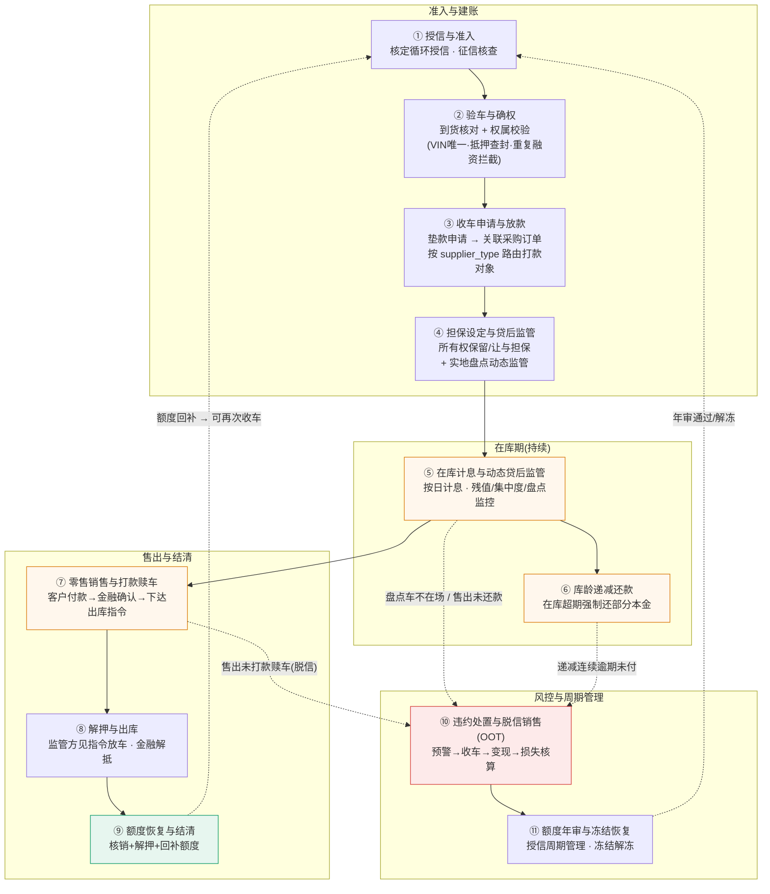
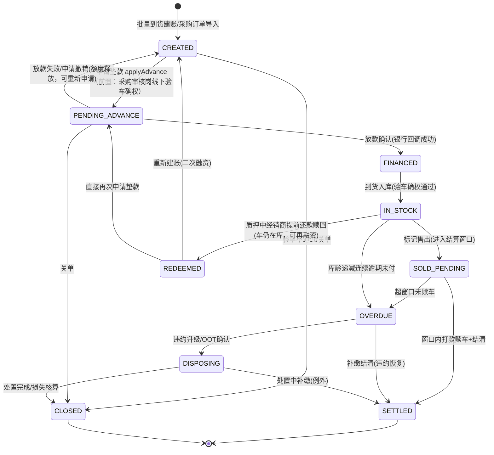
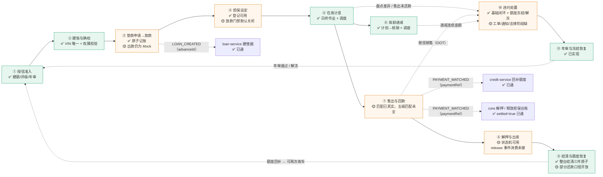
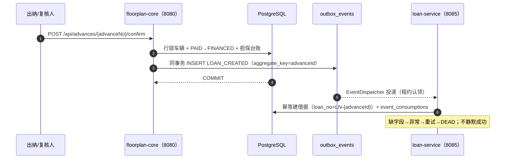
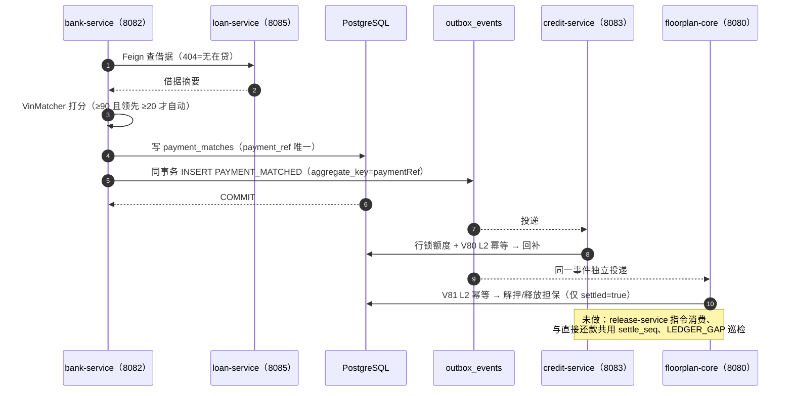
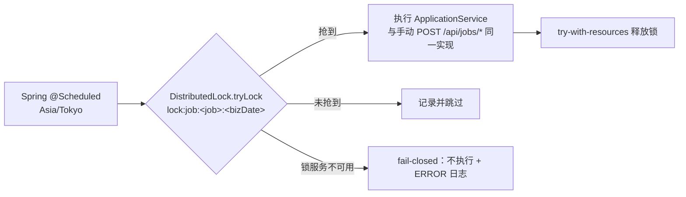

# 汽车库存融资（Floorplan）核心系统 · 业务流程文档

> **定位**：项目设计文档第二部分的**权威展开版**。本文档定义端到端业务流程（十一环节）、资金与车辆流转闭环、状态机、风控分支，以及"原八环节 + AI 补全三环节"的缺漏排查结论（P0/P1）。
> **版本**：v1.2　|　**日期**：2026-10-26（设计基线）　|　**现状复核**：2026-11-24
> **业务定位**：金融公司内部系统 · 新车渠道 · B2B 循环授信（借款人＝品牌授权经销商，法人）
> **目标客户**：🇯🇵 **日本客户**（新车渠道＝厂家金融 / 信用销售（分期）公司 / 地方银行与信用金库）← 直接影响担保与监管方式，见第 6 节
> **默认值说明**：凡此前标注"预设"的取值/规则已于 2026-10-26 定稿为系统默认值，全部支持配置化调整，调整无需改代码。

---

## 0. 文档变更与结论速览

| 项 | 结论 |
|---|---|
| **最近复核** | 2026-10-26 21:50 代码 + 实库二次复核：作业名 4 处校正（→`SETTLE_WINDOW_SCAN`/`INTEREST_ARCHIVE`）；环节④ 断点表述由"放款后无衔接"修正为"**放款前无门禁**"；新增「担保数据三源不一致」问题——详见核查报告 §8 |
| 用户原流程 | 8 环节（授信准入 / 验车确权 / 收车放款 / 担保与物理监管 / 在库计息 / 零售赎车 / 解押出库 / 额度恢复结清） |
| 升级后流程 | **11 环节**（在第 5 节补齐 3 个缺失环节：库龄递减还款、违约处置与脱信销售、额度年审与冻结恢复） |
| P0 缺漏（设计必须覆盖） | ①库龄递减还款流程 ②违约与脱信销售（OOT）处置闭环 ③重复融资拦截（验车确权须含 VIN 唯一性 + 抵押/查封校验） |
| P1 缺漏（应补，优先级次） | 额度年审冻结恢复、车辆损毁/盗抢保险、展期续贷、厂家回购、提前部分还款、结清证明文书交付 |
| 日本客户关键澄清 | 物理监管**不采用**扣押钥匙/GPS/封签（那是中国第三方监管做法）；日本新车渠道以**实地盘点 + 所有权保留/让与担保/厂家回购承诺**为主 |

> 本流程文档为主文档第二部分之权威版本；主文档第二部分流程图与对照表为精简摘要，深度以本文档为准。

---

## 1. 业务本质与闭环

对车商而言，**库存就是整张资产负债表**。库存融资解决时间错配：**收车要立刻付钱，卖车要几周甚至几个月后才收钱**。金融公司替车商把钱垫给上游，车停在车商场地作担保，卖掉一台归还一台，额度随之释放 —— 这就是**循环授信**与一次性贷款的本质区别。

**资金与车辆流转闭环**（十一环节，必须逐一在系统中有落点）：

**资金流**：金融 → 上游（直付，不经车商账户）｜ 车商 → 金融（还款/递减/违约回收）
**车辆流**：上游 → 车商场地（担保物）｜ 金融/监管方指令 → 车商放车（出库）

---

## 2. 十一环节逐环节说明

| # | 环节 | 业务动作 | 系统落点 | 风险/说明 |
|---|---|---|---|---|
| ① | 授信与准入 | 核定循环授信上限、准入审核、征信核查 | `POST /api/credit-lines`（含征信查询） | 发起与执行分离；额度冻结/恢复须可追溯；征信接入周期长（见外部集成文档） |
| ② | 验车与确权 | 到货核对车辆物理信息（VIN/车型/数量）+ 法律权属校验 | `POST /api/vehicles/batch-ingest` + 权属校验服务 | 🔴 **P0-③**：须含 VIN 唯一性、是否已在他处重复融资/抵押查封校验，拦截重复融资 |
| ③ | 收车申请与放款 | 垫款申请 → 关联**采购订单** → 按订单 `supplier_type` 路由打款对象 | 垫款原子流程：占额度+建台账+付款；采购订单为锚点 | 🔴 **打款对象不是系统自选，而是跟着真实采购单走**（ADR-007）：`DIRECT_PAY` 代付上游（销售公司/总代理/批发/拍卖）vs `SELF_PAY` 回款经销商（营运资金），两者**法律基础与校验链不同**；付款为外部调用，事务边界见 ADR-006 |
| ④ | 担保设定与贷后监管 | 逐台设定担保 + 持续监管 | `security_records` + 盘点/监控批处理 | 🇯🇵 日本＝所有权保留/让与担保/动产让渡登记/厂家回购承诺；监管以**实地盘点**为主，不扣押钥匙/GPS/封签 |
| ⑤ | 在库计息与动态贷后监管 | 按日计息 + 残值/集中度/盘点差异动态监控 | 日终批处理 + 风控扫描 | 计息须可重跑、有执行记录；盘点差异升级风控工单 |
| ⑥ | 库龄递减还款 | 在库超期强制偿还部分本金 | `aging_plans` 计划 + 递减到期批处理 + 部分还款接口 | 🟡 **P0-① 基础闭环已实现**（计划生成→核销，幂等正确、不释放额度）；⚠️ **仍缺**：分层递增规则（当前单层：90 天触发 + 固定 30 天周期 + 固定 10% 比例）、自动扣款、豁免审批、未还款升级（额度冻结/限制解押/转违约）。详见《库龄递减与强制还款设计》 |
| ⑦ | 零售销售与打款赎车 | 终端客户付款 → 金融确认收款 → 下达出库指令 | `POST /api/vehicles/{vin}/sold` + 赎车确认 + 出库指令 | 资金未到账不得下达出库指令（防脱信）；sold 触发源默认人工标记（一期），二期可接自动推送 |
| ⑧ | 解押与出库 | 监管方见指令放车，金融公司解除担保 | 出库指令 + `security/release` | 指令闭环：放车与解抵须同一指令触发，留痕 |
| ⑨ | 额度恢复与结清 | 还款核销 + 解除担保 + 回补额度 | `POST /api/repayments`：三件事原子完成 | 须原子完成，不可只做还款而漏解除担保 |
| ⑩ | 违约处置与脱信销售 | 逾期/OOT → 预警 → 收车 → 变现 → 损失核算 | 违约处置工单 + 处置批处理 + 残值核算 | 🟡 **P0-② 处置闭环已实现**（开单→收车→变现→结案，损失=应收−变现，终态不可回退）；⚠️ **仍缺**：四类触发源统一扫描（现仅扫 OVERDUE 状态）、盘点缺失不改状态（最严重的脱信信号进不了处置）、违约通知能力（零通知代码）、法律清算阶段（现状态机无 NOTIFIED/LEGAL_ACTION）、处置不冻结额度。详见《违约处置与法律清算设计》 |
| ⑪ | 额度年审与冻结恢复 | 授信周期年审、冻结解冻、终止 | 年审任务 + 冻结/解冻接口 | P1 重点；冻结须可恢复且全程留痕 |

> **闭环关键**：第 ⑨ 步"额度回补"必须回连第 ① 步——循环授信的核心。第 ⑪ 步年审/解冻后同样回连准入，构成授信生命周期闭环。

---

## 3. 车辆单元状态机（覆盖违约处置）

**生命周期状态**：`CREATED`·`PENDING_ADVANCE`·`FINANCED`·`IN_STOCK`·`SOLD_PENDING`·`SETTLED`·`REDEEMED`·`OVERDUE`·`DISPOSING`·`CLOSED`（与主文档 2.7 一致）。
**风险标记（独立字段，非状态）**：`overdueDays`·`riskLevel`·`ootSuspected`·`lastAuditDate`·`auditMismatchCount`·`encumbranceChecked`（权属校验结果）·`duplicateFinanced`（重复融资标记）。

> **赎回与结清必须分开（2026-10-26，V14）**：两者资金侧完全一样（本金利息结清、担保解除、额度回补），
> 但车辆去向相反——`SETTLED` 是车已零售卖出、永不回来（终态）；`REDEEMED` 是车**还在经销商场地**，
> 经销商提前还款把物权赎了回去，随时可以再次质押融资。若合并成一个状态，系统就无法判断
> "这台车还能不能再借"，而"还清后再借"正是库存融资的标准业务循环。
> 原实现只允许 `SOLD_PENDING`/`OVERDUE` 结清，等于"车没卖出去就不能还钱"，该路径现已补齐。

> **起点修正（2026-10-26，V12 + V13）**：原状态机把"建账"与"已放款"合并——建账即置 `FINANCED`，
> 导致 `FINANCED`（已付款）出现在付款之前，`stageAdvance` 反向要求"申请垫款前必须已垫款"，
> 而真正付款时 `finance()` 只能绕过白名单直接赋值。
>
> 现已拆成三级，付款成为一次真实的状态流转：
> - `CREATED`（已建账）：批量到货建账/采购订单导入后落此态，**未申请、未付款**；采购审核岗线下验车确权是其前置动作。
> - `PENDING_ADVANCE`（待垫款）：`applyAdvance` 提交申请时流转至此，**已申请、钱未付**；
>   放款失败/申请撤销时回退 `CREATED`，申请入口重新打开。
> - `FINANCED`（在途）：银行回调确认付款后流转至此，语义回归"已付款、尚未入库"。

> 状态流转一律**显式白名单**，非法流转抛领域异常（见技术设计文档第 3 节）。

---

## 4. 五大核心机制（不变）

| 机制 | 要点 |
|---|---|
| 单台独立核算 | 以 VIN 为主键，每台独立建账、独立计息 |
| 售出即还 | 零售成交后结算窗口内必须结清该台垫款 |
| 库龄递减还款 | 在库超期强制偿还部分本金，防残值跌破垫款（对应环节 ⑥） |
| 实地盘点核查 | 定期到场逐台扫描 VIN，账实不符当场升级（日本渠道主监管手段） |
| 脱信销售（OOT） | 车已售却不还款——最严重违约，可致整个额度被收回（对应环节 ⑩） |

---

## 5. 缺漏排查结论（原八环节 → 十一环节）

### 5.1 用户原八环节 vs 应补环节

| 用户原环节 | 是否保留 | 问题 |
|---|---|---|
| 授信与准入 | ✅ | 已含征信，但缺**年审/冻结恢复**作为周期管理 |
| 验车与确权 | ✅（补强） | 缺**法律权属校验**（重复融资/抵押查封）——P0-③ |
| 收车申请与放款 | ✅（修正） | "三方委托付款直付上游"表述过窄：①上游不是"工厂"单一实体，而是销售公司/区域总代理/批发公司/拍卖行/中古批发商多层渠道；②存在**三种场景**——新车采购、二手采购（均代付上游），以及"已有库存抵押补充周转"（钱回经销商自身，属营运资金，**不适用三方委托付款**）。打款对象须由**采购订单**的 `supplier_type` 决定，见 ADR-007 |
| 担保登记与物理监管 | ✅（修正） | "扣押钥匙/装GPS/封签"不适用于日本客户，改为实地盘点 + 所有权保留/让与担保/厂家回购 |
| 在库计息与贷后监管 | ✅ | 已含动态监管 |
| 零售销售与打款赎车 | ✅（细化） | 明确"客户付款→金融确认→下达出库指令"的资金闸门 |
| 解押与出库 | ✅ | 明确指令闭环 |
| 额度恢复与结清 | ✅ | OK |
| **库龄递减还款** | ➕ 新增 | 原流程缺失；**P0-① 基础闭环已实现**（2026-10-26）。剩余缺口为分层递增规则、自动扣款、豁免审批、未还款升级 —— 见《库龄递减与强制还款设计》 |
| **违约处置与脱信销售** | ➕ 新增 | 原流程缺失；**P0-② 处置闭环已实现**（2026-10-26）。剩余缺口为四类触发源、通知能力、法律清算阶段、额度冻结联动 —— 见《违约处置与法律清算设计》 |
| **额度年审与冻结恢复** | ➕ 新增 | 原流程缺失（P1 重点，但作为授信生命周期闭环不可或缺） |

### 5.2 P0（设计必须覆盖，不覆盖则流程不成立）

| # | 缺漏 | 落点 | 说明 |
|---|---|---|---|
| P0-① | 库龄递减还款流程 | 环节 ⑥ | ✅ 基础闭环已落地（计划生成 → 批处理催收 → 部分还款核销，幂等正确）；**增强项**：分层递增规则 + 自动扣款 + 豁免审批 + 未还款升级路径 |
| P0-② | 违约与 OOT 处置闭环 | 环节 ⑩ | ✅ 处置闭环已落地（开单→收车→变现→结案，损失=应收−变现）；**增强项**：四类触发源统一扫描 + 盘点缺失改状态 + 违约通知能力 + 法律清算阶段 + 处置冻结额度 |
| P0-③ | 重复融资拦截 | 环节 ② | 验车确权必须校验：VIN 是否已在本系统建账、是否已在其他金融机构抵押/查封；命中则拒绝收车建账 |

### 5.3 P1（应补，优先级次，可在二期）

| # | 缺漏 | 落点 | 说明 |
|---|---|---|---|
| P1-① | 额度年审冻结恢复 | 环节 ⑪ | 年度复核、临时冻结与解冻、授信终止 |
| P1-② | 车辆损毁/盗抢保险 | 环节 ④/⑤ | 担保物保险，出险报案与理赔对接 |
| P1-③ | 展期续贷 | 环节 ⑥/⑨ | 递减/结清展期，规则版本化 |
| P1-④ | 厂家回购 | 环节 ④/⑩ | 滞销/违约时厂家回购承诺兑现，作为处置路径之一 |
| P1-⑤ | 提前部分还款 | 环节 ⑨ | 非整台结清的部分还款（影响计息基数） |
| P1-⑥ | 结清证明文书交付 | 环节 ⑨ | 结清后向车商出具证明书，留档可查 |

---

## 6. 🇯🇵 日本客户适配（关键澄清）

> 用户已确认：**本系统面向日本客户（新车渠道）**。此点修正了此前文档中"担保登记与物理监管＝扣押钥匙/装GPS/封签"的假设——该做法是中国第三方监管公司对二手车/高风险车商的做法，**不适用于日本厂家金融新车渠道**。

| 维度 | 中国第三方监管常见做法 | 日本新车渠道（本项目） |
|---|---|---|
| 物理监管 | 扣押钥匙、装 GPS、贴封签、驻场监管 | **以实地盘点为主**（逐台扫 VIN + 拍照留证），不做钥匙/GPS/封签 |
| 担保公示 | 抵押登记 | 所有权保留 / 让与担保 / 动产·债权让渡登记（无统一 UCC 式登记） |
| 兜底保障 | 监管方强控制 | 厂家回购承诺 + 经销商信用 + 让与担保合同 |
| 新车未上牌 | — | 登记无对象，担保靠让与担保合同/动产让渡登记/厂家回购承诺（路径以客户确认为准） |

**对系统的直接影响**
- 环节 ④ 的"物理监管"= 实地盘点（`inventory/audit`），**移除钥匙/GPS/封签相关字段与流程**。
- 担保是**逐台**的，登记状态（`reg_no`/`owner_name`/`set_date`/`release_date`）作为一等公民字段，但确路径以客户确认结果落地（见外部集成文档第 3 节）。
- OOT 识别仍主要靠内部 `sold` 标记 + 结算窗口计时；外部信号（登记变更、保险退保等）在日本渠道可得性低，实现范围据此校准。

---

## 6.5 现状实现流程图（2026-11-24 复核）

> §1–§6 是**业务设计基线**（2026-10-26）。本节是**代码现状**：哪些环节已经贯通、哪些只是半通、哪些仍是断裂。
> 与 §7 速览表冲突时，以本节为准（§7 表保留为设计基线快照，便于对照演进）。

### 6.5.1 十一环节现状闭环

**现状一句话**：新车主链的「记账 + 计息 + 结清 + 回款匹配 + 解押」已经能跑；断点集中在
**真实出款通道、担保门禁开关、release-service 事件消费、部分还款/提前还本回补口径、工单与通知**。

### 6.5.2 放款 → 建借据（`LOAN_CREATED`，已通）

### 6.5.3 回款匹配 → 额度回补 + 解押（`PAYMENT_MATCHED`，已通）

### 6.5.4 日终作业调度（`@Scheduled` + 分布式锁）

**已接作业（9 个）**：计息、库龄推进、递减计划、结算窗口扫描、处置开单、年审扫描、季度归档、银行流水采集、DPD 刷新。
**未接**：`RISK_SCAN` / `TERM_CHECK` / `DEALER_METRIC_SCAN` / `RECON_FILE_GEN` / `SUBSIDY_SETTLE`（无 ApplicationService，不造空壳）、USED J1–J4、Quartz 动态 cron。

### 6.5.5 USED 二手车域（R1–R3 已贯通）

> USED 域的详细泳道图、七闸门与补偿矩阵见《二手车库存垫资改造-05-业务流程图.md》；
> 接口/错误码/权限点以 D07 为准，估值口径以 D08 为准，放车放证以 D09 为准。

### 6.5.6 与 2026-10-26 基线的主要变化

| 项 | 2026-10-26 基线 | 2026-11-24 现状 |
|---|---|---|
| ④ 放款前担保门禁 | 无门禁 | 门禁代码已实现，但开关默认 false（Q27 路径未完全落地，开启会全量拒付） |
| ⑦ 回款匹配 | 只有 sold 标记，缺付款确认 | bank 真实匹配 + Feign 查借据 + `PAYMENT_MATCHED` 生产；五级匹配只做 VIN + 金额，人工兜底 |
| ⑧ 解押/出库 | 出库指令零实现 | release-service 状态机与 5 个端点可用；回款事件驱动 release-service 的消费未接 |
| ⑨ 额度恢复 | 整台结清原子；部分还款有争议 | 整台结清仍原子；credit 消费 `PAYMENT_MATCHED` 真实回补；部分还款/提前还本口径仍开放 |
| ⑩ 违约处置 | 不冻结额度、无通知 | 基础闭环 + 额度冻结/解冻已实现；工单体系仍 0 Java、通知与法律清算阶段仍缺 |
| 作业 | 全部手动点 | 9 个作业接入 `@Scheduled` + 分布式锁；prod 强制启用 |
| 测试 | 端到端冒烟为主 | 129 个 `@Test` + 主干/事件 290 断言 + USED 209 + 浏览器 37 + Redis 锁 7 |

---

## 7. 环节 ↔ 接口 ↔ 批处理 ↔ 代码现状 对照

> ⚠️ **下表是 2026-10-26 的设计基线快照**，用于对照"当初设计时怎么判断"；
> 其中 ④⑦⑧⑨⑩ 与作业、测试的现状已在 §6.5 更新。汇报或面试请以 §6.5 为准。

### 贯通状态速览（2026-10-26 代码 + 实库实测）

| # | 环节 | 贯通 | 一句话结论 |
|---|---|---|---|
| ① | 授信与准入 | 🟡 | 建额与评级可用，**唯一没有双人复核的业务决策** |
| ② | 验车与确权 | ✅ | 实现质量最高：VIN 唯一 + 权属独立留痕 + 明确的拒绝码 |
| ③ | 收车申请与放款 | ✅ | 五段四岗 + 幂等三层 + 收款方路由，资金主干唯一走完的环节 |
| ④ | 担保设定与监管 | 🔴 | **放款前无担保门禁**；担保事实三源不一致；批次表无 VIN；`regNo` 丢弃；无盘点计划 |
| ⑤ | 在库计息与监管 | 🟡 | 计息本身扎实（幂等/快照/归档），但**无"该停在哪天"**、无风险扫描 |
| ⑥ | 库龄递减还款 | 🟡 | 计划生成→核销闭环可用，单层规则/无自动扣款/无豁免/不升级；**两作业零运行记录** |
| ⑦ | 零售销售与赎车 | 🟡 | 只有"标记售出"，**缺客户付款确认与回款匹配** |
| ⑧ | 解押与出库 | 🔴 | **出库指令零实现**（设计稿已完成，代码无一行） |
| ⑨ | 额度恢复与结清 | 🟡 | 整台结清三件原子 ✅；**"提前还本金"不回补（已产生实盘损失 10 万）** |
| ⑩ | 违约处置与 OOT | 🟡 | 处置四步闭环可用，但**不冻结额度**、盘点缺失不进流程、零通知、无法律清算 |
| ⑪ | 额度年审与冻结恢复 | ✅ | 冻结按记录量回退，额度操作里最规范的一环 |

> **总判定**：11 环节中 **3 个贯通（②③⑪）**、**6 个半通（①⑤⑥⑦⑨⑩）**、**2 个断裂（④⑧）**。
> 断裂点不在"环节内部"，而在**环节之间的移交**（详见《十一环节闭环核查报告》§4、§8）。

**逐环节详情**：

| 环节 | 核心接口 | 批处理 | Java 原型现状 |
|---|---|---|---|
| ① 授信与准入 | `POST /api/credit-lines` | `ANNUAL_REVIEW_SCAN` | ✅ 额度建账 + Mock 占用；✅ 评级口径动态配置（`/api/rating-configs`，默认口径 A/B/C/D） |
| ② 验车与确权 | `POST /api/vehicles/batch-ingest` + `POST /api/vehicles/{vin}/lien-check` | — | ✅ 建账有；✅ **重复融资拦截已实现（P0-③）**：权属核对录入，最新核对 `encumbered=true` 则拒绝建账（`VEHICLE_005`） |
| ③ 收车申请与放款 | `POST /api/advances` | — | ✅ 占额度+建台账+Mock 付款；✅ 执行利率=基准+评级加点（口径动态生效） |
| ④ 担保设定与监管 | `POST /api/vehicles/{vin}/security` + V10 批次登记接口 | `RISK_SCAN`（**代码中不存在**）/`INVENTORY` | 🟡 盘点 ✅；担保登记 V10 路径 ✅（批次级，含合同与证明书附件） 🔴 **实测断点**：①**放款前无担保门禁**——没登记也放款（实测 25/26 台车 `vehicle_units.security_status` 为空，正常计息照跑）②老接口 `regNo`/`ownerName` **接收后丢弃**（VehicleUnit 无此字段）③无盘点任务生成与频次管控④**担保数据三源不一致**（`vehicle_units` 1 台 / `collateral_ledger` 10 台 REGISTERED / 批次表 14 条却无 VIN 关联）——见核查报告 §8.1 |
| ⑤ 在库计息与监管 | `POST /api/interest/settle` | `DAILY_INTEREST`/`AGING_ADVANCE`/`RISK_SCAN`（代码中不存在） + `INTEREST_ARCHIVE`(季度归档) | ✅ 计息 ✅；✅ 按季度归档（预设） |
| ⑥ 库龄递减还款 | `POST /api/curtailments/{vin}/pay` | `AGING_REDUCTION_DUE` | ✅ **已实现（P0-①）**：逐期核销本金、推进计划、写核销流水；不释放额度 ⚠️ **待增强**（见《库龄递减与强制还款设计》）：①单层规则（90 天/30 天周期/10% 固定比例）需改为分层递增 ②应还额生成时算死，需按当前阶梯动态重算 ③仅人工核销，缺回款抵扣与自动划款 ④无豁免机制 ⑤未还款不升级（`frozen_amount` 从不写） |
| ⑦ 零售销售与赎车 | `POST /api/vehicles/{vin}/sold` + `POST /api/extensions/apply` | `SETTLE_WINDOW_SCAN` | ✅ sold 标记；✅ 展期顺延（P1）；⚠️ 出库指令独立闭环未实现 |
| ⑧ 解押与出库 | `POST /api/vehicles/{vin}/security/release` + **赎车申请/释放指令/回执（新）** | — | 🔴 **原仅单方解押，无出库指令** → 🟡 **📄 设计已完成**（《放车放证指令设计》）：八环节全链路（发起赎车→资金校验→四级冲抵与额度处理→质押变更→生成指令→指令下发→回执确认→台账更新）；新增 `PENDING_RELEASE` 中间态、6 张新表（`redemptions`/`release_orders`/`release_receipts`/`custodians`/`vehicle_certificates`/`repayment_allocations`）、3 个权限点、账实缺口巡检 ⚠️ **关键约束**：**额度回补必须放在最后（台账更新环节）**——冲抵时就回补，解押或下发失败即成"钱收了、额度放了、车还押着"的资损 |
| ⑨ 额度恢复与结清 | `POST /api/repayments`（整台）+ `POST /api/repayments/partial`（部分）+ `POST /api/payoffs/issue`（结清证明） | — | ✅ 核销+解押+回补三件原子；✅ 结清证明（P1） ✅ **额度回补已实现**：`RepaymentApplicationService:121` `line.release(principal)` + 行锁 `findByIdForUpdate`；放款失败 `AdvanceApplicationService:498` 回滚 🟡 **部分还款的回补判定待细化**（2026-10-26 业务定稿"额度回补三原则"）：`partialRepay` 现为**一律不回补**——对"未解押部分还款"正确，但**未区分车辆状态**，在库车主动"**提前还本金**"被误伤（按原则应回补）。详见《十一环节闭环核查报告》§⑨-1 |
| ⑩ 违约处置与 OOT | `POST /api/disposals/open → repossess → liquidate → close` | `SETTLE_WINDOW_SCAN` + `DEFAULT_DISPOSAL` | ✅ **已实现（P0-②）**：结算窗口"告警但允许"（宽限期预设 5 营业日），超限升级 OOT → OVERDUE；处置闭环损失=应收−变现；扫描作业自动开单 ⚠️ **待增强**（见《违约处置与法律清算设计》）：①触发源只扫 OVERDUE，盘点缺失仅置 `oot_suspected` 不改状态 ②零通知能力 ③状态机缺 NOTIFIED/LEGAL_ACTION/CANCELLED（无法律清算、无撤销通道）④处置**完全不冻结额度**（经销商违约后仍可放款） |
| ⑪ 额度年审与冻结恢复 | `POST /api/annual-reviews/initiate` → `/{reviewNo}/complete` | `ANNUAL_REVIEW_SCAN` | ✅ **已实现**：发起冻结（量=发起时已用额度）→ 复核通过解冻恢复；超期自动发起扫描 |
| 附：保险 / 厂家回购 | `POST /api/insurances/bind`→`claim`；`POST /api/repurchases/request`→`fulfill` | — | ✅ 已实现（P1）：回购兑现冲抵本金不自动结清；保险理赔状态流转 |

> 原型现状详见各实现文档；接口契约见接口文档 §4.14，表结构见数据库设计文档 §V2/V3 迁移。

---

## 8. 默认值清单（流程相关，已定稿可配置）

> 以下各项已采纳默认值（2026-10-26 定稿），均为可配置项，后续按需调整、无需改代码。

| # | 项 | 已采纳默认值 | 影响环节 | 调整方式 |
|---|---|---|---|---|
| 1 | 担保路径 | 所有权保留（RETENTION）+ 让与担保（ASSIGNMENT，默认）+ 厂家回购承诺；不做动产让渡登记 | ④⑧ | yml `security.default-type` / 设定担保接口 |
| 1b | **担保登记时序** | **收到垫款申请后、放款之前**；债权人与债务人去法务省办理的**线下业务**，系统只记录结果。⚠️ **当前系统无此门禁**（放款流程不查担保状态） | ③④ | 待建（阻断打款 + 强制工单） |
| 1d | **出库指令有效期** | 7 个日历日（过期可重新申请，生成新编号） | ⑧ | `release_orders.valid_until` |
| 1e | **冲抵顺序** | **费用/罚息 → 利息 → 本金**（本金最后动，敞口下降最保守） | ⑧⑨ | `repayment_allocations.alloc_seq` |
| 1c | **额度回补三原则** | **质押物释放 + 本金敞口下降 + 合同规则一致**，三者同时成立才回补。「卖车回款/提前还本金」应回补；「只还利息/逾期补款/未解押部分还款」不回补 | ⑨ | 待建 `CreditReleasePolicy` |
| 2 | 实地盘点频率与差异升级 | 月度实地盘点；账实不符立即告警（账无实有=HIGH，账多有=MEDIUM） | ④⑤ | 盘点作业调度 |
| 3 | 库龄递减规则 | 90 天首次触发 / 每 30 天一期 / 每期还原始垫款 10% | ⑥ | yml `floorplan.aging.*` |
| 4 | OOT 识别信号 | 默认人工标记 sold + 结算窗口扫描自动识别（宽限期告警但允许→超限升级 OOT） | ⑦⑩ | yml 结算窗口/宽限期参数 |
| 5 | 结算窗口 | 2 个营业日 + 宽限期 5 个营业日（告警但允许） | ⑦ | yml `settle-window-*` |
| 6 | 违约处置路径 | 自行收车 → 变现 → 损失认定（损失=应收−变现）闭环；支持厂家回购冲抵本金 | ⑩ | 处置接口参数 |
| 7 | 征信接入 | 一期人工录入评级（评级口径后台动态配置）；二期可接征信 API 自动回填 | ① | `/api/rating-configs` |
| 8 | 虚拟账号入金 | 一期人工确认入金；方案与表结构已预留（见外部集成文档 4.2） | ⑦⑨ | 集成模式配置 |

---

## 附录　术语表（流程视角）

| 中文 | 含义 |
|---|---|
| 库龄递减（Curtailment） | 在库超期强制偿还部分本金，压降风险敞口 |
| 脱信销售（OOT, Out-of-Trust） | 车已售但车商未上报/未还款赎车，最严重违约 |
| 所有权保留 | 还清前车辆登记在金融公司/信贩名下 |
| 让与担保 | 以担保为目的移转权利外观的担保方式（日本判例法） |
| 动产·债权让渡登记 | 让与担保的对抗要件登记 |
| 厂家回购承诺 | 滞销/违约时厂家按约定回购，作为处置兜底 |
| 实地盘点 | 到场逐台扫描 VIN + 拍照，账实核对（日本渠道主监管手段） |
