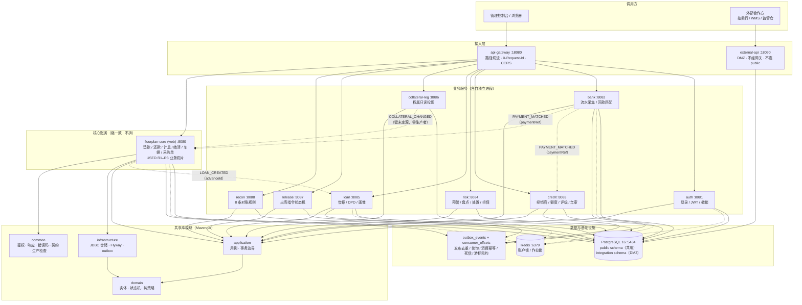
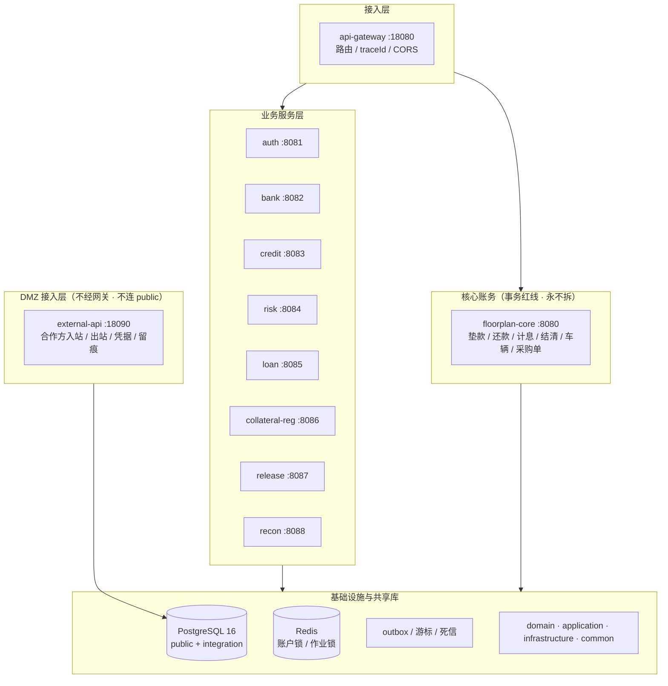
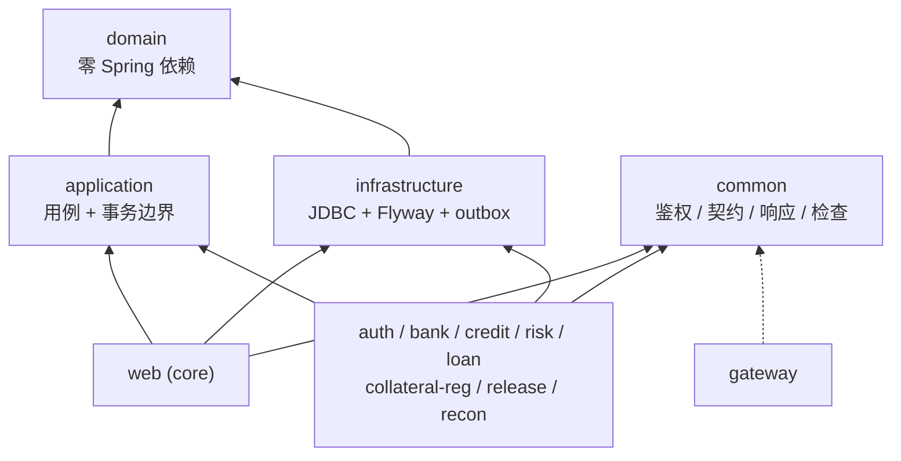
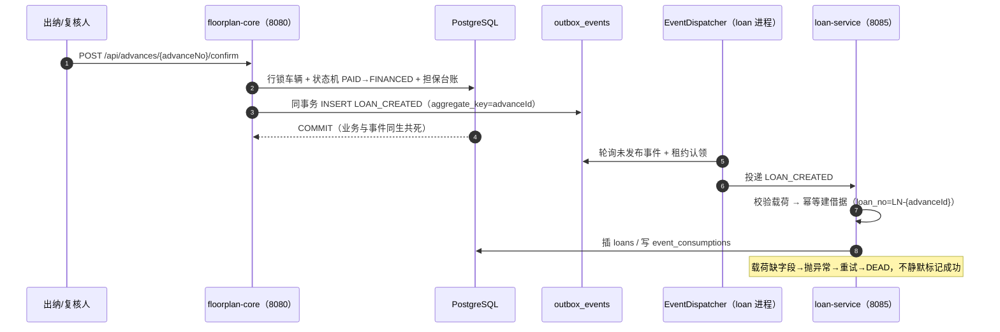
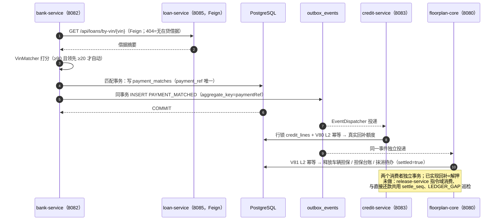

# 库存融资核心系统 · 目标微服务架构设计

> 生成时间：2026-11-21 ｜ **最后校对：2026-11-24（代码实查）** ｜ 配套：《任务进度与演进路线图.md》《PROGRESS.md》《微服务落地问题与解决.md》
> 定位：描述**目标态**架构全貌，并以 §0「当前实况」标出目标与现状的差。
> **阅读约定：§0 是现状（数字全部实查），§1–§8 是目标态蓝图，两段不要混读；有出入以 §0 为准。**
> 核心判断：**拆不拆的标准是一致性边界和数据归属，不是业务名词是否像一个域**。

---

## 0. 当前实况（2026-11-24 代码实查）

> 本节是**现状**；§1–§8 是目标态蓝图。两者冲突处以本节为准。
> 口径：数字全部取自仓库实查，不抄历史文档。

### 0.1 服务清单：11 个可部署进程 + 4 个共享库模块

| # | 进程 | 端口 | 职责 | 端点数 | 状态 |
|---|---|---|---|---|---|
| 1 | `api-gateway` | 18080 | 统一入口，12 条路由（11 条 API 切流 + 1 条控制台静态页），`RequestIdFilter` 贯穿 traceId | — | 运行中 |
| 2 | `floorplan-core`（web） | 8080 | 核心账务：垫款/还款/计息/结清/车辆主数据/采购单/附件；含 USED R1–R3 业务切片 | 73 | 运行中·**不拆** |
| 3 | `auth-service` | 8081 | 登录 / JWT 签发 / 退出登录（token_version） | 2 | 运行中 |
| 4 | `bank-service` | 8082 | 银行流水采集 + 回款匹配 + `PAYMENT_MATCHED` 生产 | 8 | 运行中 |
| 5 | `credit-service` | 8083 | 经销商 / 授信额度 / 评级 / 年审 + `PAYMENT_MATCHED` 消费回补 | 17 | 运行中 |
| 6 | `risk-service` | 8084 | 盘点 / 预警 / 担保台账 / 权属核对 / 违约处置 | 21 | 运行中 |
| 7 | `loan-service` | 8085 | 借据、DPD、经销商风险画像；`LOAN_CREATED` 消费 | 6 | 运行中 |
| 8 | `collateral-reg-service` | 8086 | 担保权属登记与三源投影（只读投影，权威源为批次表） | 6 | 运行中 |
| 9 | `release-service` | 8087 | 出库指令状态机 | 5 | 运行中 |
| 10 | `recon-service` | 8088 | 8 条对账规则 | 2 | 运行中 |
| 11 | `external-api` | 18090 | DMZ 外部接入面 | 0 | **仅骨架**（pom + 启动类 + yml，零 Controller） |

**另有 4 个共享库模块**（不可独立部署，被各业务服务按需装配）：
`domain`（实体 / 状态机 / 纯策略，零 Spring 依赖）· `application`（用例编排，事务边界唯一所在）· `infrastructure`（JDBC 仓储 + Flyway + outbox 机制）· `common`（鉴权 / RBAC / 错误码 / Feign 与事件契约 / 生产就绪检查）

**「多少个微服务」的口径澄清**：

- 按**可部署进程**算 = **11 个**（1 网关 + 9 业务服务 + 1 DMZ）
- 按**业务服务**算 = **9 个**（core + auth/bank/credit/risk/loan/collateral-reg/release/recon）
- 按 **Maven 模块**算 = **15 个**（+ 父 POM = 16 个构建单元）
- `run-microservices.sh` 一键起 **10 个**进程（不含 `external-api`——它是 DMZ，不经网关）
- **物理拆库尚未开始**：11 个进程仍共用同一个 PostgreSQL 库的 `public` schema。§1 图中的「每服务独立 schema」是目标态

### 0.2 现状部署架构图



> 实线是同步调用或部署依赖；虚线是 outbox 事件。`PAYMENT_MATCHED` 的两个消费者是**独立事务**，
> 不存在分布式事务；部分状态由 L2 幂等 + DEAD 可见 + 后续巡检兜底。
>
> **图中最容易被误读的两处**：
> 1. 所有服务连同一个 `PostgreSQL`，不是每服务独立库；`external-api` 只连 `integration` schema。
> 2. `COLLATERAL_CHANGED` 是目标态事件，当前**零生产者**，图中保留是为了标出缺口。

### 0.3 通信：两条异步链路已端到端跑通

| 通道 | 机制 | 当前实况 |
|---|---|---|
| 同步（Feign） | `common/contract/` 3 个 Feign 契约 + `OutboxPublisher` 接口；`web` 与 `bank-service` 已装配 `@EnableFeignClients` | `CollateralClient` 真实调用方是 `FeignGuaranteeLookup`（放款门禁开关 `floorplan.core.guarantee-gate.enabled` **默认 false**，默认配置下不触发）；`LoanQueryClient` 真实调用方是 bank `FeignLoanLookupClient`（回款匹配查借据，2026-11-24）；`CreditLineQueryClient` 服务端 `/available` 已实现但暂无消费方。`fallback` 在无 circuit-breaker 依赖下不生效，门禁 fail-closed 由 catch + null 判定保证 |
| 异步（outbox） | `outbox_events` + `JdbcOutboxPublisher`（应用侧 `NOT EXISTS` 去重）+ `EventDispatcher`（1s 轮询）+ `consumer_offsets` 游标/租约 + `event_consumptions` 框架幂等 + DEAD 死信 | 机制**全部落地**。真实生产者：`OutboxLoanCreatedPublisher`（web，键 `advanceId`）与 `PaymentMatchedPublisher`（bank，键 `paymentRef`，2026-11-24）。真实消费者：`LoanCreatedConsumer`（loan-service）、`PaymentMatchedConsumer`（credit-service，行锁真实回补 + V80 L2）、`PaymentMatchedSecurityConsumer`（floorplan-core，settled=true 时真实解押 + V81 L2，2026-11-24）。`COLLATERAL_CHANGED` **仍零生产者**；`PAYMENT_MATCHED` 的 release-service 消费未做 |

### 0.4 目标态 vs 现状：差在哪儿

| 项 | 目标态（§1–§8） | 现状（实查） |
|---|---|---|
| 服务数 | 8 业务服务 + 网关 | **9 业务服务 + 网关 + 1 个 DMZ**（另有 4 个共享库模块） |
| 数据隔离 | 每服务独立 schema | **共用 `public` schema**，物理拆库未开始 |
| 服务间调用 | Feign 门禁（担保 + 额度两问） | 契约已定义；借据查询链路已真实打通；**担保门禁链路默认关闭**，额度侧暂无消费方 |
| 异步事件 | 3 类事件全链路 | **2 条端到端跑通**：`LOAN_CREATED`→建借据；`PAYMENT_MATCHED`→额度回补 + core 解押。`COLLATERAL_CHANGED` 零生产者 |
| 注册中心 | Nacos | 本地不启，`fail-fast=false`，注册失败仅告警 |
| 可观测 | actuator + 链路追踪 | **未接入 actuator**（全仓无 actuator / micrometer 依赖） |
| 消息中间件 | outbox 起步，量起来换 MQ | 仍是 **DB 轮询**，零 MQ 依赖 |
| 多实例 | 消费游标 / 作业锁 / 配置一致 | 游标租约（V83）+ Redis 锁 + prod 配置 fail-fast **已落地** |
| 迁移 | V16–V21 规划号 | 已落库到 **V83**，共 **65 个迁移文件 / 98 条 `CREATE TABLE`** |
| 测试 | 单测 + 端到端 | **129 个 `@Test` / 25 个测试文件**；主干 + 事件 290 条断言全绿 |

### 0.5 已知结构事实（写文档时最容易记错的五处）

1. `@EnableFeignClients` 目前有**两处**：`web/FloorplanApplication.java`（`basePackages = common.contract`）与 `bank-service/BankServiceApplication.java`（`clients = LoanQueryClient.class`）。其他服务即便注入了契约类型也拿不到 Feign 代理——这是"死契约"的直接成因，不是"忘了实现"。
2. `@FeignClient(fallback = ...)` **在当前依赖下不生效**：仓库无 circuit-breaker / resilience4j，Spring Cloud 2023.0.5 走 `DefaultFeignTargeter`，该类不读 `fallback` 字段。放款门禁的 fail-closed 实际由 `FeignGuaranteeLookup` 捕获异常返回 null、`RoleSeparationPolicy.evaluateGuarantee` 判 null 硬阻断共同保证，**不是靠 Fallback 类**。
3. `EventDispatcher` 的游标按 `consumer` 一行，**多实例部署靠 V83 的 `lease_owner/lease_until` 租约**：每轮原子认领/续租 2 分钟，未抢到跳过；`@PreDestroy` 释放租约。接管语义 at-least-once，由 `event_consumptions` + 业务唯一键兜底。
4. `external-api` **刻意不装配** `JdbcOutboxPublisher`（给 DMZ 装配业务写能力等于直接破安全边界），它也不连 `public` schema。
5. **核心账务不拆**不是"没做完"：垫款—计息—结清是同一事务内的强一致不变量，拆开就要上分布式事务；这是主动裁决，不是技术债。

---

## 1. 架构分层



**代码模块依赖方向（编译期）**：



> 依赖方向严格自上而下：`web / *-service → application → domain ← infrastructure`；
> `common` 横切所有层。`domain` 不含任何 Spring 注解，可纯单测。

---

## 2. 服务清单与拆分依据

| 服务 | 端口 | 真相源 | 状态（2026-11-24 实查） | 为什么这样拆 |
|---|---|---|---|---|
| api-gateway | 18080 | — | 运行中·12 条路由 | 唯一入口，路径切流；specific 路由必须在 core 兜底之前 |
| floorplan-core | 8080 | 账本 | 运行中·73 端点·**不拆** | 垫款/计息/结清是一个强一致事务，拆开必须引入分布式事务——红线 |
| auth-service | 8081 | 用户、角色 | 运行中·2 端点·JWT 可撤销 | JWT 本地验签，各服务共享密钥，零信任；token_version 支持即时失效 |
| credit-service | 8083 | 额度、评级 | 运行中·17 端点·真实回补 | 授信域独立；消费 `PAYMENT_MATCHED` 行锁回补 + V80 L2 幂等 |
| risk-service | 8084 | 预警、处置、规则 | 运行中·21 端点 | 风险闭环；**规则引擎并入**——输入（预警）输出（工单）都在本服务内 |
| bank-service | 8082 | 银行流水 | 运行中·8 端点·真实匹配 | 采集 + 回款匹配；Feign 查借据、JDBC 落匹配、同事务发 `PAYMENT_MATCHED` |
| loan-service | 8085 | 借据、DPD、画像 | 运行中·6 端点 | 读多写少、变化频率高；逾期的唯一判定源（ADR-008）；消费 `LOAN_CREATED` |
| collateral-reg | 8086 | 担保权属 | 运行中·6 端点 | 消灭 vehicle_units / collateral_ledger / 批次表三源不一致（只读投影） |
| release-service | 8087 | 出库指令 | 运行中·5 端点 | 跨机构异步协同（确认→放车→解抵），不能拖住 core 的同步账本 |
| recon-service | 8088 | 对账差异 | 运行中·2 端点 | 只读账本做 8 条对拍，与写链路解耦 |
| external-api | 18090 | integration schema | **仅骨架**·0 端点 | DMZ 接入面：不经网关、不连 public schema；业务能力未实现 |

> 表中「状态」列反映的是**代码实况**（有无端点、有无真实调用方），不是「有没有这个目录」。
> 目录存在 ≠ 服务已建；见 §0.3 当前只有两条异步链路真正跑通。

### 两处对最初裁决的修正（重要）

1. **放车放证从 core 内模块 → 独立 release-service**。原因：它是跨机构异步协同，节奏与 core 的同步账本事务完全不同。塞进 core 会让账本服务被外部响应时间拖住。
2. **规则引擎从独立服务 → 并入 risk-service**。原因：它的输入（预警事件）和输出（处置工单）都在 risk 内，独立只多一次网络调用，没有扩展性收益。

> 这两处修正印证了同一个原则：**按一致性边界和数据归属拆，不按业务名词拆**。

### 明确不做独立服务的五项

| 业务 | 形态 | 理由 |
|---|---|---|
| 放车放证的状态机主体 | release-service 内的状态机 | 已独立，但表结构与车辆强关联的部分仍由 core 维护 |
| 残值估值 | 算法库（jar） | 是算法不是业务，被 credit/loan 共用，独立进程只多一次往返 |
| 通知中心 | MQ + 消息模板 | 通用组件，业务服务通过 outbox 发事件即可 |
| 经销商门户 | BFF 聚合层 | 聚合各服务读接口，不在写链路上 |
| 数据 BI | 离线数仓 | 直接读库，做成微服务没有扩展性收益 |

---

## 3. 通信设计

### 3.1 同步：只用于门禁（fail-closed）

放款前 core 必须拿到两个答案，拿不到就拒付：

```
core 放款请求 ──Feign──> collateral  查该 VIN 有 REGISTERED 批次？
             ──Feign──> credit      查经销商可用额度够？
             两者 OK → core 本地事务放款（行锁 + 唯一约束）
```

- 调用失败、超时、返回 UNKNOWN，一律**拒绝放款**——金融门禁宁可误拒不可放过。
- 超时时间 2s，不重试或最多一次幂等重试；长重试会拖垮放款链路。
- 门禁判定源必须唯一（Q27 业务确认），否则会被"随便填一个源"绕过。
- **现状**：担保门禁代码已实现但 `floorplan.core.guarantee-gate.enabled` 默认 false；Q27 判定路径改造未完全落地前开启会全量拒付，不能擅自打开。

### 3.2 异步：用于事后状态同步

允许秒级最终一致，消费端靠唯一键幂等：

```
bank 回款匹配 VIN ──outbox: PAYMENT_MATCHED──> credit-service 真实额度回补（2026-11-24 已通）
                                            ├─> loan 更新借据 DPD（未接）
                                            └─> core 解押（floorplan-core，settled=true 时释放车辆/担保台账；2026-11-24 已通）
core 放款确认 ──────outbox: LOAN_CREATED─────> loan-service 建借据（已通）
collateral 登记变化 ─outbox: COLLATERAL_CHANGED─> core 刷新担保视图（零生产者，键/状态域待定源）
```

#### 3.2.1 `LOAN_CREATED`：放款确认 → 建借据（已通）



#### 3.2.2 `PAYMENT_MATCHED`：回款匹配 → 额度回补 + 解押（已通）



- 事件契约统一带 `vin` + `traceId`，便于跨服务排障。
- outbox 本地消息表 + `@Scheduled` 投递，暂不上 MQ；量起来后换 RocketMQ 不动业务代码。
- `aggregate_key` 必须标「这一次发生」：`advanceId` / `paymentRef`，禁止 `vin` / `traceId`。

### 3.3 明确不用 Seata

AT 模式的全局锁 + 回滚日志在金融账务上成本和风险都过高。当前方案：**Feign 门禁（即时拦截）+ outbox 幂等补偿（事后同步）**，每一环都可验证、可排障、可重放。

---

## 4. 数据真相源

每类数据只有**一个权威写者**，其他服务只读或通过接口访问：

| 数据类型 | 权威写者 | 规则 |
|---|---|---|
| 账本（advances / repayments / interest_ledger） | core | 本地事务，**禁止缓存** |
| 担保权属（批次表） | 批次表 + core 解押 | collateral-reg 是只读投影；Q27 裁决 |
| 借据 / DPD / 画像 | loan | 逾期判定的唯一来源 |
| 额度 / 评级 | credit | core 通过 Feign 访问，不留本地副本 |
| 银行流水 / 匹配结论 | bank | 采集幂等；匹配结论 JDBC 持久化 |
| 出库指令 | release | 状态机驱动 |
| 对账差异 | recon | 只读账本产生 |

**Redis 边界**：只做账户级采集锁、作业锁和幂等去重。**绝不缓存账本字段**——缓存值与账本必然漂移，这是金融系统红线。

---

## 5. 迁移编号分配（现状）

| 编号 | 归属 | 内容 |
|---|---|---|
| V1–V26 | 核心链路（新车） | 基线 |
| V40–V79 | USED 域 | 资质 / 车辆 / 証書 / 担保 / 估值 / 拍卖 / 监管仓 / 放车放证 / 集成层 |
| V75–V79 | USED R1–R3 | 资质配置、二人签认、双维评分、里程阈值、估值三键 |
| V80 | PAYMENT_MATCHED 回补 | `credit_line_restorations`（credit 消费侧 L2） |
| V81 | core 解押释放 | `payment_security_releases`（core 消费侧 L2） |
| V82 | 安全基线 | `users.token_version` |
| V83 | 多实例游标租约 | `consumer_offsets.lease_owner/lease_until` |

> 现状：**65 个迁移文件、编号到 V83、98 条 `CREATE TABLE`**。
> 已落库迁移**不可修改**——改一个字就是 Flyway checksum 校验失败、整栈起不来；
> 要改结构一律新增版本号。核心侧下一可用号 **V27**；USED 域下一可用号 **V84**。
> 逐号台账见 `PROGRESS.md §1`。

---

## 6. 技术栈基线与当前缺口

- Java 17 / Spring Boot 3.2.5 / Spring Cloud 2023.0.5 / Spring Cloud Alibaba 2023.0.3.3
- Spring Cloud Gateway（WebFlux）+ Nacos Discovery + loadbalancer
- 数据库 PostgreSQL 16（`ON CONFLICT DO NOTHING`、`uk_` 唯一约束）+ Flyway（迁移到 V83）
- 跨服务：Spring Cloud OpenFeign（3 个契约，web + bank 装配）+ outbox 本地消息表（DB 轮询，零 MQ 依赖）
- 调度与锁：Spring `@Scheduled` + `DistributedLock`（memory / Redis），9 个已接作业；Redis 实例 `run-redis.sh`
- 测试：JUnit 5 + Mockito（129 个 `@Test` / 25 个测试文件）+ Python 网关级冒烟 + Playwright 浏览器测试

**当前缺口**：

1. 无 actuator / micrometer（可观测未接入）；
2. `COLLATERAL_CHANGED` 零生产者；`PAYMENT_MATCHED` 的 release-service 消费未做；
3. 「银行匹配」与「直接还款」尚未共用 `settle_seq` 幂等，双路径可能重复释放额度；
4. 两个消费者独立事务，部分状态巡检 `LEDGER_GAP` 未实现；
5. 物理拆库未开始，11 个进程仍共用 `public` schema；
6. 本地不启 Nacos（`fail-fast=false`）；生产未接 Nacos / 网关未统一验签；
7. 工单体系 0 Java、前端 8 个模块 0 页面；
8. Quartz 动态 cron、Redis HA、密钥轮换 / MFA 未做。

---

## 7. 面试话术

> 我的目标架构是 9 个业务服务加网关和 DMZ，但核心账务保持单体——垫款、计息、结清是一个强一致事务，拆开就要上分布式事务，这个代价在金融账务上不可接受。拆分的判据是一致性边界和数据归属，不是业务名词：所以跨机构协同的出库指令我独立成服务，而看起来像个域的规则引擎我并进了 risk，因为它的输入输出都在 risk 内部。
>
> 通信上同步只用于门禁——放款前问担保和额度，拿不到答案就拒付；事后同步走 outbox 异步事件，允许秒级最终一致。我没有用 Seata，AT 模式的全局锁对账务风险太高。数据上每类只有一个权威写者，Redis 只做锁和去重，绝不缓存账本字段——缓存和账本一定会漂移。
>
> 现在有 11 个可部署进程——1 个网关、9 个业务服务、1 个 DMZ 接入面，外加 4 个共享库模块（领域、应用、基础设施、公共契约）。**两条异步链路端到端跑通**：放款确认→建借据，回款匹配→额度回补 + core 解押。第三条 `COLLATERAL_CHANGED` 还零生产者，我不把它包装成"事件驱动全面落地"。
>
> 多实例这块也补了课：事件消费游标有租约（V83），作业调度默认关闭 + 分布式锁 + 锁服务 fail-closed，生产配置弱密钥/默认密码/memory 锁会直接拒绝启动。
>
> 我不打算把这个包装成"已经微服务化完成"。**分布式单体到真微服务，最难的不是拆，是拆完之后保证跨服务的一致性还能被验证**——所以我的做法是先把幂等、唯一约束、状态机和冒烟断言这些"拆完还能用"的底座建起来，再一条一条通链路。现在物理拆库还没开始，release-service 的指令域消费、双路径结算幂等、部分状态巡检也还没做，这些我在 `PROGRESS.md` 里都标着。

---

## 8. 与配套文档的关系

| 文档 | 回答的问题 |
|---|---|
| 《任务进度与演进路线图》 | 要做哪些事、工期多少、依赖和阻塞项 |
| `PROGRESS.md` | **当前断点与未开发需求全量清单**——事实以它为准，本文只管架构形态 |
| 《库存融资核心系统-面试解析》 | 服务拓扑 / 事务红线 / 网关切流 / 踩坑的速查版 |
| 《微服务落地问题与解决》 | **按模块列出真实问题、根因、解法、验证证据与面试讲法** |
| 《库存融资核心系统-业务流程文档》 | 十一环节、资金与车辆闭环、现状实现流程图 |
| **本文** | 最终长什么样、为什么这么拆、服务间怎么通信；§0 给出与现状的差与架构图 |

---

## 9. 微服务落地的真实问题（摘要）

完整版见《微服务落地问题与解决.md》。面试可优先讲这五条：

1. **网关路由被兜底吞掉**：端点存在但网关 404；解法是精确路由前置 + 路由顺序单测 + 网关侧断言。
2. **Feign 契约死代码**：没有 `@EnableFeignClients` 就没有代理，`fallback` 在无熔断依赖时是死配置；解法是真实调用方 + catch/null 的 fail-closed。
3. **outbox 聚合键与两层幂等**：`aggregate_key` 选"这一次发生"的主键；框架幂等 + 业务 L2 缺一不可。
4. **多实例**：消费游标要有租约（V83），作业要有分布式锁且锁异常 fail-closed。
5. **JWT 权限快照**：撤销靠 `token_version` + 每请求回查，不能信任令牌里的 `perms/roles`。
