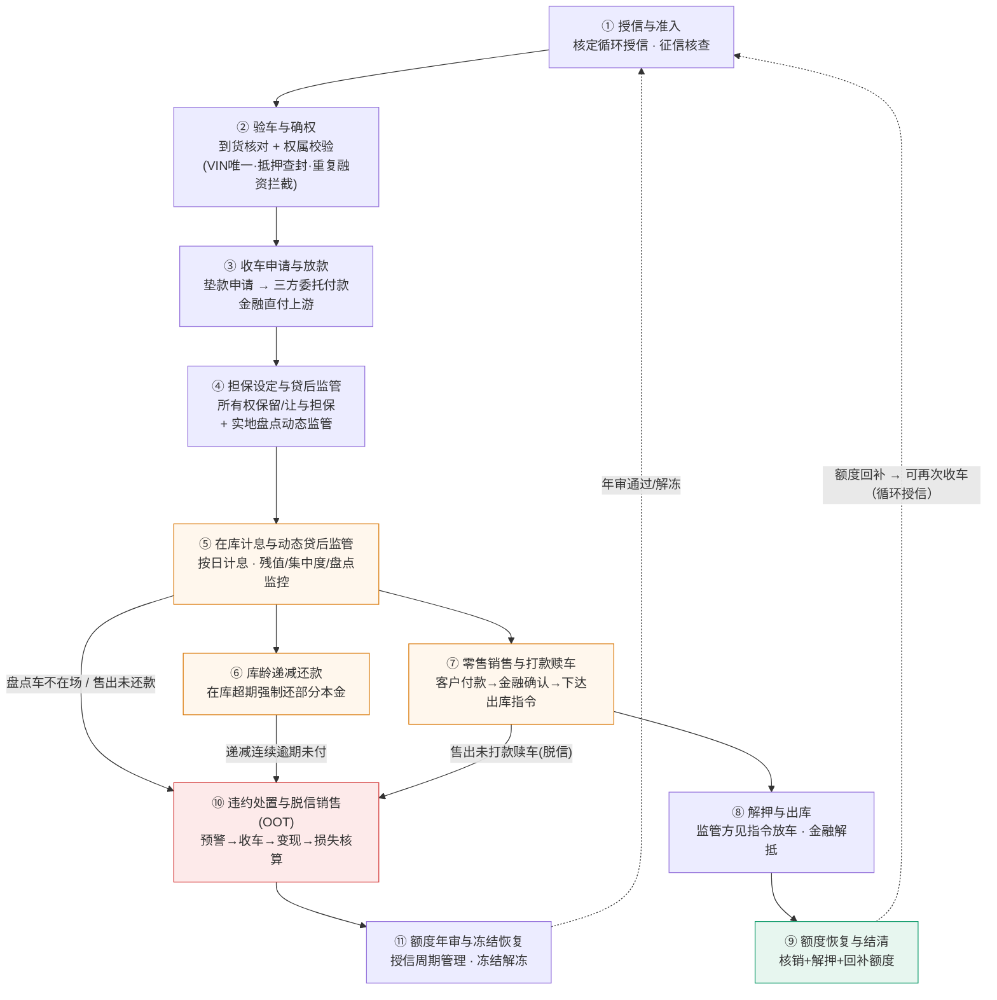
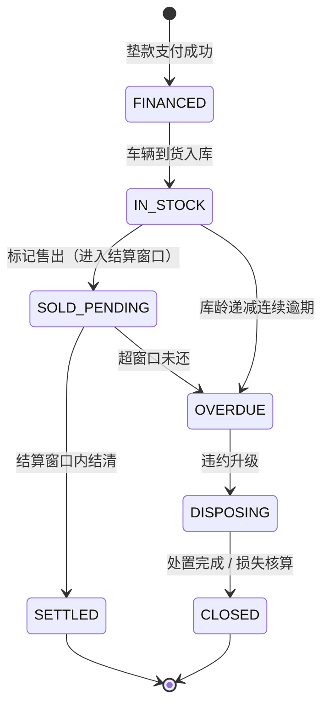
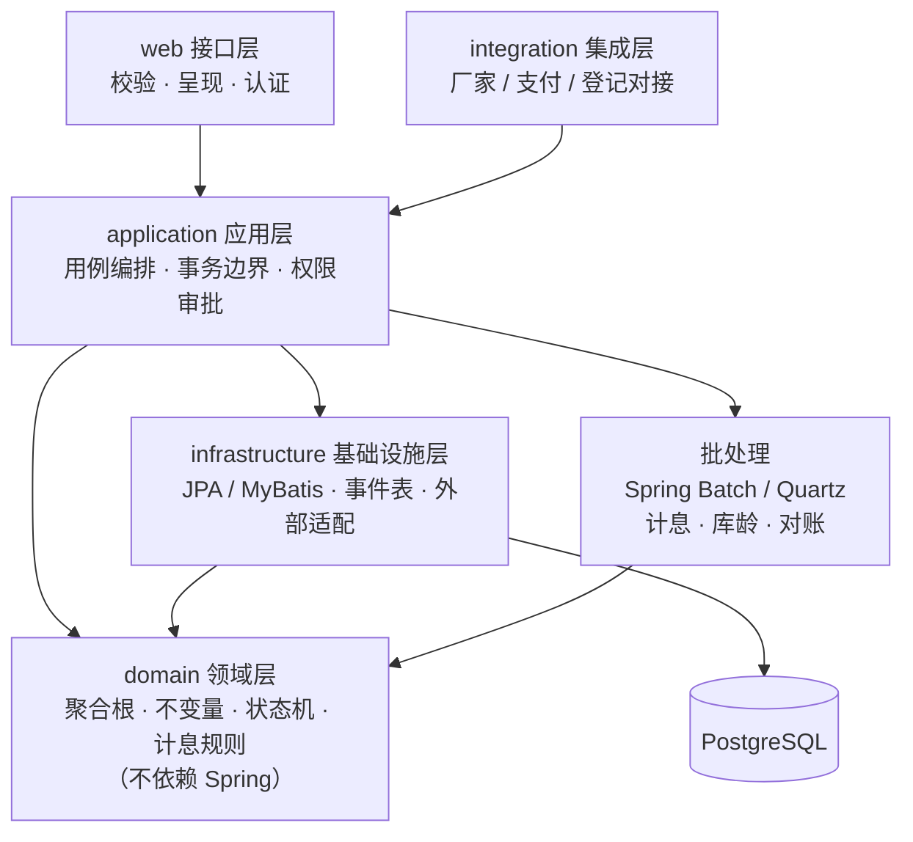
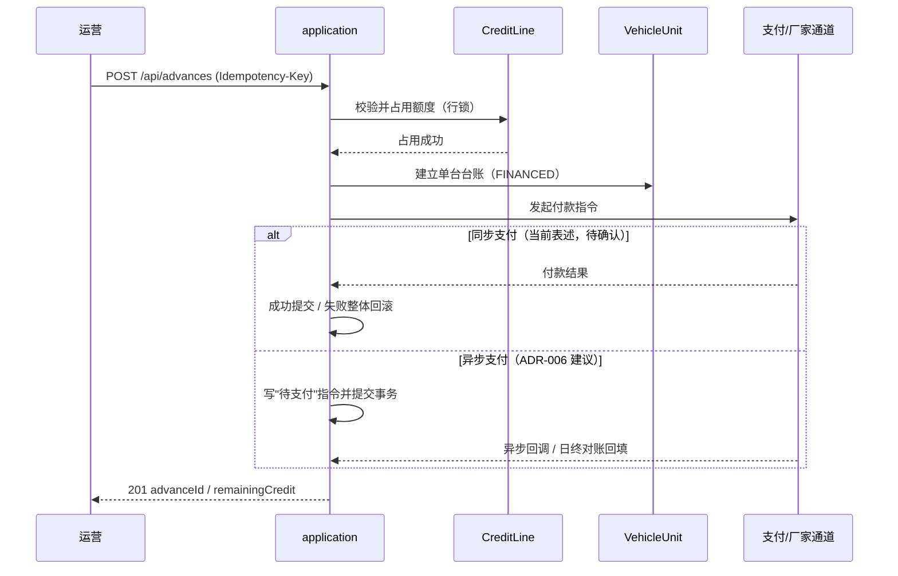
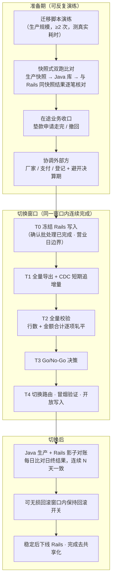

# 汽车库存融资（Floorplan）核心系统 · 项目设计文档

> **文档性质**：三合一设计文档 = 项目设计 + 业务流程 + 结构设计
> **版本**：v1.1　|　**编制日期**：2026-10-25　|　**v1.1 更新**：2026-10-26（业务流程升级为十一环节；明确系统面向日本客户，修正物理监管表述；业务流程缺漏排查 P0/P1）
>
> **变更摘要（v1.1）**：① 第二部分业务流程由"七环节"升级为"十一环节"（补齐库龄递减还款、违约处置与脱信销售、额度年审与冻结恢复）；② 用户原"扣押钥匙/装GPS/封签"物理监管表述，按"系统面向日本客户"修正为实地盘点 + 所有权保留/让与担保/厂家回购承诺；③ 新增"业务流程缺漏排查与补强（P0/P1）"小节；④ 深度业务流程见独立文档《库存融资核心系统-业务流程文档.md》。
> **业务定位**：金融公司内部系统 · 新车渠道 · B2B 循环授信（借款人＝品牌授权经销商，法人）
> **技术动作**：Ruby on Rails → Java **等价重写**（公司战略：所有业务统一 Java）
> **团队**：5 人 · AI 辅助编程
> **硬约束**：迁移全过程**不得影响原有系统运行**
> **说明**：本文档整合并替代此前三份分散文档，统一此前存在的口径冲突（工期、数据策略等）。

---

## 0. 前置：三个必须先拍板的问题

这三项不定，后续设计与排期都悬空。**本文档按"情形 A（已上线）"编写**，如实际为情形 B 需整体调整。

| # | 待拍板问题 | 为什么卡脖子 | 本文档当前假设 | 影响范围 |
|---|---|---|---|---|
| 1 | **系统当前是否已上线、是否有生产账务？** | 决定"绞杀者"还是"一次性重写"，以及是否要并行维护 Rails | **已上线**（按此编写） | 迁移路径、排期、并行成本 |
| 2 | **工期 12 个月还是 18 个月？** | 已上线时需扣除"维持 Rails + 双跑比对"的并行净工时 | 推荐 **18 个月** | 里程碑、人力重心 |
| 3 | **新车未上牌时担保如何落地？** | 所有权保留登记无登记对象；直接决定"担保"模块做不做 | **待确认**（文档中所有担保环节均标注） | 流程④⑦、担保接口、数据表字段 |

> **工期说明（诚实呈现冲突）**：你此前给出的基线是 **12 个月**。但按"已上线 + 绞杀者 + 并行维护 Rails + 双跑比对"的实际约束，12 个月净工时偏紧；本文档按 **18 个月** 排期（12 个月做主体 + 6 个月加固与切流）。**若坚持 12 个月，必须压缩范围或接受更高的并行风险——此项需你拍板。**

---

# 第一部分　项目设计文档

## 1.1 项目背景与目标

公司战略决定**所有业务统一用 Java 实现**，本系统当前为 Ruby on Rails 实现的库存融资核心系统，须重写为 Java。

系统服务于**金融公司内部**，面向**新车渠道**：金融公司向品牌授权经销商提供以库存车为担保的周转资金，车辆售出后即时还款、额度回补。

**目标**：在保持业务等价的条件下完成重写——**领域模型保留、实现架构按 Java 最佳实践重做**，并具备账务正确性、审计合规、批处理与对账能力。

**关键心智**：战略决定用 Java ≠ 逐行翻译代码。若带翻译心态，会把 Rails 该还的债（藏在回调里的业务规则、靠 gem 撑着的审计、散落的 boolean 字段）原样搬进 Java，导致战略上迁了、架构上退步。

## 1.2 范围

| 做（第一版） | 不做（防膨胀） |
|---|---|
| 客户授信与额度管理、单台台账、垫款与付款、还款与结清、计息与账务、库龄递减、风控预警、实地盘点、厂家贴息结算、审计留痕、批处理 | 多品牌/多厂家扩展、多产品（试驾车/设备/建店资金）、规则引擎全可视化、对外车商门户、多币种、多地区部署 |

> **范围纪律**：18 个月的最大风险是镀金与范围 creep。余量应用于**提质量水位与吸收不确定性**（压测、故障演练、监控、合规复核、双跑差异修复），而非加业务范围。

## 1.3 技术栈与架构总览

- **架构**：起步为 Spring Boot **模块化单体**（Maven 多模块），逻辑拆、物理不拆；
  **2026-11-20 已演进为 DDD 四层 + Spring Cloud 微服务**（网关 + web/auth/bank/credit/risk 五服务 + 共享库 + common）。
  核心账务（垫款/还款/计息/台账）仍保留单体，不拆——事务红线。详见《库存融资核心系统-面试解析.md》二点五节。
- **模块**：`domain`（聚合/不变量/状态机/计息，**不依赖 Spring**）· `application`（用例编排+事务边界）· `infrastructure`（JPA/MyBatis/事件表/适配）· `common`（横切：JWT/异常/响应包装）· `web`（核心账务+控制台）· `auth-service`/`bank-service`/`credit-service`/`risk-service`（拆分出的外围服务）· `gateway`（唯一入口）· `integration`（厂家/支付/登记对接）
- **ORM**：简单实体用 Spring Data JPA；计息/对账/报表用 MyBatis 或 JDBC Template 手写 SQL
- **数据库**：PostgreSQL；金额列 `bigint` 映射 Java `long`（日元无小数）
- **批处理**：Spring Batch / `@Scheduled` + Quartz
- **权限**：Spring Security + 自定义投票器，落实"发起与执行分离"

## 1.4 团队与排期（按 18 个月）

5 人分工：1 架构/技术负责人（守领域层+规范+review）· 2 后端（核心域+应用层）· 1 批处理/账务（计息引擎+日终作业）· 1 集成/前端+运维（厂家对接+网关切流+监控）。

| 阶段 | 月份 | 主要交付 | 人力重心 |
|---|---|---|---|
| 领域萃取 + 测试基准 | M1–M2 | 业务规则规格化；RSpec→JUnit 边界用例；架构骨架 | 架构 + 2 后端 |
| 核心域 + 应用层 | M3–M7 | 经销商/额度/车辆单元聚合；垫款/还款/结清用例；快照式双跑比对 | 2 后端 + 架构 |
| 计息 + 账务 + 批处理 | M8–M11 | 计息引擎、账务、日终作业（可重跑·有执行记录） | 批处理/账务专人 |
| 风控 / 盘点 / 集成 | M12–M14 | 预警、盘点、厂家/支付/登记对接 | 集成/运维 + 全员 |
| 迁移演练 + 切流 + 下线 | M15–M18 | 生产规模迁移演练、切换窗口执行、影子对账、回归、压测、下线 Rails | 全员 |

> 若最终确认为**未上线**，可压缩为：M1–M9 纯重写，M10–M11 双跑比对与修复，M12 上线。

## 1.5 关键架构决策（ADR）

### ADR-001　采用模块化单体（Accepted）

- **Context**：低 QPS + 强一致 + 事务密集；5 人单组；边界尚未经生产验证。
- **Decision**：逻辑拆、物理不拆，用 Maven 多模块表达边界，单进程部署。
- **Consequences**：✅ 无分布式事务成本、可逆性高（未来物理拆分成本低）；❌ 模块边界靠纪律维持，需依赖方向检查防劣化。
- **后续演进（2026-11-20）**：边界经代码与冒烟验证后，已按限界上下文物理拆出 auth/bank/credit/risk 四服务 + 网关；
  **核心账务仍遵循本 ADR 保持单体**（本地事务 + 行锁 + 唯一约束是账务正确性基石，拆开要引入分布式事务，得不偿失）。
  ADR-001 对核心账务依然有效，对外围服务则已进入"物理拆分"阶段。

### ADR-002　等价重写三条铁律（Accepted）

1. **等价重写，不趁机升级**——业务范围、对外行为保持与 Rails 一致；重写不是镀金机会。
2. **测试资产平移**——RSpec 计息边界用例（提前还/部分还/利率变更/跨月/节假日/贴息轧差）逐条翻成 JUnit，作为"等价"的唯一硬证据。
3. **数据原样不动**——schema 照搬；金额 `bigint`→`long`，不趁机改字段/加字段。
   > **例外窗口**：ADR-004 的**一次性整体迁移**是唯一合法改 schema 的机会（如金额类型转换），届时可不受 Rails 兼容约束，但须定义明确舍入规则并对账可解释。

### ADR-003　AI 编程纪律：先测后码（Accepted）

- **Context**：5 人 + AI 辅助，产出接近"准 8–10 人"，但金融账务边界条件密集，AI 极易生成"看起来对、边界却错"的代码。
- **Decision**：M1–M2 先把边界用例翻成 JUnit 并跑通作为等价基准，之后才允许 AI 生成实现；计息/额度/批处理核心 **100% 人工 review + 强测试**；维护编码规范文件约束 AI 产出；**禁止把业务规则藏在框架回调中**。
- **Consequences**：✅ 核心正确性有人兜底；❌ 早期速度让位于验证，需向管理层解释"AI 加速写码但不加速算对钱"。

### ADR-004　数据策略：独立库 + 最后一次整体迁移（Accepted）

- **Context**：用户明确**不使用共享数据库**，要求在灰度测试前完成数据库整体迁移；同时要求不影响原系统运行。
- **Decision**：Java 使用**独立数据库**；在切流前的维护窗口内，执行一次性整体数据迁移（全量导出 + CDC 短期追增量 + 短停写窗口切换），迁移、校验、切流**在同一窗口内连续完成**。
- **Consequences**：
  - ✅ 彻底解耦，Java 库可自主演化；迁移是唯一一次合法改 schema 的窗口。
  - ✅ 双跑比对从"持续比对"变为**快照式确定性验证**（生产快照灌入 Java 库比对），更干净可重复。
  - ❌ 承担一次性切换风险；**迁移后到切流完成之间若 Rails 仍在写入，会产生数据漂移**——故必须与切流相邻执行。
  - ❌ 回滚仅在**极短窗口内无损**（详见 3.8）。
- **放弃方案**：共享数据库。放弃理由：用户选择承担一次性切换风险以换取彻底解耦。（注：在"不影响原系统运行"约束下，共享库本也并非更危险——分库的 CDC 若长期驻留会因 WAL 堆积反噬生产库；但本方案采用**短期**复制槽，追平即删，风险窗口远小于长期管道。）

### ADR-005　迁移路径：绞杀者 + 不影响原系统运行（Accepted）

- **Context**：硬约束"不得影响原有系统运行"，排除一次性重写/大爆炸切换（需停机或不可逆）。
- **Decision**：应用层按用例灰度切流（只读 → 边缘写 → 核心写），数据层按 ADR-004 一次性迁移；切流前 Java 仅做**影子运行**（只算不写）。
- **Consequences**：✅ 每步可回滚、业务无感；❌ 需维护路由开关与灰度体系，且对切换时点（营业日/批处理边界）有严格要求。

### ADR-006　支付与额度占用的最终一致性（**Proposed，待确认**）

- **Context**：垫款若在同一事务内同步调用外部支付，会把外部 IO 放进持锁事务，长时间占用额度行锁，造成并发堵塞或超时回滚。
- **Decision（建议）**：业务事务只负责"占额度 + 建台账 + 写待支付指令"；支付异步执行，结果通过回调/对账回填。
- **Consequences**：✅ 并发健康、锁持有时间可控；❌ 需处理支付失败的补偿与状态机（待支付/已支付/支付失败）。
- **状态**：当前文档（及流程图注释）仍按"同事务回滚"表述，**此项需确认后再改**。

---

# 第二部分　业务流程文档

## 2.1 业务本质

对车商而言，**库存就是整张资产负债表**。库存融资解决的是时间错配：**收车要立刻付钱，卖车要几周甚至几个月后才收钱**。金融公司替车商把钱垫给上游，车停在车商场地作担保，卖掉一台归还一台，额度随之释放。

## 2.2 三方角色与系统边界

| 角色 | 要什么 | 怕什么 | 系统要给什么 |
|---|---|---|---|
| **金融公司**（系统主用户） | 担保物真实、账实相符、坏账可控、资金周转效率 | 脱信销售、车辆残值低于垫款、车商倒闭 | 额度管理、单台台账、计息引擎、盘点核查、风险预警、处置流程 |
| **车商**（借款方） | 收车快、额度够用、还款省事 | 额度突然冻结、库龄减贷抽走现金流 | 在线申请垫款、一键还款、在库明细、利息试算、额度余额 |
| **盘点/审计方**（风控执行） | 快速核完场地、证据留痕、差异可追溯 | 盘点数据与台账对不上 | 移动端盘点：扫码核对 VIN、拍照定位留证、差异即时上报 |

## 2.3 资金与车辆的流转闭环（十一环节）

> 这是系统的骨架，十一环节必须逐一在系统中有落点，不得遗漏。**v1.1 由七环节升级为十一环节**（原八环节 + 补齐三环节）。深度说明见独立文档《库存融资核心系统-业务流程文档.md》。



**十一环节 ↔ 系统落点对照（精简，详情见业务流程文档）**

| 环节 | 系统落点 | 风险 / 说明 |
|---|---|---|
| ① 授信与准入 | `POST /api/credit-lines`（含征信查询） | 发起与执行分离；征信接入周期长 |
| ② 验车与确权 | `POST /api/vehicles/batch-ingest` + 权属校验 | 🔴 **P0-③**：须含 VIN 唯一性 + 抵押/查封校验，拦截重复融资 |
| ③ 收车申请与放款 | 垫款原子流程：占额度+建台账+付款 | 防挪用底线；付款事务边界见 ADR-006 |
| ④ 担保设定与监管 | `security_records` + 盘点/监控批处理 | 🇯🇵 日本＝所有权保留/让与担保/厂家回购；监管以实地盘点为主，不扣押钥匙/GPS/封签 |
| ⑤ 在库计息与监管 | 日终批处理 + 风控扫描 | 计息须可重跑；盘点差异升级工单 |
| ⑥ 库龄递减还款 | `aging_plans` + 递减到期批处理 + 部分还款 | 🔴 **P0-①**：当前仅有表无流程/用例，须落地闭环 |
| ⑦ 零售销售与赎车 | `sold` + 赎车确认 + 出库指令 | 资金未到账不得下达出库指令（防脱信） |
| ⑧ 解押与出库 | 出库指令 + `security/release` | 放车与解抵须同一指令触发，留痕 |
| ⑨ 额度恢复与结清 | `POST /api/repayments`：三件事原子完成 | 不可只做还款而漏解除担保 |
| ⑩ 违约处置与 OOT | 违约处置工单 + 处置批处理 + 残值核算 | 🔴 **P0-②**：当前仅告警无闭环，须全流程落地 |
| ⑪ 额度年审与冻结恢复 | 年审任务 + 冻结/解冻接口 | P1 重点；冻结须可恢复且留痕 |

> **闭环关键**：第 ⑨ 步"额度回补"必须回连第 ① 步——这是**循环授信**与一次性贷款的本质区别；第 ⑪ 步年审/解冻后同样回连准入，构成授信生命周期闭环。

### 2.3.1 业务流程缺漏排查与补强（P0 / P1）

> 用户原流程为 8 环节，经排查补齐至 11 环节。以下为必须覆盖的缺漏（详见业务流程文档第 5 节）。

- **P0-① 库龄递减还款流程**：原流程缺失；代码仅有 `aging_plans` 表无流程/用例。须落地"计划生成 → 递减到期催收 → 部分还款核销"闭环。
- **P0-② 违约与脱信销售（OOT）处置闭环**：原流程缺失；当前仅 `alerts` 告警无处置落地。须有"识别 → 收车 → 变现/残值核算 → 损失认定"全流程。
- **P0-③ 重复融资拦截**：植入环节 ② 验车确权，须校验 VIN 是否已建账、是否已在他处抵押/查封，命中即拒绝收车建账。
- **P1（应补，优先级次）**：额度年审冻结恢复、车辆损毁/盗抢保险、展期续贷、厂家回购、提前部分还款、结清证明文书交付（其中"额度年审与冻结恢复"已提升为环节 ⑪ 纳入主流程）。

## 2.4 五大核心机制

| 机制 | 要点 |
|---|---|
| **单台独立核算** | 以车架号（VIN）为主键，每台车独立建账、独立计息，绝不做总额 |
| **售出即还** | 零售成交后结算窗口（如 24–72h）内必须结清该台垫款 |
| **库龄递减还款** | 在库超 60/90/120 天未售，强制偿还部分本金，防残值跌破垫款 |
| **实地盘点核查** | 定期到场逐台扫描车架号，账实不符当场升级 |
| **脱信销售（OOT）** | 车已售却不还款——**最严重违约**，可致整个额度被收回 |

> **为什么 OOT 决定系统成败**：库存融资的全部风控逻辑，本质上都是在和"车商卖了车却不上报"对抗。落地版本主要靠**内部 sold 标记 + 结算窗口计时**来识别；业务文档中提及的外部信号（登记变更、保险退保、挂牌下架、终端贷款记录）在**金融公司内部系统**中大多不可得，实现范围需据此校准。

## 2.5 计息与成本模型

- **计息方式**：按日计息，未售出期间持续累计；售出结清即停止
- **定价结构**：基准利率 + 加点（浮动），加点取决于车商资本实力、周转表现、信用风险；可叠加单台手续费
- **成本驱动**：利息是时间成本，在库 60 天利息是 30 天的两倍，故"周转天数"是车商第一指标

```
单台日息 = 未偿本金 × 年利率 ÷ 365
累计利息 = Σ 每日未偿本金 × 日利率
示例：垫款 100 万，年利率 5%，在库 60 天 → 约 100万 × 5% × 60/365 ≈ 8,219
```

> ⚠️ 实际利率水平因业者、车商资质、市场环境而异，日本本地具体区间需向目标客户核实，不得直接套用海外数值。

## 2.6 风控规则引擎（必须内置）

| 规则 | 说明 |
|---|---|
| 额度占用校验 | 可用余额 = 总额度 − 在库未偿本金 − 冻结部分；超额直接拒绝 |
| 结算窗口监控 | 状态转"已售"后开始倒计时，超窗口未还款 → 自动升级逾期并告警 |
| 库龄阈值 | 按配置天数触发递减还款；连续多期未付 → 触发额度冻结评估 |
| 脱信销售交叉验证 | 以内部 sold 标记 + 结算窗口为主；外部信号按可得性逐步接入 |
| 残值保护 | 定期重估在库车辆，"垫款余额 / 当前残值"超阈值时要求追加还款或担保 |
| 集中度限制 | 单品牌/单车型占用比例上限，防止压在单一滞销车型 |
| 盘点差异升级 | 按差异台数与金额自动分级，达阈值触发冻结流程 |

## 2.7 车辆单元状态机



**状态枚举与风险标记分离（重要）**

- **生命周期状态**：`FINANCED`（已垫款）· `IN_STOCK`（在库）· `SOLD_PENDING`（已售待还）· `SETTLED`（已结清）· `OVERDUE`（逾期）· `DISPOSING`（处置中）· `CLOSED`（关闭）
- **风险标记（独立字段，不是状态）**：`overdueDays`（逾期天数）· `riskLevel`（风险等级）· `ootSuspected`（脱信销售嫌疑）· `lastAuditDate`（最后盘点日）· `auditMismatchCount`（盘点差异次数）

> 这样划分是为了避免"逾期到底是状态还是标记"的歧义：逾期既是生命周期状态（进入处置流程），也需要独立的天数/等级字段支撑风控分级。

## 2.8 日本本地特殊性（🇯🇵 已确认面向日本客户）

> **v1.1 已确认**：本系统面向**日本客户（新车渠道）**。由此修正此前"担保登记与物理监管＝扣押钥匙/装GPS/封签"的假设——该做法是中国第三方监管公司对二手车/高风险车商的做法，**不适用于日本厂家金融新车渠道**（见业务流程文档第 6 节）。

| 维度 | 美国常见做法 | 日本本地结构 |
|---|---|---|
| 担保公示 | 州政府提交 UCC-1 融资声明 | 无统一 UCC 式登记；实务以**所有权保留**、**让与担保**、动产·债权让渡登记为主 |
| 放款对象 | 银行、信用社、厂家金融、专业批发贷款商 | 信用销售（分期）公司、厂家金融、地方银行与信用金库 |
| 收车渠道 | 厂家直供 + 大型批发拍卖 | 新车以厂家渠道为主；二手车高度依赖批发拍卖 |
| 法律框架 | 统一商法典第 9 编 | 民法典下的所有权保留与让与担保（判例法为主）、《分期付款销售法》、涉放贷时《放贷业法》 |
| **物理监管** | 第三方监管：扣押钥匙、装 GPS、贴封签、驻场 | **以实地盘点为主**（逐台扫 VIN + 拍照留证）；不做钥匙/GPS/封签；兜底＝厂家回购承诺 + 经销商信用 + 让与担保合同 |

> **对系统的直接影响**：日本无"一纸登记覆盖全部库存"的机制，担保是**逐台**的。因此"某一台车的登记状态"必须作为一等公民字段管理（登记编号、所有者名义、设定日、解除日）。
> **新车未上牌时登记无对象**——担保可能靠让与担保合同 / 动产让渡登记 / 厂家回购承诺 / 经销商信用；**定位已明确（日本新车渠道），具体落地路径（采用哪种组合）仍待客户确认**，直接决定 `security_*` 字段与担保接口形态（见外部集成文档第 3 节）。

---

# 第三部分　结构设计文档

## 3.1 分层架构



**依赖方向铁律**：`domain` 不依赖任何框架；`application` 是唯一划定事务边界的层；`web`/`integration` 不得直接改领域对象。

## 3.2 领域模型（聚合根与不变量）

| 聚合根 | 守的不变量 | 关键子实体 |
|---|---|---|
| **Dealer**（经销商） | 授信额度 ≤ 核定上限；额度占用 + 可用 = 核定 | 额度记录、经营档案 |
| **CreditLine**（额度） | 占用额不得超额（并发加锁）；释放须对应还款 | 占用明细、冻结记录 |
| **VehicleUnit**（车辆单元） | 状态机合法流转；一台车同一时刻唯一状态；售出须先结清 | 垫款、还款、计息记录、担保状态 |

**并发控制**：额度占用用数据库行锁/乐观锁，**禁止无锁的读-改-写**。

## 3.3 数据模型（主要表）

| 表 | 关键字段 | 说明 |
|---|---|---|
| `dealers` | id, name, status, risk_grade | 经销商档案 |
| `credit_lines` | dealer_id, approved_limit, used_amount, frozen | 额度，`used_amount` 须加锁更新 |
| `vehicle_units` | **vin(PK)**, dealer_id, status, advance_id, invoice_amount, aging_days, security_type, security_status | 单台台账主键；担保字段取决于担保路径确认 |
| `advances` | id, vin, amount, paid_at, status | 垫款记录 |
| `repayments` | id, vin, principal, interest, settled_at | 还款核销 |
| `interest_ledger` | vin, date, accrued, rate_snapshot | 计息流水（按日） |
| `aging_plans` | vin, rule_version, periods, paid_periods, next_due_date | 库龄递减还款计划 |
| `security_records` | vin, type, reg_no, owner_name, set_date, release_date | 担保登记（**待确认**） |
| `batch_runs` | job_name, biz_date, status, started_at, finished_at | 批处理执行记录（可重跑、可定位） |
| `audit_events` | id, actor, action, before, after, ts | **append-only** 审计事件表 |

**金额约定**：金额字段一律 `bigint` / Java `long`（整数日元）；**比率类参数**（利率、垫款比例）可用定点或 BigDecimal，但落到金额必须量化为整数日元。

## 3.4 接口设计

**通用约定**

- REST/JSON；内部 SSO + 角色令牌；每个写操作须带操作人身份（审计）
- 金额：整数日元，JSON 以数字（long）传递，禁止小数与浮点
- 时区：统一 JST；计息/结算以"营业日"为准，节假日表内置
- 幂等：写接口须带 `Idempotency-Key`，防重复垫款/重复还款
- 错误码：统一 `{code, message, traceId}`

**核心接口清单**

| 方法 | 路径 | 说明 | 权限 |
|---|---|---|---|
| POST | `/api/dealers` | 创建经销商档案 | 客户经理 |
| POST | `/api/credit-lines` | 核定/调整额度（需审批） | 客户经理+审批 |
| POST | `/api/vehicles/batch-ingest` | 批量到货建账 | 运营 |
| POST | `/api/advances` | 申请垫款（原子：占额度+建台账+付款） | 运营+复核 |
| POST | `/api/vehicles/{vin}/security` | 设定担保（逐台登记）⚠️待确认 | 运营 |
| POST | `/api/vehicles/{vin}/sold` | 标记售出（进入结算窗口） | 运营 |
| POST | `/api/repayments` | 还款结清（核销+解除担保+释放额度） | 财务 |
| POST | `/api/vehicles/{vin}/security/release` | 解除担保（结清时触发）⚠️待确认 | 财务 |
| POST | `/api/interest/settle` | 计息结算（日终批处理触发） | 系统/财务 |
| GET | `/api/vehicles/{vin}` | 单台台账查询 | 全部角色 |
| POST | `/api/inventory/audit` | 提交盘点结果 | 风控 |
| POST | `/api/credit-lines/{id}/freeze` | 冻结额度/车辆 | 风控 |
| GET | `/api/alerts` | 风险预警列表 | 风控 |

**关键接口：申请垫款**

```json
POST /api/advances
{
  "creditLineId": "CL-100023",
  "vin": "JMA***********",
  "manufacturerInvoiceAmount": 1850000,
  "advanceRatio": 0.9,
  "idempotencyKey": "adv-20261025-0001"
}
// 201
{
  "advanceId": "ADV-558201",
  "status": "PAID",
  "advancedAmount": 1665000,
  "remainingCredit": 3350000,
  "vehicleStatus": "IN_STOCK"
}
```

> ⚠️ **事务边界待确认（ADR-006）**：若支付为同步外部调用，不应与额度行锁处在同一事务内。当前按"任一失败整体回滚"表述，需确认后调整。

## 3.5 关键流程时序：垫款支付



## 3.6 批处理与对账

- **日终作业**：计息（按日累计）、库龄推进、递减到期扫描、预警扫描、对账文件生成
- **幂等与可重跑**：作业须幂等 + `batch_runs` 执行记录；失败可定位、可续跑，绝不产生重复计息
- **对账**：日终生成对账文件（垫款 vs 付款通道、利息 vs 账务），与核心账务系统轧差
- **领域事件**：`VehicleSold` / `AdvancePaid` / `RepaymentSettled` / `AgingTriggered` / `AuditMismatch` / `CreditFrozen`，存事件表供风控与盘点异步消费（须处理消费幂等与失败重试）

## 3.7 权限与内控

| 角色 | 职责 | 权限敏感点 |
|---|---|---|
| 授信/客户经理 | 经销商关系、核定额度 | 可发起额度调整，**不能直接放款** |
| 运营/垫款处理 | 受理垫款、付款、单据核对 | 付款需**双人复核** |
| 风控/盘点 | 库龄监控、盘点、违约处置 | 可发起冻结，动作**全程留痕** |
| 财务/会计 | 计息、对账、入账 | 利率与计息规则变更需**审批流** |

> **内控铁律**："发起"与"执行"必须分离（客户经理提额度、另一人批；运营提付款、财务执行）。任何单人走完全流程的设计都是不合规的。

## 3.8 迁移与切换执行流程（独立库 + 一次性整体迁移）



**关键纪律（缺一不可）**

1. **迁移 + 校验 + 切流必须在同一窗口内连续完成**——严禁"周一迁移、周五切流"，中间会产生数据漂移。
2. **批处理 / 营业日边界**——必须在"日终批处理已完成、次日营业尚未开始"的时点切换；严禁在批处理中途切（会出现"利息算一半"）；避开月末/季末/年末决算（日本 3 月决算）/节假日。
3. **在途业务与中间态收口**——已售待还的**结算窗口倒计时**、库龄递减的**分期计划**（已还 2 期剩 3 期）、**最后计息日**（防重复/漏计）必须完整迁移。
4. **可无损回滚窗口**——切换后一旦产生新业务数据，回滚到 Rails 将面临"新数据回不到旧库"。须写死回滚窗口（如首个营业日开始前），超时只能向前修复；切换应选业务低峰使窗口内增量最小。
5. **迁移只读取 Rails 库 + 限流 + 避峰**——不写、不改 schema、不加长期复制槽；CDC 为短期管道，追平即删。
6. **Go/No-Go 门槛**——追增量延迟超时 → 放弃本次窗口改期；校验差异 → 立即停；切换后错误率超阈值 → 自动回滚。
7. **冻结验证**——切换后确认 Rails 侧零写入（残留 cron / 后台操作）。
8. **合规审计留痕**——切换事件完整记录（批准人/时点/校验结果/差异处理）+ 期初期末账务连续性证明。

> **最重要的一条**：这套流程"设计上合理"，但**不等于已验证可行**。切换是一次性动作，没有上线后迭代的机会——**尽早做一次生产规模演练**，用实测反过来修正流程（尤其耗时与差异项）。继续打磨文档的边际收益远低于跑一次演练。

---

## 附录 A　术语表

| 中文 | 含义 |
|---|---|
| 库存融资 / Floorplan | 以库存车为担保向车商提供周转资金，售车即还 |
| 垫款 | 金融公司代付给厂家的购车款，形成对车商的债权 |
| 结算窗口 | 车辆零售后须还清该台垫款的期限 |
| 库龄递减 | 在库超期强制偿还部分本金的机制 |
| 脱信销售（OOT） | 车已售但车商未上报/未还款 |
| 所有权保留 | 还清前车辆登记在金融公司/信贩名下（新车未上牌时无法落地，须另确认担保路径） |
| 厂家贴息 | 厂家对部分利息的补贴，须与利息轧差结算 |

## 附录 B　全部待确认清单

| # | 待确认项 | 影响 |
|---|---|---|
| 1 | 系统是否已上线、是否有生产账务 | 迁移路径、排期（本文档按已上线编写） |
| 2 | 工期 12 还是 18 个月 | 里程碑与人力重心 |
| 3 | 新车未上牌时的担保落地路径 | 流程④⑦、担保接口、security_* 字段 |
| 4 | 真实业务参数：结算窗口、库龄递减天数与比例、垫款比例、利率结构、厂家贴息、违约阈值 | 计息引擎与风控模块实现 |
| 5 | `sold` 触发源：零售系统对接 or 人工标记 | 集成层工作量与 OOT 识别及时性 |
| 6 | 支付与额度占用的事务边界（ADR-006） | 垫款原子流程实现、并发健康度 |
| 7 | 日本本地接口现实：厂家系统、车辆登记、支付通道（有接口 or 人工） | 自动化程度与集成层工作量 |
| 8 | 本系统与核心账务系统的边界（是否记完整 GL、如何传分录） | 账务模块范围 |
| 9 | 🇯🇵 **系统面向日本客户（已确认）** → 物理监管方式＝实地盘点，不做钥匙/GPS/封签 | 环节④、担保与监管模块设计（已据此修正） |
| 10 | 日本担保路径组合（所有权保留/让与担保/动产让渡登记/厂家回购承诺，采用哪种） | 环节④⑧、`security_*` 字段与担保接口形态 |
| 11 | 实地盘点频率与差异升级阈值 | 环节④⑤ 风控参数 |
| 12 | 违约处置路径（自行收车/委托/厂家回购/法律）与残值核算口径 | 环节⑩ 处置闭环 |
| 13 | 是否采用虚拟账号入金（影响赎车资金确认） | 环节⑦⑨ 资金闸门 |

## 附录 C　免责说明

1. 业务机理部分基于国际通行的库存融资行业实践整理；涉及日本本地法律结构、担保方式、参与者与业务参数，需向目标客户或官方资料核实，不作为可直接引用的事实数据。
2. 文中金额与利率计算均为**公式示例**，用于说明计息逻辑，不构成任何报价或市场行情。
3. 涉及放贷、担保设定、催收处置的部分，**须经日本当地法律与合规专业人士确认**后方可落地。
